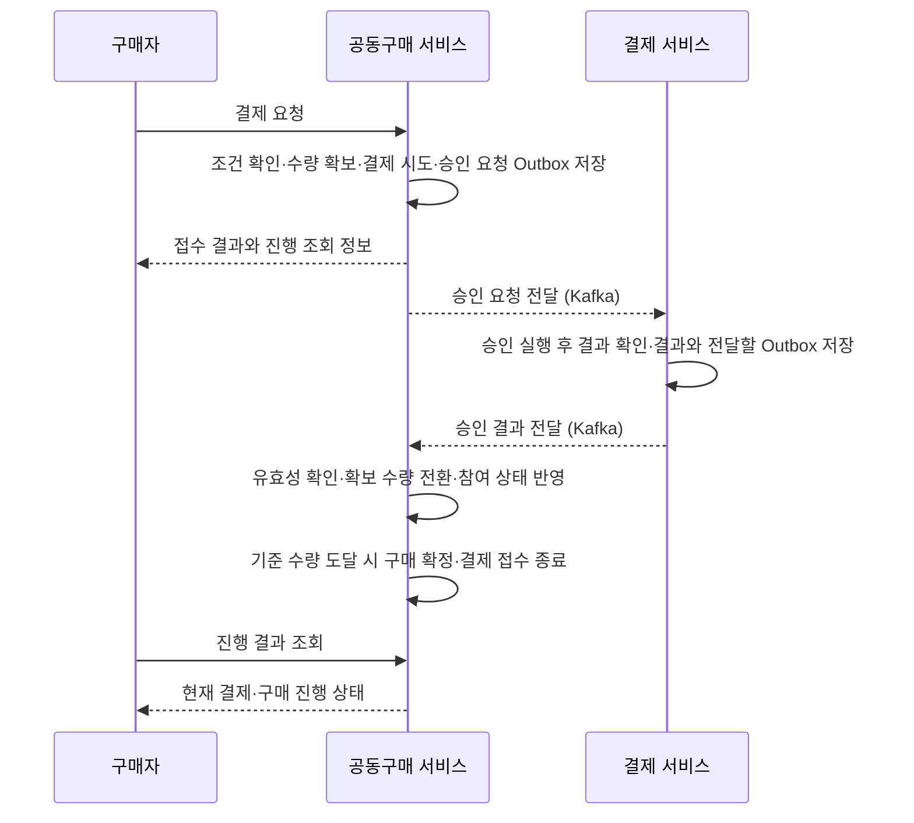

# 핵심 결제 흐름 설계

작성 기준: 2026-10-28 대화 내용 반영

상태: **부분 합의. 공동구매 서비스의 Saga Orchestration, 2절의 진행 상태·비동기 접수·결과 조회, 3절의 사전 수량 확보·전환·해제 기준, 5절의 구매자 취소·늦은 승인, 6절의 마감 경합, 7절의 안내 시점·회차 공통 기한·8절의 업무 RDB 내 Transactional Outbox와 서비스 내부 폴링·8.5절의 선점 ID·기한을 이용한 원자적 선점·커밋 후 전송·재선점·이전 발행기의 갱신 제한·8.6절의 결제 시도별·전달 방향별 발행 순서 관리 범위·8.7절의 순번 기록과 앞 메시지 발행 완료 후 다음 선점·8.8절의 발행 실패·발행 여부 불명 처리와 재시도 원칙·8.9절의 운영 개입 표시·알림·재개 원칙·8.10절의 소비 멱등성과 업무 중복 방지의 다섯 원칙·8.11절의 메시지·업무 식별자 구성과 충돌 처리 원칙·8.12절의 업무 RDB 내 별도 소비 처리 기록 테이블과 커밋 후 소비 완료 통지·8.13절의 소비 실패 분류·한도 재시도·DLT 보관 원칙·8.14절의 실패 파티션 후속 처리 보류와 재개 흐름·8.15절의 무효 원본에 한정한 운영 종결 예외·8.16절의 운영 요청 영속 접수와 담당 소비자 실행·동시 조작 제어 원칙·8.17절의 실행 ID·기한에 따른 인수와 단계별 장애 복구·8.18절의 운영 실행권 DB 시간 기준과 단계 경계의 조건부 갱신·반영 시 권한 재검사·8.19절의 운영 요청별 한도 내 자동 복구와 반복 실패 시 개입·8.20절의 같은 요청 수동 재개와 복구 회차별 한도 관리를 합의했다. 운영 임계값·권한·API와 멱등성의 상세 구현, 구체적인 DB 모델·잠금·쿼리·API 계약·설정값과 복구 구현은 후속 설계에서 정한다.**

관련 문서: [프로젝트 개요](../%ED%94%84%EB%A1%9C%EC%A0%9D%ED%8A%B8%20%EA%B0%9C%EC%9A%94.md), [MVP 요구사항](MVP%20%EC%9A%94%EA%B5%AC%EC%82%AC%ED%95%AD.md), [개별 참여 상태 설계](%EA%B0%9C%EB%B3%84%20%EC%B0%B8%EC%97%AC%20%EC%83%81%ED%83%9C%20%EC%84%A4%EA%B3%84.md), [도메인 책임과 서비스 경계](%EB%8F%84%EB%A9%94%EC%9D%B8%20%EC%B1%85%EC%9E%84%EA%B3%BC%20%EC%84%9C%EB%B9%84%EC%8A%A4%20%EA%B2%BD%EA%B3%84.md)

## 1. 이번 설계의 범위

여러 서비스를 거치는 결제 한 건의 정상 흐름과 실패·복구의 기본 방향을 검토한다. 기준 수량 초과 금지, 참여 한 건 전체 결제, 취소 정책과 기존 참여 상태 초안은 요구사항을 따른다.

조정 방식과 사전 수량 확보를 다음과 같이 합의했다.

- **합의:** 공동구매 서비스 내부의 조정 로직이 Saga Orchestration을 맡아 결제 진행과 후속 반영을 관리한다.
- **합의:** 실제 승인을 요청하기 전에 공동구매 서비스가 해당 참여 건의 전체 수량을 확보한다. 확보 수량은 결제 완료 수량과 구분하고, 확인한 결과에 따라 전환·해제한다.

### 1.1. 합의한 결제 진행 조정 책임

| 담당 | 조정·실행 책임 |
|---|---|
| 공동구매 서비스 | 결제 허용과 금액 판단, 승인 요청, 확인된 결과의 참여 상태 반영·성사 판정, 취소·마감에 따른 승인 중단·결과 확인·환불 요청, 전체 업무 진행 추적 |
| 결제 서비스 | 요청받은 승인·중단·환불의 실제 처리, 실제 처리 결과 확인·기록·전달, 결제 서비스 내부의 미완료 처리 복구 |

공동구매 서비스가 업무 조건에 따라 다음 작업을 결정하고 결제 서비스에 요청한다. 각 서비스는 자신이 소유한 데이터를 변경한다. 공동구매 서비스가 전체 진행을 조정하더라도 결제 서비스의 승인·환불 실행과 실제 결과 확인 책임은 유지한다.

예를 들어 참여 취소가 먼저 수락된 뒤 승인 성공이 도착하면, 공동구매 서비스가 취소 기록을 확인해 참여를 성립 대상에서 제외하고 환불을 요청한다. 결제 서비스는 환불을 실행하고 확인한 결과를 전달하며, 공동구매 서비스는 실제 환불 완료를 확인한 뒤 참여 상태에 반영한다.

취소·기한·수량·성사 조건을 소유한 공동구매 서비스에서 후속 판단을 모을 수 있다는 이유로 이 방식을 선택했다. 대신 조정 로직과 진행 기록 관리 책임이 추가되고, 공동구매 서비스 장애 중에는 후속 판단이 지연될 수 있다. 진행을 영속화하고 재시작 후 미완료 처리를 이어갈 수 있어야 한다. Saga가 여러 서비스의 작업을 하나의 DB 트랜잭션처럼 자동 롤백하거나 동시성 제어를 대신하지는 않는다.

조정 방식과 담당 서비스, 3절의 사전 수량 확보에 이어 2절의 진행 상태·비동기 접수·결과 조회 방식과 8절의 Transactional Outbox 도입·업무 RDB 내 저장·폴링 발행을 합의했다. 구체적인 DB 모델·동시성 제어·API 및 메시지 계약·폴링 발행기의 상세 동작과 복구 구현은 아직 정하지 않았다.

## 2. 합의한 정상 결제 흐름과 진행 상태·응답

아래 흐름은 결제 안내 이후 접수 조건이 유효하고, 취소·마감과 경합하지 않으며, 기한 내 성공 결과를 반영할 수 있는 경우를 나타낸다.

공동구매 서비스는 참여 소유자·상태·결제 기한·접수 상태·수량 조건을 확인하고 결제 금액을 계산한다. 요청자가 보낸 금액을 그대로 승인 기준으로 사용하지 않는다.

조건 확인과 수량 확보, 해당 참여의 진행 중 결제 시도와 승인 요청 Outbox 기록은 하나의 로컬 트랜잭션으로 처리한다. 커밋한 뒤 발행기가 승인 요청을 Kafka로 전달한다. 같은 참여 건에 이미 미완료 결제 시도가 있으면 기존 진행을 추적하고 수량을 추가 확보하거나 추가 승인을 시작하지 않는다.

성공 결과를 반영할 때도 시도 식별자와 현재 업무 상태를 확인한다. 동일 성공 결과의 중복 반영을 막고, 확보 수량 감소·결제 완료 수량 증가·참여 상태 반영·성사 판정을 원자적으로 판단한다. 기준 수량을 채우면 기존 규칙에 따라 결제 접수를 종료하고 남은 미결제 참여를 취소한다.

위 흐름의 비동기 접수·결과 조회 방식과 DB 커밋·Kafka 발행 사이의 유실에 대응할 Transactional Outbox 도입을 합의했다. 업무 데이터와 같은 RDB에 Outbox를 두고 폴링 발행으로 시작한다. 진행·결과와 발행할 메시지를 영속화하고 재시작 후 전달을 재개한다. 상세 API 계약·폴링 발행기의 상세 동작과 복구 구현은 후속 검토한다.

### 2.1. 합의한 진행 상태 구분

이 절과 2.2~2.3절의 상태 구분·업무 의미와 비동기 접수·결과 조회 방식을 합의했다. DB 컬럼·enum의 실제 표기·API 필드의 상세 계약은 후속 설계에서 정한다.

| 구분 | 합의한 내용 |
|---|---|
| 참여 상태 | 기존 참여 신청·결제 완료·참여 취소·구매 확정·환불 대기·환불 완료를 유지 |
| 결제 시도 진행 | 공동구매 서비스가 시도별 진행 단계·확인된 승인 결과·취소 의사·업무 반영 여부를 별도 기록 |
| 공동구매 상태 | 새 결제 접수를 닫고 기존 결과를 확인하는 마감 결과 확인 중을 별도 상태로 추가 |

참여 한 건에 여러 결제 시도가 생길 수 있지만, 같은 참여의 미완료 승인 처리는 하나만 진행한다. 미승인이 확정되고 업무 반영·확보 해제가 끝난 뒤 기한·접수 조건이 유효하면 새 시도 ID로 재시도하고 이전 이력을 보존한다.

공동구매 서비스가 관리할 시도별 진행 단계는 다음과 같이 작게 시작한다.

| 진행 단계 | 의미 |
|---|---|
| 진행 중 | 접수와 수량 확보를 저장했고 승인 요청·결과 수신·업무 반영을 진행 중 |
| 결과 확인 중 | 타임아웃·응답 유실 등으로 실제 승인 결과를 확정할 수 없어 확인 중 |
| 반영 완료 | 확인한 승인 결과에 따른 참여 상태·수량 변경과 필요한 후속 요청을 저장함 |

진행 단계와 확인된 승인 결과를 구분한다. 승인 결과는 미확정·성공·미승인 확정·승인 전 중단 확정 등을 표현하며, 실제 결과의 기준은 결제 서비스가 소유한다. 공동구매 서비스의 기록은 마지막으로 확인해 반영한 진행 정보다.

반영 완료는 해당 승인 결과의 업무 반영을 뜻한다. 유효한 성공이면 결제 완료, 취소·기한 외 성공이면 환불 대기로 이어질 수 있다. 필요한 환불은 별도 진행으로 추적하고 실제 환불 완료까지 조회할 수 있게 한다.

예를 들어 취소를 수락한 참여는 참여 취소 + 결제 시도 결과 확인 중으로 표현할 수 있다. 이후 늦은 승인이 확인되면 참여는 환불 대기, 승인 시도의 진행은 반영 완료가 되고 환불 처리는 계속된다. 조회 화면은 각 상태의 의미를 구분해 표시한다.

마감 결과 확인 중에는 새 결제·재시도를 받지 않고, 기존 시도의 결과를 확인한다. 구매 확정 전의 구매자 취소는 기존 정책대로 허용한다. 확인한 유효 결제로 기준을 채우면 구매 확정으로, 필요한 결과 확인 뒤에도 미달이면 최종 마감에 따라 재모집 또는 만료로 전환하는 기존 규칙을 적용한다.

### 2.2. 합의한 비동기 접수·결과 조회

결제의 최종 결과를 기다리는 대신 접수 결과를 응답하고, 구매자가 공동구매 서비스에서 같은 결제 시도를 조회하는 방식을 사용한다.

| 상황 | 합의한 응답·처리 |
|---|---|
| 신규 결제를 유효하게 접수함 | 조건 확인·수량 확보·시도 기록과 재개 가능한 승인 의뢰를 영속화한 뒤 HTTP 202 Accepted 응답. 시도 ID와 조회 경로 제공 |
| 권한·기한·상태·수량 조건에 맞지 않아 접수하지 않음 | 접수 거절 사유 응답. 다른 시도의 확보 때문에 일시적으로 부족한 경우를 구분 |
| 진행 상태 조회가 성공함 | HTTP 200과 참여 상태·시도 진행·확인된 승인 결과·환불 진행·현재 재시도 가능 여부를 반환 |
| 같은 참여에 이미 미완료 시도가 있음 | 기존 시도와 조회 정보를 안내. 수량을 추가 확보하거나 새 승인을 시작하지 않음 |

202는 접수된 작업의 처리가 아직 끝나지 않았다는 의미다. 승인 성공이나 공동구매 성사를 보장하는 응답으로 사용하지 않는다. 수량 확보·시도·승인 요청 Outbox 저장이 함께 커밋된 뒤 응답하며, 저장이 실패했다면 202로 접수 성공을 알리지 않는다. Kafka 전달이 지연되어도 저장된 Outbox로 전달을 재개한다. 초기 발행 방식은 폴링으로 합의했으며, 구체적인 간격과 재시도·복구의 상세 구현은 후속 설계에서 정한다.

조회 경로는 응답 본문과 Location 헤더로 제공한다. 구매자는 주기적으로 조회하고, 서버는 마지막 갱신 시각과 다음 조회 간격을 안내할 수 있다. 조회 자체는 새 결제를 시작하지 않으며, 조회자의 참여 소유 권한을 확인한다.

클라이언트가 응답을 받지 못한 경우에는 참여에 연결된 기존 시도를 찾아 조회하도록 한다. HTTP 타임아웃이나 조회 중단을 결제 실패로 취급하지 않는다. 결과 불명 시에는 새 시도를 만들지 않고 기존 결과를 확인한다.

조회 응답의 재시도 가능 여부는 마지막으로 확인한 업무 상태를 기준으로 안내한다. 실제 새 결제 요청을 받을 때 기한·상태·수량 조건을 다시 원자적으로 판단한다. 동일 요청의 재전송과 의도적인 새 시도를 구분할 요청 식별자·멱등성 계약, 중복 요청의 상세 HTTP 응답은 후속 설계에서 정한다.

### 2.3. 선택 이유와 남은 결정

참여의 업무 상태와 승인 처리 진행을 나누면 취소가 수락된 후에도 미확정 결제를 계속 추적할 수 있다. 비동기 접수·조회는 승인·메시지 전달을 기다리는 동안 클라이언트의 결제 요청 연결을 유지할 필요를 줄인다.

대신 진행 기록과 조회 API·화면 처리가 필요하고, 반복 조회가 부하를 만든다. 조회 간격·종료 조건·이력 보관, 상태 변경·메시지 처리의 원자성, 정확한 API·오류 코드·멱등성·복구 계약은 후속 설계에서 정한다. 브라우저가 조회를 멈춰도 서버의 결제·결과 확인·환불 처리는 저장된 진행에 따라 계속되어야 한다.

## 3. 합의한 사전 수량 확보와 동시 요청

공동구매 서비스가 실제 승인 요청 전에 참여 한 건의 전체 수량을 확보하기로 했다. 수량 확인과 확보를 원자적으로 처리하며, 다음 조건을 지킨다.

`취소되지 않은 결제 완료 수량 + 진행 중 결제를 위해 확보한 수량 ≤ 기준 수량`

예를 들어 기준 수량 100개에서 이미 98개 결제가 완료되었고, 2개짜리 두 참여 건이 동시에 결제를 요청했다고 가정한다. 먼저 한 건이 2개를 확보하면 다른 건은 승인 요청을 시작하지 않는다. 첫 건의 성공을 확인하면 확보한 2개를 결제 완료 수량으로 전환해 100개가 된다.

- 실제 결제 완료 수량에 해당 건의 수량을 더해 기준 수량을 초과한다면 기존 규칙대로 건 전체를 거절한다.
- 실제 완료 수량만 보면 수용 가능하지만 다른 결제의 확보 수량 때문에 자리가 부족하다면 승인을 시작하지 않고 일시적으로 접수할 수 없다고 안내한다. 확정적인 수량 초과 거절과 구분하며, 결제 기한과 접수 조건이 유효하면 재시도할 수 있다.
- 수량을 확보한 것만으로 참여를 결제 완료로 바꾸거나 공동구매를 확정하지 않는다.
- 외부 승인 응답을 기다리는 동안 DB 트랜잭션이나 DB 잠금을 계속 유지하는 방식으로 설계하지 않는다. 확보 기록을 커밋해 추적한다.

이 확보 기록은 결제 시도의 내부 진행 정보다. 참여 상태는 기존 구성을 유지하고 결제 시도의 진행 중·결과 확인 중·반영 완료를 별도로 관리한다. DB 잠금·조건부 갱신 등 구체적인 동시성 제어 방식은 미정이다.

### 3.1. 확보 수량의 전환·해제

| 확인한 결과 | 확보 수량 처리 |
|---|---|
| 취소되지 않은 참여의 유효한 승인 성공 | 확보 수량을 결제 완료 수량으로 전환하고 참여 상태·성사 판단을 함께 반영 |
| 미승인 실패 또는 승인 중단 확정 | 확보 해제. 참여·기한·접수 조건이 유효하면 재시도 가능 |
| 취소된 참여 또는 기한 외 승인 성공 | 성립 대상 제외·환불 필요성과 재개 가능한 환불 요청을 기록한 뒤 해제. 환불 완료까지 기다리지 않음 |
| 타임아웃·응답 유실 등 결과 불명 | 확보 유지, 같은 시도의 실제 결과 확인. 새 결제를 시작하지 않음 |

전환·해제는 중복 반영하지 않는다. 취소 수락이나 마감, 단순한 시간 경과만으로 결과 불명 건의 확보를 자동 해제하지 않는다. 실제 미승인·승인 중단이 확정되거나, 성공 결과에 대한 유효 결제 반영 또는 제외·환불 요청 기록이 이루어진 뒤 위 기준에 따라 처리한다. 취소·마감 경합의 세부 기준은 5절과 6절을 따른다.

### 3.2. 선택 이유와 비용

같은 남은 수량에 여러 승인 요청을 실행하는 상황을 막기 위해 사전 확보를 채택했다. 확보 기록을 저장한 뒤 외부 처리를 진행하므로 승인 응답을 기다리는 동안 DB 잠금을 유지하지 않는다.

대신 확보 기록과 결과별 전환·해제·복구 처리가 추가된다. 결과 불명이 길어지면 확보가 유지되어 다른 참여자의 결제가 제한될 수 있다. 구체적인 DB 제어, 장기 미해결 건의 복구·운영 개입 기준은 후속 설계에서 정한다.

## 4. 실패·중복·복구 방향 제안

수량 확보의 유지·전환·해제 기준은 3절의 합의에 따른다. 메시지 전달·재시도와 구체적인 복구 구현은 후속 설계에서 정한다.

| 상황 | 처리 방향 |
|---|---|
| 미승인 실패가 확정됨 | 확보 수량을 해제한다. 접수 조건이 유효한 참여는 참여 신청을 유지하고 기존 규칙에 따라 재시도할 수 있다. |
| 타임아웃·응답 유실로 결과가 불명확함 | 실패로 단정하지 않고 해당 시도의 결과를 확인한다. 확인 전까지 확보 수량을 임의 해제하거나 새 결제를 시작하지 않는다. |
| 같은 승인 요청이 중복 전달됨 | 동일 결제 시도로 식별해 결과 확인 또는 멱등 처리를 한다. 외부 연동 대상의 중복 방지 지원과 적용 범위는 별도 확인한다. |
| 성공 결과가 중복 전달됨 | 해당 시도에서 이미 반영한 결과라면 수량과 참여 상태를 다시 변경하지 않는다. |
| 승인 성공 후 공동구매 서비스의 결과 반영이 실패함 | 저장된 결제 결과를 재전달·조회해 반영을 재개한다. 반영 실패만으로 다시 승인하지 않는다. |
| 취소 수락 후 승인 성공을 확인함 | 5절의 합의한 구매자 취소 경합 규칙에 따라 성립 판단에 반영하지 않고 환불 보상으로 연결한다. 마감과 경합한 승인은 6절의 합의한 기준을 따른다. |
| 환불 실패 또는 결과 불명 | 실제 환불 완료 확인 전까지 환불 완료로 바꾸지 않고, 결과 확인·재시도할 미완료 기록을 유지한다. |
| 서비스가 재시작됨 | 저장된 수량 확보·결제 시도·결제 결과·업무 반영 진행을 기준으로 미완료 처리를 재개한다. |

결과 불명 상태가 길어지면 확보 수량 때문에 다른 결제가 제한될 수 있다. 미완료 건 조회·복구와 장기 미해결 건의 처리 정책이 필요하다. 단순한 시간 경과는 미승인 확정의 근거가 아니다.

## 5. 합의한 진행 중 결제 취소와 늦은 승인 처리

구매자 취소 수락과 실제 결제 중단·환불을 별도로 추적한다. 공동구매 서비스가 취소를 받아들이면 해당 참여를 성립 판단에서 제외하고, 결제 서비스가 실제 결제 결과 확인과 필요한 환불을 처리하도록 조정한다.

사전 수량 확보 방식을 채택했으며, 아래 확보 수량 유지·해제 조건을 3절의 합의와 함께 적용한다. 구체적인 DB 동시성 제어 구현은 아직 결정하지 않았다. 이 절의 합의는 구매자 취소에 대한 것이며, 마감에 따른 시스템 처리는 6절의 합의한 기준을 따른다.

### 5.1. 취소와 구매 확정의 순서

공동구매 서비스의 원자적인 상태 변경 순서를 기준으로 판단한다.

| 먼저 반영된 업무 | 뒤에 도착한 요청·결과 처리 |
|---|---|
| 공동구매 구매 확정 | 기존 정책에 따라 구매자 취소를 허용하지 않는다. |
| 참여 취소 수락 | 뒤늦게 승인 성공을 확인해도 이 참여를 구매 확정 대상에 다시 포함하지 않고 환불한다. |

결제 완료 수량이 아직 기준에 못 미쳐 공동구매가 확정되지 않았다면, 이미 결제 완료된 참여의 취소도 기존 규칙대로 허용한다. 해당 수량은 즉시 성립 판단에서 제외하고 환불 대기로 전환한다.

### 5.2. 승인 진행 중 취소를 받아들인 경우

1. 공동구매 서비스가 구매 확정 여부와 취소 권한을 확인하고, 참여를 참여 취소로 전환하며 해당 결제 시도의 취소 의사를 저장한다. 같은 참여에 추가 승인 요청을 시작하지 않는다.
2. 결제 서비스에 해당 시도의 승인 중단·결과 확인을 요청한다. 결제 서비스는 시도별 취소 의사를 영속화하고, 늦게 도착한 동일 시도의 승인 요청도 확인한다.
3. 외부 승인을 시작하기 전이라면 취소 기록을 기준으로 승인을 차단한다. 이미 외부 승인을 시작했다면 해당 작업의 결과를 확인한다.
4. 아래 표에 따라 공동구매 서비스가 참여 상태·확보 수량과 필요한 환불 요청을 반영한다. 각 처리와 중복 방지에 필요한 기록은 재시작 후에도 추적할 수 있어야 한다.

| 확인한 결과 | 참여·결제 처리 | 확보 수량 처리 |
|---|---|---|
| 승인 시작 전 중단이 확정됨 | 참여 취소 유지, 같은 시도의 늦은 승인 요청도 차단 | 정확히 한 번 해제 |
| 미승인이 최종 확정됨 | 참여 취소 유지 | 정확히 한 번 해제 |
| 승인 성공을 확인함 | 취소된 참여를 환불 대기로 전환하고, 환불 필요성과 재개 가능한 환불 요청 기록을 함께 저장 | 해당 참여의 제외와 환불 필요성이 저장되면 해제. 환불 완료까지 기다리지 않음 |
| 결과가 불명확함 | 참여 취소는 유지하되, 해당 결제 시도의 결과 확인을 계속 추적 | 결과 확인 전까지 유지 |
| 실제 환불 완료를 확인함 | 환불 완료로 전환 | 이미 해제했다면 다시 변경하지 않음 |

조회 시점에 결제 내역이 없다는 사실만으로 승인 중단이 확정되었다고 판단하지 않는다. 전달 중인 승인 요청이 나중에 도착할 수 있으므로, 결제 서비스가 해당 시도의 취소 기록을 바탕으로 추가 승인을 차단해야 한다. 이미 시작한 외부 작업은 결과 확인이 필요하다.

늦게 성공한 취소 건에 대해 확보 수량을 해제할 때는 결제 완료 수량을 증가시키지 않는다. 취소된 참여는 계속 유효 참여금액 합계와 성립 판단에서 제외하며, 환불 실패는 별도의 미완료 환불로 복구한다.

참여 상태 초안에 **참여 취소 → 환불 대기** 전환을 추가하기로 했다. 구매자 취소가 먼저 수락된 참여에서 진행 중이던 결제의 승인 성공을 뒤늦게 확인하면 적용한다. 이 전환은 취소된 참여를 성립 대상에 복귀시키지 않는다. 실제 환불 완료 전에는 환불 완료로 바꾸지 않는다.

동일 취소·승인 결과·환불 요청의 중복으로 환불이나 수량 해제가 반복되지 않도록 한다. 환불 완료된 참여를 중복 승인 결과 때문에 환불 대기로 되돌리지 않는다. 재참여는 기존 규칙대로 새 참여 건을 만들고 이전 시도의 취소·환불과 구분해 추적한다.

## 6. 합의한 마감 경합 처리

마감에 새 결제 접수를 종료하고, 이미 진행 중인 결제의 실제 결과를 확인해 성사·재모집·무산을 판정하기로 했다. 승인 기한과 결과 확인에 필요한 시간을 구분한다.

### 6.1. 유효한 승인으로 인정할 기준

각 결제 시도에 접수 당시 회차의 결제 기한 `D`를 연결한다. 결제 기한은 7절에서 정한 회차 공통 결제 개시 시각부터 168시간과 최종 마감 중 빠른 시각이다. 새 모집 회차를 시작해도 이전 시도의 기한을 늘리지 않는다.

유효한 결제 시도로 기한 내 접수되었고, 실제 승인 완료 시각이 `D` 미만이며, 구매자 취소로 이미 제외되지 않은 결제만 성립 판단에 반영한다. `D`와 같거나 이후에 승인된 결제는 제외하고 전액 환불한다. 접수만 기한 내에 이루어진 것으로는 충분하지 않다.

판정에는 결제 서비스가 연동 대상으로부터 확인한 실제 성공 완료 시각을 사용한다. 사용자가 보낸 시각·메시지를 받은 시각·이벤트 생성 시각을 성공 완료 시각으로 임의 대체하지 않는다. 실제 연동 대상을 선택할 때 완료 시각의 제공 여부·신뢰성·정밀도·시간대와 조회 가능성을 확인해야 한다. 이를 확인할 수 없다면 이 정책을 그대로 구현할 수 있다고 가정하지 않고 기준을 재검토한다. 채택한 PG Mock에서도 동일한 의미의 완료 시각을 재현하도록 설계한다.

기한이 20:00인 경우의 예시는 다음과 같다. 아래 유효 판정은 나머지 참여·수량 조건도 충족할 때 적용한다.

| 실제 승인 완료 | 결과 수신 | 판정 |
|---|---|---|
| 19:59:59 | 20:00:02 | 기한 내 승인으로 반영 |
| 20:00:00 | 20:00:02 | 기한 외 승인으로 제외·환불 |
| 20:00:01 | 20:00:02 | 기한 외 승인으로 제외·환불 |
| 결과 불명 | 20:00 이후에도 미확인 | 미승인으로 단정하지 않고 확인 계속 |

구매자 취소가 먼저 수락된 참여는 5절의 합의대로 처리한다. 실제 승인이 기한 내였더라도 성립 대상에 복귀시키지 않고 환불한다.

### 6.2. 마감 시 처리 순서

1. 이미 구매 확정된 공동구매는 이후 기한 도래로 다시 무산 판정하지 않는다. 마감 처리도 반복 실행에 안전해야 한다.
2. 마감 시 신규 결제 접수를 종료한다. 마감 작업 실행이 늦어져도 각 접수에서 기한을 확인해 `D` 이후 신규 요청을 받지 않는다.
3. 기한 내 등록된 결제 시도 중 미확정 건을 식별하고 결과 확인을 진행한다. 결제 서비스도 시도별 기한을 확인해 늦게 전달된 요청의 신규 승인을 차단한다. 이미 시작한 외부 작업은 최종 결과를 확인한다.
4. 미승인·미실행이 확정된 참여는 취소하고, 기한 내 승인 성공이 확인된 참여는 중복 없이 결제 완료로 반영한다. 기한 외 승인 성공은 성립 판단에서 제외하고 환불 필요성과 재개 가능한 환불 요청을 기록한다.
5. 기한 내 유효 결제가 기준 수량을 채우면 구매를 확정한다. 성사 여부를 바꿀 수 있는 미확정 건이 남아 있고 아직 미달이라면 마감 결과 확인을 계속한다.
6. 필요한 결과 확인 뒤에도 미달이라면 아래 표에 따라 재모집 또는 무산 처리한다.

| 마감 종류·현재 조건 | 미달 시 처리 |
|---|---|
| 회차 결제 기한 종료, 결과 확인 후에도 최종 마감이 남음 | 미결제 확정 참여를 취소하고 기존 유효 결제 완료분을 유지한다. 부족분만 재모집한다. |
| 최종 마감 도래 또는 결과 확인 중 최종 마감이 지남 | 새 모집·결제를 시작하지 않는다. 확인이 필요한 기존 시도를 정리한 뒤 미달이면 만료·전체 취소와 결제 완료분 전액 환불을 진행한다. |

MVP에서는 이전 회차의 필요한 결제 결과를 확인한 뒤 재모집을 시작한다. 이전 시도의 결과를 새 회차의 결제로 취급하지 않는다. 결과 확인 중 최종 마감이 지났다면 새 회차를 시작하지 않는다.

공동구매가 아직 구매 확정되지 않은 동안에는 기존 구매자 취소 정책을 유지한다. 마감 확인 중에도 취소 수락과 성사 판정은 5절의 원자적인 상태 변경 순서를 따른다.

### 6.3. 결과 확인 중의 상태와 수량

마감 후 접수 종료와 최종 성사·무산 판정을 구분하기 위해 공동구매에 마감 결과 확인 중을 별도 상태로 둔다. 사용자에게 마감되어 새 결제는 불가하고 기존 결과를 확인 중임을 표현한다. 실제 DB 모델·enum 표기·API 필드 계약은 후속 설계에서 정한다.

기한이 끝났다는 이유만으로 결과 불명 참여를 즉시 참여 취소로 확정하지 않는다. 마감 시 미결제 취소 규칙을 미결제 확정 건과 결과 확인 중인 건으로 구분하기로 했으며, 이 기준을 요구사항과 참여 상태에 반영했다.

기한 외 승인 성공을 확인한 참여는 **참여 신청 → 환불 대기**로 전환하고 전액 환불한다. 이 전환을 참여 상태 문서에 반영했다. 성립 판단의 결제 완료 수량에는 포함하지 않으며, 실제 환불 완료 전까지 환불 완료로 바꾸지 않는다.

3절에서 합의한 사전 수량 확보 기준에 따라 유효 승인 건은 확보 수량을 결제 완료 수량으로 전환한다. 최종 미승인 건은 확보를 해제하고, 기한 외 성공 건은 제외와 환불 필요성·환불 요청이 기록되면 확보를 해제한다. 결과 불명 건의 확보는 결과 확인 전까지 유지하며, 처리·해제는 중복 반영하지 않는다.

### 6.4. 비용과 남은 결정

합의한 규칙은 늦은 통지만으로 기한 내 결제를 탈락시키지 않고, 기한 후 실제 승인을 유효 결제로 포함하지 않는다. 결과 확인 시간은 새로운 결제 접수나 승인 기한의 연장을 의미하지 않는다.

대신 결과 불명이 길어지면 최종 안내가 늦어지고 재모집 가능 시간이 줄어들 수 있다. 조회·재전달·재시작 후 복구와 장기 미해결 건의 운영 처리가 필요하다. 복구 주기·운영 개입 기준은 후속 설계에서 정하며, 단순한 타임아웃이나 재시도 횟수 소진을 미승인 확정으로 취급하지 않는다.

상품 정보와 판매 조건은 임시 저장 중에만 수정하고 최초 게시 후에는 고정하기로 했으며, [상품 정보 수정 정책](%EC%83%81%ED%92%88%20%EC%A0%95%EB%B3%B4%20%EC%88%98%EC%A0%95%20%EC%A0%95%EC%B1%85.md)을 따른다. 결제 완료 시각을 확인할 실제 연동 근거와 시간 비교 구현, 마감 확인 상태의 구체적인 DB 모델·API 계약은 후속 설계에서 정한다.

## 7. 합의한 결제 안내 시점과 기한

결제 기한의 기준인 안내 시점을 공동구매 서비스가 기록한 **회차별 공통 결제 개시 시각 `T0`**로 정의하기로 했다. 최초 모집과 재모집에서 결제 개시 조건을 충족하고 결제 접수를 여는 상태 변경이 성공할 때, 그 변경과 함께 서버가 기록한 시각을 사용한다.

### 7.1. 개시와 기한의 기준

- 공동구매 서비스가 회차의 결제 개시 시각·결제 기한·안내 대상과 안내 내용을 확정해 저장하고, 대상 참여자가 결제 가능 여부와 기한을 조회할 수 있게 한다.
- 같은 회차의 결제 대상 참여자에게 공통 `T0`와 공통 기한을 적용한다. 대상은 해당 회차의 유효한 미결제 참여이며, 기존 결제 완료분은 다시 결제하도록 안내하지 않는다.
- 기한은 `min(T0 + 168시간, 공동구매 최종 마감)`으로 계산한다. 7일은 168시간으로 계산한다.
- 계산한 개시 시각과 기한은 해당 회차에 저장한다. 알림 발행·재시도·실제 전달·읽음 확인 때문에 다시 계산하지 않는다.
- 새 재모집 회차는 새 개시 시각과 기한을 갖되, 이전 회차 결제 시도에 연결한 기한은 유지한다.
- 최종 마감에 도달했다면 새 결제 회차를 개시하지 않는다. 최종 마감이 먼저 오면 결제 가능 기간은 7일보다 짧을 수 있다는 기존 규칙을 유지한다.

예를 들어 10월 26일 10:00에 개시했고 최종 마감이 11월 10일 18:00이라면 결제 기한은 11월 2일 10:00이다. 같은 개시 시각에서 최종 마감이 10월 29일 18:00이라면 결제 기한은 10월 29일 18:00이다. 예시 표시 시각은 한국 시간이며, 저장과 시간 비교의 구현은 후속 설계에서 정한다.

### 7.2. 알림 전달과의 관계

결제 개시를 확정한 뒤 그 개시 정보와 기한을 알림 서비스에 전달한다. 실제 이메일·문자 등의 수신 성공 시각과 읽음 시각은 알림의 전달 정보로 관리하며, 결제 기간의 시작으로 사용하지 않는다.

| 상황 | 처리 |
|---|---|
| 개시 정보 저장·상태 변경이 실패함 | 결제가 개시된 것으로 취급하지 않고 처리 재개 시 조건을 다시 확인 |
| 개시는 성공했으나 알림 전달이 지연·실패함 | 같은 개시 시각·기한으로 전달 복구. 알림 지연·실패만으로 자동 연장하지 않음 |
| 같은 회차의 개시 처리·알림 요청이 반복됨 | 이미 확정한 개시 시각·기한을 유지하고 중복 개시·중복 전달에 대응 |
| 참여자마다 알림 도착 시각이 다름 | 동일 회차의 공통 기한을 유지 |
| 재시도할 때 이미 결제 기한이 지남 | 결제할 수 있는 것처럼 안내하는 새 발송을 하지 않음. 상세 안내 종류와 재시도 종료 정책은 후속 설계 |

참여자가 조회하는 정보와 알림 문구에는 절대적인 결제 기한을 명시한다. 실제 도착 시점부터 7일을 추가로 보장하는 표현은 사용하지 않는다. 유효한 승인 완료 시각은 6절의 합의대로 저장된 결제 기한 미만이어야 한다.

개시의 상태 변경과 안내 의뢰 사이의 유실을 막기 위해 상태·개시 정보와 알림 의뢰 Outbox를 업무 데이터와 같은 RDB의 로컬 트랜잭션으로 영속화한다. 커밋한 메시지를 폴링 발행기가 전달하며, 재시작 후에도 전달을 재개한다. 폴링의 구체적인 주기·동시성·재시도와 기한 경과 후 안내 처리의 상세 정책은 후속 설계에서 정한다.

### 7.3. 이유와 비용

공동구매 서비스가 하나의 회차와 기한을 소유하고, 알림 서비스는 전달을 맡는 기존 책임 경계에 맞춘 규칙이다. 전달 채널마다 성공·읽음 확인의 의미와 지원 범위가 다를 수 있으므로, 실제 전달 결과를 결제 기간의 기준으로 삼는 의존을 줄인다.

대신 알림이 늦거나 끝내 도착하지 않더라도 결제 기한은 진행된다. 참여자가 실제로 안내를 받은 뒤 결제할 수 있는 시간은 짧아질 수 있다. 조회 가능한 결제 정보, 명확한 기한 표시, 알림 실패 복구와 미해결 건 확인이 필요하다.

안내 시점 정의·공통 기한·알림 지연과 실패만으로 자동 연장하지 않는 정책·회차 개시와 알림 복구 기준을 합의해 MVP 요구사항과 도메인 책임 문서에 반영했다. 후속 합의로 전달 유실에 대응할 Outbox를 업무 RDB에 저장하고 폴링 발행으로 시작한다. 시각 저장·비교와 개시 처리의 구체적인 데이터 모델·폴링 발행기의 상세 동작·재시도 종료·운영 기준은 후속 설계에서 정한다.

## 8. 합의한 메시지 발행 신뢰성: Transactional Outbox

업무 변경과 Kafka 메시지 발행 사이의 유실에 대응하기 위해 Transactional Outbox를 도입하기로 합의했다. 각 서비스는 자신이 소유한 업무 데이터와 같은 영속 RDB에 Outbox 테이블을 두고, 업무 변경과 전달할 메시지를 같은 로컬 트랜잭션으로 저장한다. 한쪽 저장이 실패하면 함께 롤백하고, 발행기는 커밋된 Outbox 메시지만 Kafka로 전달한다. 초기 발행은 각 서비스 내부의 폴링 작업으로 합의했다.

이 합의의 저장소는 애플리케이션의 Outbox 저장소를 뜻한다. Kafka 브로커는 전달받은 메시지를 자체 로그 저장소로 관리한다. 각 서비스는 자신의 업무 RDB와 Outbox를 소유하며, 서비스 간 테이블 공유·교차 접근과 DB 서버의 물리적 공유 여부는 이번 결정에 포함하지 않는다.

결제 접수에는 조건 확인·수량 확보·결제 시도·승인 요청 Outbox 저장을 함께 적용한다. 커밋 성공 후 202와 시도 ID·조회 경로를 반환한다. 202 응답을 위해 실제 승인 완료를 기다리지 않으며, 기존 접수·결과 조회 원칙을 유지한다.

### 8.1. 적용할 업무와 메시지

| 소유 서비스 | 같은 로컬 트랜잭션에 저장할 업무 정보와 메시지 |
|---|---|
| 공동구매 | 수량 확보·결제 시도와 승인 요청 Outbox |
| 공동구매 | 참여 취소·시도 진행 변경과 필요한 승인 중단·결과 확인 요청 Outbox |
| 공동구매 | 성립 대상 제외·수량 변경·환불 필요성과 환불 요청 Outbox |
| 공동구매 | 회차 결제 개시 상태·개시 시각·기한·안내 정보와 알림 의뢰 Outbox |
| 결제 | 확인한 승인·중단·환불 결과와 해당 결과 전달 Outbox |

위 표는 적용 원칙을 나타낸다. 메시지 이름·필드·토픽과 테이블 구성은 후속 설계에서 정한다. 각 서비스의 로컬 DB 저장 범위에 적용하며, 외부 결제 시스템의 실제 승인·환불까지 하나의 DB 트랜잭션으로 묶는 것은 아니다. 외부 결과 불명과 결과 저장 전 장애의 복구는 계속 별도로 설계해야 한다.

### 8.2. 전달과 결과 확인의 구분

발행기는 Kafka 발행 결과를 확인하고 발행 진행을 기록하며, 전송 실패·확인되지 않은 발행은 재시작 후에도 추적할 수 있어야 한다. Kafka 발행 성공은 결제 서비스의 승인·환불 완료를 의미하지 않는다. 실제 업무 결과는 결제 서비스의 결과 전달과 공동구매 서비스의 반영을 통해 확인한다.

Kafka 전송 성공 직후 발행 완료 기록 전에 서비스가 종료되면 같은 메시지를 다시 발행할 수 있다. Outbox 도입만으로 중복 전달·중복 승인·중복 수량 반영을 막는다고 가정하지 않는다. 소비 멱등성과 실제 외부 연동의 중복 방지·결과 확인 원칙은 8.10절의 합의를 따른다. 구체적인 저장·DB 제어·API와 외부 연동 구현은 후속 설계에서 정한다.

발행 실패·타임아웃만으로 실제 미승인을 확정하거나 확보 수량을 임의 해제하지 않는다. 기존의 확인된 결과에 따른 전환·해제 기준을 유지하며, 메시지 지연으로 결제 기한을 연장하지 않는다.

### 8.3. 업무 RDB 저장과 초기 폴링 발행

초기 폴링 간격은 길게 잡아 반복 조회 빈도를 낮추는 방향으로 합의했다. 정확한 초 단위 값은 아직 미정이며 구현 전에 정한다. 승인 의뢰와 결과 전달 각각에 발행 대기가 생겨 결제 시작·결과 반영과 확보 수량의 전환·해제가 늦어질 수 있다. 이 지연을 고려해 구현 후 DB 조회 부하·메시지 적체·전체 업무 완료 시간을 함께 측정하고 간격을 조정한다. 폴링 대기로 결제 기한을 연장하거나 결과 불명 건의 수량을 임의 해제하지 않는다.

폴링 발행기는 업무 RDB의 Outbox를 주기적으로 조회해 발행할 메시지를 찾고 Kafka로 전송한다. 발행 성공 확인 후 완료를 기록하며, 실패·발행 여부 불명은 기록을 유지해 복구 대상으로 추적한다. 전송 성공 후 완료 기록 전 장애에 따른 재발행 가능성과 소비 멱등성 요구는 8.2절을 따른다.

기존 업무 RDB를 활용하고 폴링으로 시작하면 초기 전달 경로에 별도 CDC 도구를 추가하지 않고 흐름을 구성할 수 있다. 대신 주기적인 DB 조회 부하와 발행 대기 시간이 생기며, 중복·순서·복구 처리는 별도로 설계해야 한다. CDC·Debezium은 필요가 확인되면 비교할 후속 대안으로 둔다.

업무 데이터와 메시지의 추가 저장, 미발행·미확인 발행 추적과 재시도·운영 관리가 필요하다. Outbox 기록은 서비스 재시작 후에도 유지되어야 한다. 같은 업무 RDB에 Outbox 테이블을 두는 방향은 합의했고, DB 제품·서비스별 물리 구성과 구체적인 테이블명·컬럼은 아직 선택하지 않았다.

폴링 발행기를 각 서비스 내부에서 실행하고, 8.5절의 선점 ID·기한을 이용해 발행 대상을 원자적으로 선점하기로 합의했다. 발행 순서는 8.6절의 결제 시도별·전달 방향별 범위로 관리하며, 8.7절의 순번 기록과 앞 메시지 발행 완료 조건 및 8.8절의 재시도 허용 조건을 선점에 적용한다. 다음 세션 검토 항목은 RDB 구성·핵심 테이블과 트랜잭션·동시성 제어다. 정확한 폴링 간격·선점 기한·조회 건수·재시도 간격·Kafka의 발행 성공 확인 설정·정리 정책과 소비 멱등성의 상세 구현도 해당 구현 설계에서 함께 정한다. 이번 합의는 설계 결정이며 코드 구현·실행 검증은 수행하지 않았다.

### 8.4. 서비스 내부 발행기

초기 폴링 발행기는 메시지를 발행하는 각 서비스의 애플리케이션 내부에서 주기적인 작업으로 실행하기로 합의했다. 공동구매 서비스의 발행기는 자신의 Outbox에 저장된 승인·중단·결과 확인·환불·알림 의뢰를 전달하고, 결제 서비스의 발행기는 자신의 Outbox에 저장된 승인·중단·환불 결과를 전달한다. 각 발행기는 해당 서비스가 소유한 Outbox만 조회·변경한다.

구매자의 요청 처리에서는 업무 데이터와 Outbox를 함께 커밋한 뒤 기존 원칙에 따라 202를 응답하고, 내부 발행기의 주기적인 작업이 이후 전달을 진행한다. 요청 처리 중 다음 폴링 시점이나 실제 결제 결과를 기다리지 않는다. Spring의 스케줄링 기능을 사용할 수 있으며, 구체적인 스케줄러·스레드 구성과 설정값은 후속 구현 설계에서 정한다.

서비스와 발행기를 함께 배포·운영해 초기 실행 구성을 단순하게 유지한다. 대신 같은 프로세스의 자원을 공유하며, 서비스가 중단되면 해당 발행기도 멈춘다. 재시작 후에는 영속 Outbox 기록을 기준으로 미완료 전달을 재개한다. 부하 검증에서 자원 경합이나 독립 확장의 필요성이 확인되면 해당 서비스에 속한 별도 워커로 분리하는 방안을 비교한다.

서비스 인스턴스를 여러 개 실행하면 각 인스턴스의 발행기가 같은 Outbox를 조회할 수 있다. 이에 대한 발행 대상 선점·기한 만료 후 재선점과 이전 발행기의 갱신 제한은 8.5절의 합의를 따른다. 메시지의 발행 순서 관리 범위는 8.6절을 따르며, 구체적인 DB 잠금·조건부 갱신 쿼리와 순서 제어 구현은 아직 미정이다. 발행 대상 경합을 제어하더라도 전송 성공 후 완료 기록 전 장애에 따른 재발행과 소비 멱등성 요구는 유지한다.

### 8.5. 선점 ID·기한을 이용한 발행 대상 선점과 복구

여러 내부 발행기가 같은 Outbox를 조회할 때, DB에 처리 중 상태·고유한 선점 ID·선점 기한을 원자적으로 기록해 발행 대상을 정하기로 합의했다. 선점 확인과 갱신을 분리된 무조건 처리로 구현하지 않는다. 발행 담당자를 정하는 짧은 로컬 트랜잭션을 커밋한 뒤 Kafka로 전송하며, Kafka 전송·응답을 기다리는 동안 DB 트랜잭션과 행 잠금을 유지하지 않는다.

| 단계 | 합의한 처리 |
|---|---|
| 선점 | 8.7절의 순서 조건과 8.8절의 재시도 허용 조건을 만족하는 메시지 중 미발행이면서 유효한 선점이 없는 메시지 또는 선점 기한이 만료된 미완료 메시지를 원자적으로 선점. 처리 중 상태·새 선점 ID·선점 기한을 저장 |
| 선점 커밋 | 선점 기록을 영속화하고 DB 트랜잭션·잠금을 종료. 다른 발행기는 아직 유효한 선점이 있는 메시지를 제외 |
| Kafka 전송 | 선점한 발행기가 DB 트랜잭션 밖에서 전송하고 발행 결과 확인 |
| 완료·실패 기록 | 처리 중 상태이며 현재 선점 ID가 자신이 획득한 ID와 같은 경우에만 해당 발행 결과에 따른 상태를 갱신. 이미 완료되었거나 새 담당자에게 넘어간 기록을 늦은 콜백으로 덮어쓰지 않음 |
| 중단 복구 | 발행기가 중단되어도 미완료 기록을 보존. 선점 기한이 지나고 순서·재시도 허용 조건을 만족하면 다른 발행기가 새 선점 ID로 원자적으로 재선점해 전달 재개 |

선점 ID는 선점할 때마다 새로 부여하며, 같은 메시지의 재발행은 원래 메시지와 연결해 추적한다. 메시지 자체의 식별과 이번 발행 담당 권한의 식별을 구분한다. 실제 필드명·ID 형식·소비 멱등성 계약은 후속 설계에서 정한다.

선점 기한 만료는 이전 발행기의 Kafka 전송을 물리적으로 중단시키지 않는다. 이전 발행기가 뒤늦게 전송하거나 전송 성공 후 완료 기록 전에 중단되면 중복 전달될 수 있다. 선점 ID 검사는 이전 발행기의 DB 상태 갱신을 제한하며, 소비자의 업무 중복 반영 방지를 대신하지 않는다. 실패·발행 여부 불명 메시지를 임의 폐기하거나 발행 완료로 단정하지 않으며, 재시도 원칙은 8.8절을 따른다. 운영 개입의 구체적인 기준과 구현은 후속 설계에서 정한다.

만료되는 것은 Outbox 메시지 발행의 선점 권한이다. 결제를 위해 확보한 수량이나 결제 시도의 업무 결과를 선점 기한으로 만료시키지 않는다. 사전 수량 확보·기한 판정·결과 불명 처리의 기존 합의를 유지한다.

추가 선점 정보와 재선점·이전 담당자의 갱신 제한을 관리해야 하는 비용이 있다. DB 제품과 원자적 선점의 구체적인 잠금·조건부 갱신 방식, 선점 기한의 길이·시간 기준·연장 여부, 조회 건수·폴링 간격·실패 후 재시도 간격·순서 제어 구현·정리 정책은 미정이다. 발행 순서 관리 범위는 8.6절의 합의를 따른다. 여기서 합의한 상태와 정보는 업무 의미이며 실제 DB 모델·enum·쿼리나 코드 구현을 확정한 것은 아니다.

### 8.6. 결제 시도별·전달 방향별 발행 순서 관리

같은 결제 시도에서 같은 방향으로 보내는 메시지는 업무상 생성된 선후 관계에 따라 발행 순서를 관리하기로 합의했다. 예를 들어 공동구매 서비스가 같은 시도에 대해 승인 요청을 저장한 뒤 승인 중단·결과 확인 요청을 저장했다면, 해당 메시지의 발행 선후 관계를 관리한다. 결제 서비스가 공동구매 서비스로 보내는 같은 시도의 결과 메시지도 자신의 전달 방향 안에서 관리한다. 양방향 메시지 전체를 하나의 순서로 묶는 것은 아니다.

| 범위 | 합의한 방향 |
|---|---|
| 같은 결제 시도·같은 전달 방향 | 메시지의 발행 선후 관계를 관리 |
| 서로 다른 결제 시도 | 전체 또는 공동구매 단위의 발행 순서를 강제하지 않고 병렬 전달 가능 |
| 공동구매 수량·취소·구매 확정 경합 | 공동구매 서비스의 원자적인 업무 상태 변경으로 제어. 메시지 발행 순서로 대체하지 않음 |
| 회차 결제 개시 알림 | 결제 시도 순서에 포함하지 않음. 알림의 별도 순서 요구는 후속 메시지 계약에서 검토 |

선점 ID는 개별 메시지의 발행 담당 권한을 확인하는 정보다. 개별 메시지를 원자적으로 선점하는 것만으로 같은 시도의 여러 메시지 사이의 발행 순서가 보장되지는 않으므로, 순서 관리와 발행 대상 선점을 연계해야 한다. 앞 메시지의 실패·발행 여부 불명이 같은 시도의 후속 전달을 지연시킬 수 있는 비용을 고려한다.

Kafka는 같은 토픽·파티션에 기록된 순서대로 읽도록 보장한다. 같은 Kafka 키를 지정하는 것만으로 여러 발행기의 전송 순서가 업무상 생성 순서와 같아진다고 가정하지 않는다. 선점 기한 만료 후 이전 발행기의 늦은 전송과 재발행으로 중복·역순 도착이 생길 수 있으므로, 발행 순서 관리를 모든 재전달의 도착 순서나 실제 업무 완료 순서에 대한 보장으로 해석하지 않는다.

소비 측은 기존 5절의 취소 기록과 상태 전이 규칙을 유지한다. 승인 중단 요청을 먼저 받으면 해당 시도의 취소 의사를 영속화해 늦은 승인 요청을 차단한다. 공동구매 서비스에서 취소가 먼저 수락된 참여의 늦은 승인 성공은 성립 판단에 다시 포함하지 않고 환불한다. 중복 승인·환불 결과로 완료 상태가 역행하거나 수량이 반복 반영되지 않아야 한다.

발행 순서의 관리 범위는 이 절을 따르고, 순번의 기록 시점·동시 생성 제어 원칙과 후속 발행 허용 조건은 8.7절의 합의를 따른다. 실패·발행 여부 불명 시 재시도 원칙은 8.8절을 따른다. 구체적인 DB 모델·쿼리와 Kafka 키·토픽·파티션·소비 처리 계약·복구 구현은 후속 설계에서 정한다. 코드 구현·실행 검증은 수행하지 않았다.

### 8.7. 순번 기록과 앞 메시지 발행 완료 후 다음 선점

같은 결제 시도·같은 전달 방향 안에서 메시지마다 증가하는 순번을 저장하고, 앞 메시지의 발행 완료를 기록한 뒤 다음 메시지를 선점하기로 합의했다. 업무 변경·해당 시도와 방향의 순번 갱신·Outbox 메시지 저장은 같은 로컬 트랜잭션으로 묶는다. 동시 요청이 같은 순번을 받거나 업무상 선후 관계와 다른 순번을 받지 않도록 제어한다. 구체적인 저장 위치·제약 조건·잠금·쿼리는 후속 설계에서 정한다.

| 단계 | 합의한 처리 |
|---|---|
| 메시지 생성 | 같은 시도·방향 안에서 순번을 부여. 순번 갱신·업무 변경·Outbox 저장을 함께 커밋하거나 롤백 |
| 발행 대상 선택·선점 | 해당 시도·방향의 가장 앞선 미완료 메시지만 선점 대상으로 삼음. 앞 메시지가 전송 중·실패·발행 여부 불명이면 후속 메시지는 선점하지 않음 |
| 전송·발행 완료 기록 | 선점 커밋 후 Kafka로 전송. 전송 성공을 확인하고 현재 처리 중인 선점 ID가 일치할 때 Outbox 발행 완료를 기록 |
| 다음 메시지 허용 | 앞선 메시지들의 발행 완료 기록이 커밋된 뒤 다음 순번의 메시지를 선점 가능하게 함 |
| 재시도·재선점 | 같은 메시지 ID와 순번을 유지. 재선점 시 선점 ID만 새로 부여하고 선점 기한을 다시 기록 |

발행 완료는 Kafka 전송 성공 확인과 Outbox 완료 기록을 뜻한다. 실제 결제 승인·중단·환불이나 소비자의 업무 반영 완료까지 기다리지 않는다. Kafka 전송에 성공했어도 완료 기록 전에 중단되면 앞 메시지를 미완료로 유지하고 복구하며, 완료가 기록되기 전에는 후속 메시지를 선점하지 않는다. 순서 조건 확인과 선점은 동시 실행에서도 이 원칙이 유지되도록 제어해야 한다.

앞 메시지의 재시도 대기·유효한 선점·발행 여부 불명을 이유로 해당 메시지를 건너뛰어 후속 메시지를 선점하지 않는다. 반면 다른 결제 시도는 자신의 순서·선점 조건을 만족하면 독립적으로 진행할 수 있다. 앞 메시지 장애가 같은 시도의 승인 중단 요청까지 지연시킬 수 있으며, 이를 해결하기 위해 자동 폐기하거나 임의로 발행 완료로 바꾸지 않는다. 실패·발행 여부 불명 시 재시도와 자동 재시도 중단의 원칙은 8.8절을 따른다.

선점 만료 후 이전 발행기의 늦은 전송이나 재발행으로 중복·역순 도착이 생길 수 있다는 8.5~8.6절의 한계와 소비 측 취소 기록·상태 전이 규칙은 유지한다. 이번 결정은 순번 기록과 발행 대상 선점을 연결하는 논리적 처리 원칙이며, 실제 DB 모델·enum·쿼리나 Kafka 설정을 확정한 것은 아니다. 후속 합의한 재시도 원칙은 8.8절을 따른다. 코드 구현·실행 검증은 수행하지 않았다.

### 8.8. 발행 실패·발행 여부 불명 처리와 재시도 원칙

일시 장애·발행 여부 불명은 미완료 기록을 유지하며 간격을 늘려 재시도하고, 원인 수정이 필요한 오류는 자동 재시도를 중단한 뒤 원인 해결 후 재개하기로 합의했다. 이 원칙은 Outbox 메시지 발행에 적용하며, 실제 결제 승인·환불 실패나 Kafka 소비 실패의 재시도 계약을 대신하지 않는다.

| 상황 | 합의한 처리 |
|---|---|
| Kafka 일시 장애·네트워크 문제 | 미완료 기록을 보존하고 대기 후 자동 재시도 |
| 타임아웃·응답 유실로 발행 여부 불명 | 성공 또는 미전송을 단정하지 않고 같은 메시지 ID·순번으로 재시도. 이미 저장되었을 가능성과 중복 전달을 고려 |
| 직렬화 오류·잘못된 데이터·권한 문제 등 원인 수정이 필요한 오류 | 오류와 자동 재시도 중단을 영속화. 원인 해결 후 재개하며 임의 폐기·완료 처리하지 않음 |
| 일시 장애의 장기화 | 운영 개입 대상으로 알리면서 상한 간격의 자동 재시도는 계속 진행. 장기화만으로 자동 재시도 중단 대상과 동일하게 취급하지 않음 |

자동 재시도 간격은 점차 늘리되 상한을 두고, 여러 발행기의 재시도 시점이 몰리지 않도록 작은 무작위 차이를 준다. 정확한 시작 간격·증가 방식·상한·무작위 차이 범위는 아직 정하지 않았다. 장기 일시 장애에 대해 일정 횟수 초과만으로 자동 재시도를 종료하는 정책을 채택한 것은 아니다.

재시도 횟수·마지막 오류·다음 재시도 시각을 영속화해 서비스 재시작 후에도 전달을 이어간다. 원인 수정이 필요한 오류의 자동 재시도 중단도 재시작 후 유지한다. 재시도 시점이 도래했고 자동 재시도 중단 대상이 아니며 순서·선점 조건을 만족하는 메시지만 자동 재시도 대상으로 삼는다. 유효한 선점으로 전송 중인 메시지를 폴링마다 새로 전송하지 않는다. 선점 기한 만료만으로 재시도 대기 시각이나 자동 재시도 중단을 무시하지 않는다. 발행기가 이 정보를 갱신할 때도 현재 처리 중인 선점 ID에 따른 권한 확인 원칙을 적용한다. 운영자의 수동 재개는 8.9절의 현재 중단 상태 확인을 따른다.

재발행 시 메시지 ID·순번은 유지하고 재선점 시 선점 ID를 새로 부여한다. 자동 재시도 대기·중단 중인 앞 메시지는 미완료로 유지하며 후속 메시지를 건너뛰어 선점하지 않는다. 다른 결제 시도는 자신의 순서·선점·재시도 조건을 만족하면 독립적으로 진행한다. 서비스 공통 설정·권한 문제처럼 여러 시도에 영향을 주는 장애는 8.9절에 따라 영향받는 발행 범위를 묶어 확인·복구한다. 구체적인 영향 범위 식별과 중단·재개 구현은 후속 설계에서 정한다.

발행 여부 불명 메시지는 이미 Kafka에 저장되었을 수 있다. 애플리케이션이 다시 보내는 메시지의 중복을 Kafka producer의 멱등성만으로 제거할 수 있다고 가정하지 않으며, 소비 측의 업무 중복 방지와 기존 취소·상태 전이 규칙을 유지한다. 발행 장애·타임아웃·자동 재시도 중단만으로 실제 결제 미승인을 확정하거나 확보 수량을 해제하지 않는다. 메시지 지연으로 결제 기한을 연장하지 않는다.

이번 합의는 재시도와 자동 재시도 중단을 구분하는 처리 원칙이다. 운영 개입의 표시·알림·재개 원칙은 8.9절을 따른다. 구체적인 오류 분류, 운영 임계값·권한·API, Kafka 클라이언트 내부 재시도와 Outbox 재발행의 설정 조율, 저장 모델·쿼리·시간 설정은 후속 설계에서 정한다. 코드 구현·실행 검증은 수행하지 않았다.

### 8.9. 운영 개입 대상의 표시·알림·재개 원칙

자동 재시도 상태와 운영 확인 상태를 구분해 관리하기로 합의했다. 운영자가 알림을 확인하거나 재개를 요청해도 메시지는 미완료로 남으며, 실제 Kafka 발행 성공 확인과 Outbox 완료 기록 후에 해당 메시지의 문제를 해결된 것으로 표시한다. 이 구분은 논리적 처리 원칙이며 실제 상태명·enum·DB 모델은 아직 정하지 않았다.

| 운영 개입 대상 | 알림 시점 | 이후 처리 |
|---|---|---|
| 원인 수정이 필요한 오류로 자동 재시도 중단 | 중단 기록 저장 후 즉시 알림 | 원인 수정 확인 후 수동 재개 |
| 일시 장애·발행 여부 불명의 장기화 | 최초 실패 이후 경과 시간이 기준을 넘을 때 | 운영 알림과 자동 재시도 병행 |
| 여러 메시지에 영향을 주는 공통 설정·권한 문제 | 공통 장애로 확인했을 때 | 영향받는 발행 범위를 묶어 확인·복구 |

최초 실패 시각을 영속화하고 같은 메시지를 재시도할 때마다 덮어쓰지 않는다. 운영자는 서비스·메시지 ID·결제 시도 ID·순번·오류 원인·최초 실패 시각·재시도 횟수·다음 재시도 시각·후속 메시지 대기 여부를 조회할 수 있어야 한다. 공통 장애를 묶어 관리하더라도 개별 메시지의 오류와 미완료 진행을 계속 추적한다.

같은 서비스·원인의 장애는 묶어 알리고 재알림 간격을 둔다. Kafka 장애 중에도 운영 알림을 전달할 수 있도록 감시·전달 경로를 구성한다. 이후 [관측과 검증 설계](%EA%B4%80%EC%B8%A1%EA%B3%BC%20%EA%B2%80%EC%A6%9D%20%EC%84%A4%EA%B3%84.md)에서 Kafka를 거치지 않는 Prometheus → Alertmanager → 로컬 테스트 수신기를 초기 운영 알림 구성으로 합의했다. 정확한 임계값·장애 묶음 식별 방식·재알림 간격과 실제 외부 수신 채널은 구현 시 정한다.

수동 재개는 다음 순서로 처리한다.

1. 운영자가 오류 원인을 수정하고 재개 대상을 확인한다.
2. 현재 중단 상태를 확인해 같은 메시지를 정상 선점 대상으로 돌린다. 기존 메시지 ID·순번·오류 이력을 유지하며 정상적인 순서·선점 조건을 적용한다.
3. 재개한 사람·시각·사유를 기록한다.
4. 이후 실제 Kafka 발행 성공과 Outbox 완료 기록을 확인한 뒤 해당 메시지의 문제를 해결된 것으로 표시한다.

재개 요청 자체가 메시지의 발행 완료를 뜻하지 않으며, 새 메시지를 만들거나 후속 메시지를 먼저 보내는 근거가 되지 않는다. 알림 확인은 자동 재시도 중단을 해제하지 않는다. 장기 일시 장애는 기존 자동 재시도로 복구하며 수동 재개를 필수로 요구하지 않는다. 구매자 취소·기한·확보 수량·소비 중복 방지의 기존 업무 규칙도 유지한다.

이번 합의는 운영 개입의 표시·알림·재개 원칙이다. 정확한 장기화 시간·재알림 간격, 공통 장애의 영향 범위 식별, 감시·알림 도구와 채널, 운영 권한·재개 API·동시 재개 제어·이력 저장 모델은 후속 설계에서 정한다. 소비 멱등성과 업무 중복 방지의 기본 원칙은 8.10절을 따른다. 코드 구현·실행 검증은 수행하지 않았다.

### 8.10. 소비 멱등성과 업무 중복 방지의 기본 원칙

멱등성은 같은 작업을 반복 요청·처리해도 업무 효과가 한 번 처리한 것과 같도록 만드는 성질이다. 메시지 재전달과 재실행이 발생할 수 있음을 전제로, 수량·상태 변경과 실제 승인·환불이 중복 반영되지 않도록 다음 다섯 가지를 합의했다.

1. 각 소비 서비스가 메시지와 업무 양쪽에서 중복을 판단한다. 자신이 처리한 메시지 ID를 영속 기록하고, 업무 식별자와 현재 상태도 확인한다.
2. DB의 중복 처리 기록·해당 단계의 업무 변경·필요한 후속 Outbox를 같은 로컬 트랜잭션으로 저장한다. 업무 변경이 실패하면 처리 기록도 함께 롤백한다. 동시에 같은 메시지나 같은 업무를 받아도 한 번만 반영하도록 제어하며, 단순 조회 후 변경만으로 동시 중복을 방지한다고 가정하지 않는다.
3. 외부 결제·환불은 별도로 중복 실행을 막는다. 같은 업무의 재요청에는 같은 멱등성 키를 사용하고 결과 불명 시 기존 작업을 확인한다. PG Mock의 구체적인 키 계약·유효기간은 구현 설계에서 정하고, 실제 PG를 연동할 때에는 해당 업체의 지원 범위·키 유효기간을 확인한다.
4. 진행 중인 작업의 복구와 새로운 결제 시도를 구분한다. 응답 유실·재전달은 기존 시도를 추적한다. 기존 합의대로 미승인 확정·업무 반영·확보 해제가 끝나고 기한·접수 조건이 유효할 때만 새 시도를 만든다. 승인 요청 접수와 실제 승인 완료는 구분한다.
5. 중복·늦은 결과가 현재 업무 상태를 되돌리지 않도록 한다. 취소된 참여의 늦은 승인 성공은 성립 판단에 다시 포함하지 않고 환불하며, 환불 완료된 참여를 중복 승인 결과 때문에 환불 대기로 되돌리지 않는다.

| 적용 지점 | 유지할 업무 효과 |
|---|---|
| 공동구매 서비스의 결제 접수 재요청 | 미완료 시도가 있으면 기존 시도를 추적하고 수량을 추가 확보하지 않음 |
| 결제 서비스의 승인·환불 요청 소비 | 같은 승인·환불 업무를 중복 실행하지 않음. 요청 접수 기록과 실제 외부 처리 진행은 구분 |
| 공동구매 서비스의 승인·환불 결과 소비 | 참여 상태·확보 수량·결제 완료 수량을 반복 반영하지 않으며 현재 상태와 유효한 전이 조건을 확인 |
| 알림 서비스의 안내 의뢰 소비 | 같은 안내의 전송 작업을 중복 생성하지 않음. 실제 전달의 중복 방지는 채널 연동 시 별도 확인 |

메시지 ID는 같은 메시지의 재전달을 식별하고, 업무 식별자는 같은 승인·환불·안내 업무인지를 식별한다. 서로 다른 메시지 ID가 같은 업무를 의뢰할 수 있으므로 메시지 ID 확인만으로 충분하다고 가정하지 않는다. 반대로 같은 결제 시도의 승인 결과와 환불 결과는 서로 다른 업무이므로 시도 ID가 같다는 이유만으로 하나를 중복으로 버리지 않는다. 선점 ID는 이번 발행 담당 권한이며 재선점마다 바뀌므로 업무 중복 판단에 사용하지 않는다.

DB 트랜잭션의 처리 기록은 해당 소비 단계의 업무 변경과 필요한 후속 진행을 저장했다는 의미다. 실제 외부 승인·환불까지 같은 DB 트랜잭션으로 묶거나, 요청 접수 기록만으로 외부 작업이 완료됐다고 판단하지 않는다. 이미 접수한 미완료 작업은 영속 진행 기록을 통해 계속 복구한다. 실제 외부 처리와 결과 저장 사이의 장애는 같은 업무 식별·멱등성 키와 결과 확인으로 다룬다.

멱등성은 발행 순서 관리와 유효한 상태 전이 검사를 함께 적용한다. Kafka producer의 멱등성만으로 애플리케이션 재발행·각 서비스의 DB·외부 결제 업무 전체의 중복을 막을 수 있다고 가정하지 않는다. 업무 예시와 원칙을 합의한 것이며 구현·테스트 결과는 아니다.

메시지·업무 식별자의 구성과 충돌 처리 원칙은 8.11절의 합의를 따른다. 소비 처리 기록은 8.12절에 따라 각 소비 서비스의 업무 RDB 내 별도 테이블에 저장한다. 실제 저장 모델·보관 기간·DB 제약 구현·동시성 제어·소비 확인 설정·오류 처리와 API 멱등성 계약, 외부 연동 방식과 키 형식은 아직 정하지 않았다. 코드 구현·실행 검증은 수행하지 않았다.

### 8.11. 메시지·업무 식별자의 구성과 충돌 처리

메시지 ID는 메시지마다 부여하고, 업무 식별자는 같은 업무의 진행 동안 유지하기로 합의했다. 메시지를 Outbox에 처음 저장할 때 메시지 ID를 생성해 함께 영속화하고, 같은 메시지를 재발행할 때는 기존 ID를 유지한다. 승인 요청과 승인 결과처럼 서로 다른 메시지는 각각 새 메시지 ID를 갖는다.

소비 측의 메시지 중복 기록은 소비 처리 역할과 메시지 ID의 조합을 기준으로 관리한다. 같은 역할의 여러 인스턴스는 이 기준을 공유한다. 인스턴스가 바뀌었다는 이유로 같은 메시지를 새 업무로 취급하지 않으며, 서로 다른 처리 역할의 소비 기록을 혼동하지 않는다. 실제 역할 식별자·필드명·ID 형식은 후속 설계에서 정한다.

| 업무 | 합의한 식별 기준 |
|---|---|
| 승인 실행 | 결제 시도 ID + 승인 업무 |
| 승인 중단 | 결제 시도 ID + 승인 중단 업무 |
| 전액 환불 실행 | 원승인 시도에 연결된 환불 ID |
| 결제 개시 안내 | 공동구매·회차·대상·안내 종류. 구체적인 대상 단위·채널 구분은 알림 계약에서 결정 |

원승인 시도당 하나의 전액 환불 업무를 만들고 재사용한다. 구매자 취소와 공동구매 무산 등으로 환불 의뢰가 반복되어도 원승인 시도에 연결된 기존 환불 ID를 찾아 이어간다. 동시 의뢰에서도 같은 원승인의 전액 환불 업무가 여러 개 만들어지지 않도록 해야 하며, 구체적인 제약·잠금·쿼리는 아직 정하지 않았다.

설명용으로 승인 요청 M1과 승인 결과 M2는 서로 다른 메시지지만 같은 결제 시도 A1에 연결된다. M1을 재발행하면 M1과 A1을 유지한다. 환불 요청 M3는 환불 R1과 원승인 A1에 연결된다. 이 값은 예시이며 실제 ID 형식·값을 확정한 것은 아니다.

결과 메시지는 업무 식별자·결과 종류·현재 상태를 함께 확인한다. 같은 결제 시도의 결과 확인 중 이후 승인 성공이 도착하면 새 결과를 반영하고, 이미 반영한 승인 성공의 반복 수신은 수량을 유지한다. 결과 확인 작업도 같은 시도의 진행을 계속 추적할 수 있어야 한다. 업무 식별자가 같다는 이유만으로 이후의 모든 요청·결과를 중복으로 배제하지 않는다.

같은 업무 식별자에 금액·대상이 다르면 충돌로 기록한다. 정상적인 중복으로 처리하거나 별도 승인·환불을 실행하는 근거로 삼지 않고 원인을 확인한다. 구체적인 비교 필드·오류 응답·운영 처리 방식은 후속 계약에서 정한다.

외부 PG의 멱등성 키는 승인·환불 업무별로 고정하고 같은 업무의 재요청에서 재사용한다. 메시지 재발행·재선점으로 키를 바꾸지 않는다. 메시지 ID·업무 식별자·선점 ID와 외부 키의 역할을 구분하며, 실제 키 형식·지원 범위·유효기간·결과 확인 방법은 연동 대상을 정한 뒤 구체화한다.

이번 합의는 식별자의 구성과 수명·충돌 처리 원칙이다. 구체적인 ID 형식·생성 구현·메시지 필드·소비 역할 명명, 알림 대상 단위·채널, API 요청의 멱등성 식별자는 미정이다. 소비 처리 기록의 별도 테이블 저장과 커밋 후 소비 완료 통지 원칙은 8.12절을 따른다. 보관·정리 기간과 실제 DB 제약 구현·동시성 제어·소비 확인 설정·오류 처리·외부 연동 구현도 후속 설계에서 정한다. 코드 구현·실행 검증은 수행하지 않았다.

### 8.12. 각 소비 서비스의 업무 RDB 내 별도 처리 기록 테이블

메시지를 소비하는 공동구매·결제·알림 서비스는 각각 자신의 업무 RDB에 소비 처리 기록 전용 테이블을 두기로 합의했다. 서비스 간 공용 테이블이나 교차 DB 접근을 추가하지 않는다. 소비 처리 기록·해당 단계의 업무 변경·필요한 후속 Outbox를 같은 로컬 트랜잭션으로 저장한다.

중복 기준은 소비 처리 역할 + 메시지 ID이며, 이 조합에 DB의 중복 저장 방지 제약을 둔다. 같은 역할의 여러 인스턴스가 동시에 처리하더라도 중복 업무 반영을 막아야 한다. 기본 기록 정보는 처리 역할·메시지 ID·처리 시각으로 시작한다. 업무 식별자 등 추적 정보와 실제 테이블명·컬럼·자료형·인덱스·DB 제품은 상세 모델에서 정한다.

| 단계 | 합의한 처리 |
|---|---|
| 수신 | 메시지를 받고 해당 소비 서비스의 로컬 DB 트랜잭션 시작 |
| 처리 기록 등록 | 소비 처리 역할 + 메시지 ID를 등록. 이미 커밋된 동일 기록에 따른 중복이면 이를 확인하고 업무를 반복 반영하지 않음 |
| 신규 메시지의 업무 처리 | 업무 식별자·현재 상태를 확인하고 해당 단계의 업무 변경·필요한 후속 Outbox 저장 |
| 커밋 | 처리 기록·업무 변경·후속 Outbox를 함께 커밋. 업무 처리가 실패하면 처리 기록도 함께 롤백 |
| 소비 완료 통지 | DB 커밋 후 Kafka에 소비 완료를 알림. 구체적인 오프셋 처리 설정은 후속 설계에서 정함 |

처리 기록 등록의 모든 오류를 이미 처리된 메시지로 취급하지 않는다. 이미 커밋된 동일 소비 역할·메시지 ID의 중복임을 확인한 경우와 다른 DB·업무 오류를 구분해야 한다. 구체적인 오류 판별·트랜잭션 제어 구현은 DB 제품과 기술 구성을 정한 뒤 구체화한다.

DB 커밋 후 Kafka에 소비 완료를 알리기 전에 중단되면 메시지가 재전달될 수 있다. 재수신 시 커밋된 처리 기록으로 반복 업무 반영을 막고 소비 완료를 알릴 수 있어야 한다. 반대로 DB 저장이 실패했다면 처리 기록도 롤백해 이후 정상 재처리할 수 있어야 한다. 소비 완료 통지의 실패가 이미 커밋된 업무를 자동으로 되돌리는 것은 아니다.

처리 기록은 해당 소비 단계의 저장이 끝났다는 의미다. 승인 요청을 받아 재개 가능한 승인 작업을 저장한 경우 실제 PG 승인 진행은 그 작업 기록으로 계속 추적한다. 외부 PG 호출까지 이 DB 트랜잭션으로 묶거나 처리 기록만으로 외부 작업 완료를 판단하지 않는다. 메시지 ID가 다른 동일 업무에 대해서도 기존의 업무 식별자·현재 상태 검사를 함께 적용한다.

별도 테이블을 통해 여러 업무에 공통적인 메시지 중복 확인 방식을 적용하는 대신 추가 테이블·DB 쓰기·보관 관리 비용을 부담한다. 소비 실패의 분류·재시도·DLT 보관 원칙은 8.13절을 따른다. 보관·정리 기간, 실제 저장 모델·오류 처리 세부·오프셋 설정·추적 정보와 외부 연동 구현은 아직 정하지 않았다. 코드 구현·실행 검증은 수행하지 않았다.

### 8.13. 소비 실패의 분류·한도 재시도·DLT 보관 원칙

소비 실패는 오류 종류에 따라 재시도·실패 메시지 보관·공통 장애 대응을 구분하기로 합의했다. DLT(Dead Letter Topic)는 처리에 실패한 메시지를 보관해 원인 확인과 재처리에 사용하는 Kafka 토픽이다. 이 절은 소비 측 원칙이며 8.8절의 Outbox 발행 재시도와 별도로 적용한다.

| 상황 | 합의한 처리 |
|---|---|
| 이미 처리한 메시지의 재수신 | 커밋된 처리 기록을 확인하고 업무 중복 반영 없이 소비 완료 |
| 기한이 지난 승인 요청·취소된 시도의 승인 요청 | 승인 차단 등 정상적인 업무 결과와 필요한 결과 Outbox를 처리 기록과 함께 커밋 |
| 일시적인 DB 경합·연결 오류 | 실패한 로컬 트랜잭션을 롤백하고 같은 메시지를 간격을 두어 한도 내 재시도 |
| 해석 불가능한 형식·필수 정보 누락·업무 식별자 충돌 | 반복 재시도로 해결하기 어려우므로 DLT 보관과 운영 알림 |
| 재시도 한도에 도달한 개별 메시지 | DLT 보관 후 원인 해결과 재처리 대상으로 관리 |
| DB 전체 장애 등 공통 장애 | 영향받는 소비를 일시 중단하고 복구 확인. 개별 메시지의 문제와 구분 |

승인 차단처럼 업무 규칙에 따른 거절 결과를 정상적으로 저장한 경우는 소비 실패로 취급하지 않는다. 반대로 승인 결과의 업무 반영을 저장하지 못한 경우는 소비 처리의 실패다. 실제 승인이 이미 성공한 결과를 단순히 기한이 지난 승인 요청과 혼동하지 않으며, 승인 완료 시각·취소·환불에 관한 기존 규칙을 적용한다.

일시적인 소비 오류는 같은 메시지 ID로 한도 내 재시도한다. 정확한 횟수·간격·시간 한도와 예외 분류는 아직 정하지 않았다. 커밋 여부가 불명확하거나 DB 커밋 후 소비 완료 통지 전에 중단된 경우에는 8.12절의 재수신·처리 기록 확인 원칙을 적용한다. DB 전체 장애 등 공통 장애를 개별 메시지 문제로 취급해 모두 DLT에 보내는 대신 영향받는 소비를 일시 중단하고 복구를 확인한다. 구체적인 영향 범위와 중단·재개 구현은 후속 설계에서 정한다.

DLT에는 원본 메시지와 원본 토픽·파티션·오프셋, 소비 역할, 오류·재시도 이력과 해석 가능한 메시지·업무 ID를 보존한다. 메시지 본문을 해석할 수 없어 ID를 추출하지 못한 경우에도 원본과 Kafka 위치 정보로 추적할 수 있어야 한다. 구체적인 보관 형식·헤더·토픽 구성·보관 기간은 후속 설계에서 정한다.

DLT 저장 성공을 확인하기 전에는 원본 소비 위치를 넘기지 않는다. 보관 실패를 원본의 처리 완료로 취급하지 않는다. 보관 성공 후에도 8.14절에 따라 해당 소비 그룹의 해당 파티션 후속 처리를 보류한다. 정상 재처리의 DB 반영이나 8.15절의 운영 종결 예외를 확인하기 전에는 실패 원본을 건너뛰는 오프셋을 커밋하지 않는다.

DLT 보관은 정상적인 업무 처리 완료와 구분한다. DLT에 보관했다는 이유만으로 정상 소비 처리 기록을 남기거나 실제 결제 실패·미승인을 확정하지 않는다. 확보 수량을 임의 해제하거나 결제 기한을 연장하지 않으며 미완료 업무를 계속 추적해야 한다. 실패 보관과 정상 처리 완료의 기록·조회 방식은 후속 설계에서 구체화한다.

원인 해결 후에는 기존 메시지·업무 식별자로 재처리하고 그 시점의 업무 상태를 다시 확인한다. 중복·늦은 승인 결과로 참여·환불 상태가 역행하거나 수량·외부 승인·환불이 반복 반영되지 않도록 한다. 실제 재처리 조작·권한·이력·원본 변경이 필요한 경우의 처리 계약은 아직 정하지 않았다.

DLT 격리나 별도 재시도 토픽으로 전달 경로를 바꾸면 후속 메시지가 먼저 처리될 수 있다. 후속 처리의 보류·재개 범위는 8.14절의 합의를 따른다. 정상 재처리가 어려운 원본의 운영 종결 예외는 8.15절을 따른다. 실제 순서 제어 구현·오프셋 설정·시간 설정은 미정이며 코드 구현·실행 검증은 수행하지 않았다.

### 8.14. DLT 보관 후 실패 파티션의 후속 처리 보류와 재개

MVP에서는 DLT에 실패 메시지를 보관한 뒤 해당 소비 그룹의 해당 토픽·파티션에 대한 후속 처리를 보류하기로 합의했다. 정상 재처리의 DB 반영이나 8.15절의 운영 종결 예외를 확인하기 전에는 실패한 메시지를 건너뛰는 오프셋을 커밋하지 않으며, 이미 읽어온 같은 파티션의 후속 메시지도 업무 처리하지 않는다. 다른 파티션은 자신의 처리 조건을 만족하면 계속 진행할 수 있다.

| 단계 | 합의한 처리 |
|---|---|
| 실패 보관·중단 기록 | 실패 메시지를 DLT에 보관하고 중단 사유·원본 위치를 영속 기록 |
| 실패 파티션 보류 | 해당 소비 그룹의 해당 파티션을 보류. 정상 재처리나 8.15절의 종결 예외 확인 전 실패 원본을 건너뛰는 오프셋 커밋과 같은 파티션의 후속 업무 처리 방지 |
| 다른 파티션 진행 | 영향을 받지 않는 다른 파티션은 계속 처리 가능 |
| 실패 건 재처리 | 원인 수정 후 기존 메시지·업무 식별자로 실패 건을 재처리하고 현재 상태·멱등성·유효한 전이 조건 확인 |
| 후속 처리 재개 | 해당 소비 단계의 DB 반영을 확인한 뒤 후속 처리 재개. 실제 외부 승인·환불 완료를 뜻하는 것으로 해석하지 않음 |

Kafka의 읽기 위치와 커밋된 소비 위치를 구분한다. 메시지를 이미 읽었거나 DLT에 복사했다는 사실만으로 실패 원본 이후를 소비 완료로 커밋하지 않는다. DB 반영 후 소비 완료 통지 전에 중단되었다면 기존 처리 기록을 확인해 반복 업무 반영을 막는 8.12절의 원칙을 적용한다.

중단 사유와 원본 토픽·파티션·오프셋 및 해당 소비 그룹·역할을 재시작 후에도 추적할 수 있어야 한다. 재시작·파티션 재할당 시 영속 기록을 확인해 중단 상태를 다시 적용한다. Kafka의 일시 중단 상태만으로 이 기록을 대체하지 않는다. 중단 중에도 소비자의 그룹 참여와 정상 파티션 진행을 유지하도록 구성하며, 구체적인 스케줄·폴링·재할당 처리·저장 모델은 후속 설계에서 정한다.

이 방식은 실패 메시지의 업무 ID를 읽을 수 없는 경우에도 파티션 위치를 기준으로 적용할 수 있다. 같은 파티션에 들어 있는 다른 결제 시도도 복구 전까지 대기하는 비용을 감수한다. 업무별로만 보류하면서 다른 업무를 진행하는 별도 보류 저장·재개 순서 관리 방식은 초기 방식으로 채택하지 않았다.

이 원칙은 해당 토픽·파티션의 후속 소비를 제어한다. 다른 토픽·서비스를 거치는 업무 전체의 순서를 보장하는 것은 아니며 기존 멱등성·취소·기한·상태 전이 검사를 유지한다. DLT 보관을 업무 완료나 결제 실패 확정으로 취급하지 않고 확보 수량을 임의 해제하지 않는다.

이 절은 실패 파티션 보류와 정상 재처리에 따른 재개 흐름이다. 정상 재처리가 어려운 무효 원본의 운영 종결 예외는 8.15절을 따르며, 그 조건을 확인하지 않고 임의로 원본을 건너뛰지 않는다. 실제 오프셋 설정·중단 기록 저장 모델·운영 API·재할당 시 제어 구현은 후속 설계에서 정하며 코드 구현·실행 검증은 수행하지 않았다.

### 8.15. 무효 원본에 한정한 운영 종결 예외

실패 원본은 원인 수정 후 기존 식별자로 정상 재처리하는 것을 기본으로 한다. 정상 재처리가 어려울 때에는 원본이 무효라는 근거와 필요한 정당한 업무가 누락되지 않는다는 확인을 갖춘 경우에만 운영자가 해당 원본을 반려·종결하는 예외를 허용하기로 합의했다. 이 예외는 8.14절의 정상 재처리 후 재개 흐름에 추가하는 제한된 경로다.

| 상황 | 합의한 처리 |
|---|---|
| 코드·설정 등의 원인을 수정해 정상 처리 가능 | 같은 원본·메시지·업무 식별자로 재처리하고 해당 소비 단계의 DB 반영 확인 후 재개 |
| 원본의 무효성과 필요한 업무의 누락이 없음을 확인 | 근거를 남겨 별도 운영 종결 기록을 커밋한 뒤 해당 실패 원본만 건너뛰는 예외 허용 |
| 실제 승인·환불 결과 또는 업무 영향이 불명확 | 보류 유지. 기존 시도의 진행·실제 처리 결과와 필요한 복구를 확인 |

형식 해석 실패, 관련 업무 기록의 부재, 재시도 횟수나 경과 시간만으로 원본의 무효성이나 업무 영향 없음을 판단하지 않는다. 정당한 승인·환불·결과 반영 등 필요한 업무가 남아 있다면 복구 대상으로 유지한다. 운영 종결만으로 실제 결제 실패·미승인·환불 완료를 확정하거나 확보 수량을 해제하지 않으며, 기존의 취소·기한·수량·결과 확인 원칙을 유지한다.

운영자는 현재 보류된 소비 그룹·소비 역할과 원본 토픽·파티션·오프셋이 종결 대상과 일치하는지 확인한다. 원본의 무효 근거, 관련 업무 상태와 필요한 업무 누락 여부의 확인 결과, 조작한 사람·시각·사유 및 원본 위치를 해당 서비스의 영속 운영 종결 기록에 남긴다. 해석 가능한 메시지·업무 식별자도 연결한다. DLT 원본과 오류 이력을 보존하며 본문을 조용히 바꾸거나 새 식별자로 정상 처리한 것처럼 만들지 않는다.

종결 기록은 8.12절의 정상 소비 처리 성공 기록과 구분한다. 종결 기록을 커밋한 뒤에만 해당 원본을 넘기는 소비 위치를 커밋하고, 다음 미처리 메시지부터 후속 처리를 재개한다. 뒤에 있는 미처리 메시지까지 일괄 건너뛰는 위치 변경은 허용하지 않는다. 종결 기록 저장 실패 시에는 원본을 넘기지 않는다.

종결 기록 커밋 후 오프셋 커밋 전에 중단되면, 재시작·재수신 시 같은 소비 그룹·역할과 원본 위치의 영속 종결 기록을 확인해 그 원본에 대한 종결 적용을 이어간다. 같은 조작의 반복으로 업무를 다시 실행하거나 더 뒤의 미처리 메시지를 건너뛰지 않아야 한다. 정상 재처리는 기존 소비 처리 기록을 확인하는 8.12절의 복구 원칙을 따른다.

이번 합의는 종결 허용 조건·근거 보존·종결 기록과 위치 변경의 선후 관계다. 운영 요청의 영속 접수·담당 소비자 실행과 동시 조작 제어는 8.16절을 따른다. 구체적인 권한·API·저장 모델·잠금·오프셋 설정과 복구 구현은 후속 설계에서 정한다. 코드 구현·실행 검증은 수행하지 않았다.

### 8.16. 운영 요청의 영속 접수와 담당 소비자 실행

실패 파티션의 재처리·종결·재개 요청은 해당 소비 서비스의 DB에 영속 접수하고, 현재 그 파티션을 할당받은 소비자의 실행 흐름에서 처리하기로 합의했다. 운영 API의 접수와 실제 실행을 구분한다. 기존 소비 흐름과 운영 작업을 조정하며, 실제 외부 승인·환불은 기존의 영속 업무 진행으로 계속 추적한다.

요청에는 요청 ID와 작업 종류, 소비 그룹·역할, 원본 토픽·파티션·실패 오프셋, 대상 보류 상태의 버전을 연결한다. 같은 요청의 반복 접수는 기존 진행을 반환하고, 같은 요청 ID의 대상·작업 내용이 다르면 충돌로 처리한다. 실제 필드명·형식·API 계약은 후속 설계에서 정한다.

같은 소비 그룹·토픽·파티션에서는 하나의 운영 작업만 실행되도록 원자적으로 제어한다. 재처리와 종결 등 충돌하는 요청을 동시에 실행하지 않는다. 실행 직전에 원본 위치와 보류 상태 버전이 여전히 일치하는지 확인하고, 오래된 요청을 그 이후에 발생한 다른 실패 건에 적용하지 않는다. 구체적인 DB 제약·조건부 갱신·잠금 방식은 아직 정하지 않았다.

| 운영 요청의 진행 구분 | 의미 |
|---|---|
| 접수 | 요청과 대상을 저장했으며 아직 실행 완료되지 않음 |
| 실행 중 | 현재 담당 소비자가 유효한 실행 권한과 대상 상태를 확인하며 작업 진행 |
| 완료 | 해당 소비 단계의 정상 재처리 또는 8.15절의 종결 반영과 필요한 소비 위치 정리·후속 처리 재개를 확인 |
| 실패 | 요청 실행을 완료하지 못했으며 오류·도달한 진행을 보존. 이 표시만으로 보류 해제·원본 종결·결제 실패를 확정하지 않음 |

위 구분은 운영상 의미이며 실제 DB 상태·enum·API 응답 이름을 확정한 것은 아니다. 요청 접수나 재개 버튼 조작만으로 문제를 해결된 것으로 표시하지 않는다. 정상 재처리는 기존 소비 처리 기록·업무 변경·필요한 Outbox의 커밋을 확인하고, 운영 종결은 별도 종결 기록의 커밋을 확인한다. 그 뒤 해당 원본만 넘기는 소비 위치를 정리하고 다음 미처리 메시지부터 재개한다. 실제 외부 승인·환불 완료와 운영 요청 완료는 구분한다.

재시작·파티션 재할당 후에는 영속 보류·운영 요청·이미 반영된 업무 또는 종결 기록을 확인해 미완료 진행을 이어간다. 이전 담당자가 파티션을 잃은 뒤 새 작업이나 소비 위치 변경을 계속하지 않도록 하고, 이전 담당자의 늦은 결과가 새 담당자의 진행을 덮어쓰지 못하도록 현재 실행 권한을 검사한다. Kafka의 파티션 할당만으로 DB 작업 경합이 모두 해결된다고 가정하지 않는다.

운영 작업 중에도 8.14절의 그룹 참여 유지와 다른 정상 파티션의 진행 원칙을 유지한다. 외부 PG 호출을 소비 처리의 DB 트랜잭션에 포함하지 않는 8.12절의 원칙도 유지한다. 실행 요청의 영속 기록은 재할당 콜백이나 메모리에만 두지 않는다.

이번 합의는 영속 요청 접수·실행 주체·대상 확인·한 파티션의 실행 직렬화·요청 진행 구분·오래된 실행자의 갱신 제한 원칙이다. 실행 ID·기한에 따른 인수와 단계별 장애 복구는 8.17절을 따른다. 운영 실행권의 DB 시간 기준·조건부 갱신·반영 시 권한 재검사는 8.18절을 따른다. 정확한 시간 설정과 구체적인 권한·API·DB 모델·쿼리·Kafka 설정은 후속 설계에서 정한다. 코드 구현·실행 검증은 수행하지 않았다.

### 8.17. 운영 요청의 실행 ID·기한과 단계별 장애 복구

운영 요청의 실행 권한은 실행 ID와 기한으로 관리하기로 합의했다. 현재 해당 파티션을 담당하는 소비자가 요청·실패 원본·보류 상태 버전의 유효성을 확인하고 DB에서 실행 ID·기한을 원자적으로 확보한다. 인수 시 새 실행 ID를 부여하며 운영 요청 ID와 원본 메시지·업무 식별자는 유지한다. 실행 권한을 확보하는 짧은 로컬 트랜잭션을 커밋한 뒤 후속 단계를 수행한다.

| 상황 | 합의한 인수 원칙 |
|---|---|
| 실행권 최초 확보 | 현재 파티션 담당자이며 요청·대상 상태가 유효하고 다른 유효 실행권이 없는 경우 원자적으로 확보 |
| 정상 인계 | 이전 실행자가 더 이상 해당 작업을 진행하지 않는 안전한 해제와 그 기록을 확인한 뒤 현재 담당자가 새 실행 ID로 확보 |
| 중단·인계 여부 불명 | 유효한 실행권이 남아 있으면 대기. 해제를 확인하지 못한 경우 기한 만료 후 현재 담당자가 새 실행 ID로 원자적으로 인수 |
| 이전 실행자의 늦은 결과 | 현재 실행권과 일치하지 않는 실행자의 업무·진행 갱신을 차단 |

기한 만료만 확인하고 아무 인스턴스나 인수하지 않는다. 현재 파티션 담당 여부와 요청·원본·보류 버전을 함께 확인한다. 안전한 해제는 이전 실행 ID와 현재 상태에 대한 조건을 확인해 기록하며, 인수 후 이전 실행자가 새 실행권을 해제하거나 진행을 덮어쓰지 못해야 한다. 구체적인 해제·인수의 DB 제어 방식은 후속 설계에서 정한다.

실행 권한 확인과 해당 단계의 업무 변경·진행 기록은 같은 짧은 로컬 트랜잭션 안에서 경합을 제어해 저장한다. 정상 재처리는 8.12절의 소비 처리 기록·업무 변경·필요한 Outbox를 함께 저장하고, 운영 종결은 8.15절의 근거와 별도 종결 기록을 보존한다. 권한을 조회한 뒤 무조건 업무를 갱신하는 방식으로 구현하지 않는다. Kafka 응답을 기다리거나 외부 PG를 호출하는 동안 이 DB 트랜잭션·잠금을 유지하지 않는다.

| 중단 지점 | 합의한 복구 방향 |
|---|---|
| 업무·종결 기록 커밋 전 | 유효한 실행권으로 기존 원본을 다시 처리. 정상 처리나 종결의 기존 조건 유지 |
| DB 커밋 후 Kafka 오프셋 커밋 전 | 저장된 소비 처리·업무 또는 종결 기록을 확인하고 업무를 반복 반영하지 않은 채 필요한 위치 정리 진행 |
| 오프셋 커밋 후 재개·완료 표시 전 | 현재 커밋 위치와 저장된 처리 근거를 확인하고 남은 후속 처리 재개·완료 기록 수행 |

DB 반영과 Kafka 오프셋 커밋을 하나의 원자적 트랜잭션으로 간주하지 않는다. 오프셋 커밋 응답을 잃었거나 재할당 중 실패했다면, 현재 담당자가 저장된 처리 근거와 Kafka의 커밋 위치를 확인해 필요한 단계만 이어간다. 뒤의 미처리 메시지를 건너뛰거나 이미 진행한 위치를 임의로 되돌리지 않는다. 읽기 위치만으로 커밋 여부를 판단하지 않는다.

실행권 만료는 담당자를 교체할 수 있는 조건이다. 결제 실패·원본 종결·환불 완료를 확정하거나 확보 수량을 해제하는 근거로 사용하지 않는다. 이전 실행을 물리적으로 중단시키거나 외부 호출을 취소하는 효과로 해석하지 않으며, 기존 업무 멱등성과 외부 작업의 결과 확인 원칙을 유지한다.

이번 합의는 실행 ID·기한과 안전한 해제 또는 만료 후 인수, 권한 확인과 DB 반영의 원자성, 저장된 단계에 따른 복구 원칙이다. 운영 실행권의 DB 시간 기준·조건부 갱신·반영 시 권한 검사는 8.18절을 따른다. 정확한 실행 기한과 단계별 제한시간, 권한 검사와 해제·인수·업무 갱신의 DB 제어·재개 위치 확인·Kafka 설정·권한·API·저장 모델은 후속 설계에서 정한다. 코드 구현·실행 검증은 수행하지 않았다.

### 8.18. 운영 실행권의 DB 시간 기준과 단계 경계의 조건부 갱신

운영 실행권의 확보·만료 비교·갱신에는 해당 소비 서비스 RDB가 제공하는 공통 시간 기준을 사용하기로 합의했다. 인스턴스마다 다른 애플리케이션 서버 시각으로 인수 여부를 판단하지 않는다. 이 시간 기준은 운영 실행권에 적용하는 결정이며, 실제 PG 승인 완료 시각의 확인 방법이나 Outbox 발행 선점의 시간 기준까지 이번에 확정한 것은 아니다. DB 제품과 실제 시간 함수·자료형은 후속 설계에서 정한다.

실행권은 짧은 처리 단계의 경계에서 남은 유효시간을 확인하고 필요한 경우에만 조건부로 갱신한다. 별도 작업이 진행 여부와 무관하게 계속 연장하는 방식을 초기 방식으로 채택하지 않는다. 현재 파티션 담당 여부·요청·실패 원본·보류 상태 버전과 현재 실행 ID가 유효하고, DB 시간 기준으로 아직 만료되지 않았을 때만 갱신한다. 이미 만료되었거나 다른 담당자에게 넘어간 실행권을 이전 실행자가 뒤늦게 되살리지 않는다.

| 확인 지점 | 합의한 처리 |
|---|---|
| 다음 단계 시작 전 | 현재 담당 여부·요청 대상·실행 ID·남은 유효시간 확인. 필요하면 아직 유효한 실행권을 조건부 갱신 |
| 업무·진행의 DB 반영 | 실행 ID·기한·보류 상태 버전 등 유효 조건 확인과 업무·진행 기록 저장을 같은 짧은 로컬 트랜잭션에서 경합 제어 |
| 갱신 실패 또는 결과 불명 | 새 단계를 시작하지 않고 저장된 실행권·진행을 확인. 기존 인수·복구 원칙 적용 |
| 만료·담당 상실·새 실행권 확인 | 이전 실행자의 갱신과 새 단계 시작 중단. 새 담당자의 업무·진행 기록을 늦은 결과로 변경하지 않음 |

처리 시작 시 한 번 확인한 권한만으로 나중의 업무 반영을 허용하지 않는다. 반영 시에도 실행권의 조건을 검사하고, 실행권 인수와 해당 업무·진행 기록의 변경이 DB에서 서로 경합하도록 제어한다. 단순 조회 뒤 무조건 저장하는 방식은 사용하지 않는다. 구체적인 행 잠금·조건부 갱신·트랜잭션 제어는 DB 선정 후 정한다. 권한을 잃은 실행자의 실패·완료 표시도 현재 요청의 진행을 덮어쓰지 못하도록 같은 제한을 적용한다.

갱신 응답을 잃었거나 DB 커밋 여부가 불명확하면, 저장된 실행권과 처리·종결 기록을 확인한 뒤 필요한 복구만 이어간다. 갱신 실패를 해당 업무의 롤백·결제 실패·원본 종결로 단정하지 않는다. 실행권 만료가 이전 실행을 물리적으로 멈추지는 않는다는 8.17절의 한계와 기존 멱등성 원칙을 유지한다.

각 단계를 짧게 나누고 단계별 처리 제한시간과 실행 기한을 함께 정한다. Kafka 응답 대기 중 DB 트랜잭션·잠금을 유지하지 않으며, 소비자의 그룹 참여와 정상 파티션 진행을 유지한다. DB의 실행권 검사만으로 Kafka의 파티션 소유권이나 오프셋 커밋까지 원자적으로 제어된다고 가정하지 않는다. 오프셋 변경·재개에는 현재 담당 여부와 8.17절의 저장 근거·커밋 위치 확인 원칙을 적용한다.

이번 합의는 운영 실행권의 DB 시간 기준·단계 경계의 조건부 갱신·반영 시 권한 재검사와 갱신 실패·불명 시 새 단계 중단이다. 운영 요청의 자동 복구 범위와 반복 실패 시 개입은 8.19절을 따른다. 정확한 실행 기한·단계별 제한시간·갱신 판단 기준과 DB 쿼리·잠금·Kafka 설정·저장 모델·운영 권한·API·재시도 횟수·간격·무진행 시간 기준과 수동 재개 세부는 후속 설계에서 정한다. 코드 구현·실행 검증은 수행하지 않았다.

### 8.19. 운영 요청의 한도 내 자동 복구와 반복 실패 시 개입

운영 요청은 개별 요청의 한도 내에서 자동 복구하고 반복 실패하거나 장시간 진행이 없으면 자동 복구를 중단해 운영 개입으로 전환하기로 합의했다. 이 정책은 8.16절의 재처리·종결·재개 운영 요청에 적용한다. Outbox 발행의 일시 장애 처리와 일반 소비 실패 분류는 각각 8.8절과 8.13절의 기존 원칙을 유지한다.

| 상황 | 합의한 처리 |
|---|---|
| 실행권 만료·파티션 재할당 | 이전 실행자는 중단. 현재 담당자가 유효한 실행권을 확보하고 저장된 진행을 이어감 |
| 일시적인 DB 경합·연결 오류 | 저장된 처리 근거와 현재 단계를 확인한 뒤 같은 요청으로 간격을 두어 한도 내 재시도 |
| 데이터 충돌·코드나 설정 수정 필요 | 자동 복구 중단과 운영 알림. 원인 확인·수정 대상으로 관리 |
| 같은 요청의 반복 실패·장시간 진행 없음 | 자동 복구 중단과 운영 알림. 원본과 미완료 진행 보존 |
| DB 전체 장애 등 공통 장애 | 영향받는 작업을 일시 중단하고 공통 장애 복구 후 재개 |

실행권 만료·재할당으로 이전 실행자가 더 진행하지 못하는 것과 운영 요청 전체의 실패를 구분한다. 이전 실행자는 권한을 잃은 뒤 공통 진행에 실패·완료를 덮어쓰지 않는다. 현재 담당자는 기존 처리·종결 기록과 Kafka 커밋 위치를 확인해 남은 단계를 이어간다. 인수 자체가 반복되며 진행하지 못하는 경우에는 같은 요청의 반복 실패·무진행 기준으로 추적한다.

재시도 이력과 진행 없는 시간은 운영 요청 ID에 연결해 영속 관리한다. 소비자 재시작이나 새 실행 ID로의 인수가 한도를 초기화하지 않도록 한다. 실행권 확보·갱신만으로 실제 처리 단계가 진행한 것으로 보지 않는다. 저장된 업무·종결 반영과 확인한 소비 위치 정리·재개 진행을 근거로 추적한다. 실제 이력 필드·무진행 시각 갱신과 한도 계산 방식은 후속 설계에서 정한다.

자동 복구 중단 여부와 원인·도달한 진행을 영속 보존하고 운영 알림 대상으로 관리한다. 중단 상태는 재시작·실행권 만료·담당자 인수만으로 해제하지 않는다. 자동 복구 허용 여부와 현재 대상·실행권을 함께 확인한다. 공통 장애는 개별 원본의 무효성으로 판단하지 않으며, 요청들을 일괄 종결하거나 실패 원본을 건너뛰는 근거로 삼지 않는다.

자동 복구를 중단해도 원본·오류 이력·이미 저장된 처리 근거와 미완료 진행을 보존한다. 중단만으로 정상 처리 완료·원본 종결·결제 실패·환불 완료를 확정하거나 확보 수량을 해제하지 않는다. 실제 결제 결과 확인과 미완료 승인·환불 작업은 기존 업무 복구 정책에 따라 계속 추적한다.

원인 수정 후에는 같은 운영 요청을 수동 재개하며 사람·시각·사유를 남긴다. 기존에 완료한 업무·종결 반영을 반복하지 않고 남은 단계를 이어가는 원칙을 유지한다. 재개 조작만으로 완료를 표시하지 않는다. 수동 재개의 복구 회차와 한도·이력 관리는 8.20절을 따른다.

이번 합의는 운영 요청 단위의 한도 내 자동 복구·원인 수정 필요 및 반복 실패 시 영속 중단·운영 알림·공통 장애 대응·이력 보존·같은 요청의 수동 재개 원칙이다. 재개 후 한도 관리 원칙은 8.20절을 따른다. 정확한 횟수·간격·무진행 시간 기준·공통 장애 중 한도 계산·알림 채널·권한·API·저장 모델은 후속 구현 설계에서 구체화한다. 코드 구현·실행 검증은 수행하지 않았다.

### 8.20. 같은 운영 요청의 수동 재개와 복구 회차별 한도

원인 수정 후 수동 재개할 때 같은 운영 요청 안에 새 복구 회차를 추가하고 해당 회차의 한도를 부여하기로 합의했다. 운영 요청 ID·원본 메시지·업무 식별자와 이미 완료한 단계는 유지한다. 이전 회차의 실패·재시도·무진행 이력과 요청 전체의 누적 이력을 보존한다.

새 회차는 운영자가 원인 수정 후 재개할 때만 만든다. 현재 요청의 중단 상태·대상 원본·보류 상태 버전을 확인하고 사람·시각·사유·수정 근거와 이번 회차의 한도를 기록한다. 재개 조작이 중복되면 같은 회차의 진행을 반환하며, 동시에 활성 회차가 둘 생기거나 한도가 반복 부여되지 않도록 원자적으로 제어한다.

소비자 재시작·파티션 재할당·실행권 인수는 같은 회차를 이어간다. 실행권 인수에 따라 실행 ID가 바뀌어도 해당 회차의 재시도 이력·한도를 초기화하지 않는다. 8.19절의 요청 ID에 연결한 이력 보존 원칙을 유지하며, 명시적인 수동 재개로 새 회차를 추가하는 경우를 구분한다.

새 회차에서도 기존 업무·종결 기록과 Kafka 커밋 위치를 확인해 남은 단계만 수행한다. 회차가 바뀌었다는 이유로 승인·환불이나 이미 반영한 업무를 반복하지 않는다. 요청 ID는 복구 의뢰, 복구 회차는 운영 개입에 따라 부여한 복구 범위, 실행 ID는 이번 담당자의 실행 권한을 구분하는 정보다. 실제 ID 형식·저장 모델·한도 값·재개 API는 후속 구현 설계에서 정한다.

메시지 안정성과 운영 복구의 큰 원칙은 8.1~8.20절에 정리했다. 이후에는 관련 설계 항목 3개씩 묶어 검토하며, 구체적인 필드·쿼리·수치 설정은 해당 구현 설계에 포함한다. 남은 검토 묶음은 [프로젝트 개요](../%ED%94%84%EB%A1%9C%EC%A0%9D%ED%8A%B8%20%EA%B0%9C%EC%9A%94.md)의 설계 진행 현황을 따른다. 구현 범위 묶음의 합의는 10절을 따른다. 구현 범위 3개는 10절에 합의했다. 사용자의 요청에 따라 이번 세션은 여기까지 마무리하고 다음 세션에서 데이터와 동시성 묶음을 검토한다. 코드 구현·실행 검증은 수행하지 않았다.

## 9. 검증 시나리오 후보

- 98개 결제 완료 상태에서 2개짜리 동시 요청 두 건을 실행해, 동일 수량을 이중으로 확보하거나 두 건 모두 승인하지 않는지 확인한다.
- 실패 확정 후 확보 수량이 정확히 한 번 해제되고, 여전히 유효한 참여가 재시도할 수 있는지 확인한다.
- 승인 응답을 유실시킨 뒤 확보 수량과 시도 기록이 유지되고, 결과 확인 후 중복 결제 없이 반영되는지 확인한다.
- 명령·결과를 중복 전달하거나 서비스가 중간에 재시작되어도 승인·수량·상태가 중복 반영되지 않는지 확인한다.
- 승인 성공 후 업무 반영 실패를 발생시키고 재개 경로를 검증한다.
- 취소 수락 후 승인이 성공한 경우, 구매 확정 수량에 포함되지 않고 환불 대기와 환불 요청이 추적되는지 검증한다. 환불 지연 중에도 해당 참여는 성립 판단에서 제외되어야 한다.
- 승인 요청보다 취소 요청이 먼저 결제 서비스에 도착한 뒤, 늦은 승인 요청을 전달해 실제 승인이 시작되지 않는지 검증한다.
- 결과 불명 취소 건의 확보 수량이 유지되고, 이후 결과 확인과 수량 해제·환불 필요성 반영이 중복 없이 처리되는지 검증한다.
- 같은 공동구매에서 취소와 구매 확정의 반영 순서를 바꾸어, 취소 우선 시 대상에서 제외되고 확정 우선 시 취소가 거절되는지 검증한다.
- 중복 승인 결과·환불 완료 결과와 재시작으로 환불·수량 해제가 반복되거나 완료 상태가 역행하지 않는지 검증한다.

아래 Outbox 시나리오는 8절의 합의를 구현 후 검증할 후보이며, 테스트 통과 결과가 아니다.

- 업무 데이터 또는 Outbox 저장을 실패시켜 둘 다 롤백되고 해당 메시지가 발행되지 않는지 확인한다.
- 수량 확보·시도·Outbox 커밋 직후 프로세스를 종료한 뒤 재시작해 기존 승인 요청의 전달을 재개하는지 확인한다.
- Kafka 장애 중 미발행 기록을 유지하고 복구 후 전달하는지 확인한다. 지연 중 결제 기한이 지났다면 기존 기한·승인 차단 규칙을 적용한다.
- Kafka 전송 성공 후 발행 완료 기록 전에 프로세스를 종료해 재발행하고, 승인·환불·수량·상태가 중복 반영되지 않는지 확인한다.
- 결제 결과 저장과 결과 Outbox 커밋 뒤 프로세스를 종료해, 재시작 후 공동구매 서비스로 결과 전달을 재개하는지 확인한다.
- 같은 메시지를 여러 발행기가 동시에 선점하도록 해, 유효한 선점 동안 하나의 선점 ID만 획득되는지 확인한다.
- 선점 커밋 후 Kafka 전송 전에 발행기를 종료하고, 기한 만료 후 새 선점 ID로 전달을 재개하는지 확인한다.
- 재선점 뒤 이전 발행기의 늦은 성공·실패 콜백을 전달해 새 선점 기록이 덮어써지지 않는지 확인한다. 이전 발행기의 늦은 전송으로 중복 메시지가 생겨도 소비 측 업무 결과가 중복 반영되지 않는지 검증한다.
- 같은 시도·방향의 메시지를 동시에 생성하도록 해 순번이 중복되지 않고 업무상 선후 관계와 일치하는지 확인한다. 저장 실패 시 순번 갱신·업무 변경·Outbox가 함께 롤백되는지 확인한다.
- 같은 시도의 승인 요청과 후속 승인 중단 요청을 서로 다른 발행기가 조회하도록 해, 앞 메시지의 발행 완료 기록이 커밋되기 전에는 후속 메시지를 선점하지 않는지 확인한다. 앞 메시지 전송 중·실패·발행 여부 불명·재시도 대기·유효한 선점 상태를 각각 재현한다.
- Kafka 전송 성공 후 완료 기록 전에 발행기를 중단하고, 재시작 후 같은 메시지 ID·순번과 새 선점 ID로 앞 메시지를 재전달하는지 확인한다. 현재 선점 ID에 따른 완료 기록이 커밋된 뒤에만 다음 순번을 허용해야 한다.
- 한 시도의 발행을 지연시켜도 순서 관리 때문에 다른 시도의 전달까지 일괄 대기시키지 않는지 확인한다.
- 선점 만료와 늦은 재전송으로 같은 시도의 메시지를 역순·중복 전달해도 취소 의사가 유지되고, 승인 차단·필요한 환불·수량 반영이 기존 규칙에 맞는지 확인한다.
- 일시 발행 장애 후 재시도 횟수·오류·다음 재시도 시각이 보존되고, 재시작·선점 만료 후에도 대기 시각 이전에 재발행하지 않는지 확인한다. 구체적인 간격·무작위 차이 검증은 설정값을 정한 뒤 구체화한다.
- 일시 장애를 장기화해 운영 알림이 발생해도 상한 간격의 자동 재시도가 계속되고, 복구 후 같은 메시지 ID·순번으로 전달을 완료하는지 확인한다. 장기화는 8.9절의 최초 실패 이후 경과 시간으로 판단하며 정확한 시간·알림 구현은 후속 설계에서 정한다.
- 원인 수정이 필요한 발행 오류로 자동 재시도를 중단한 뒤 재시작·선점 만료를 재현해도 임의 재발행·완료 처리·후속 메시지 선점이 일어나지 않는지 확인한다. 원인 해결 후 재개 원칙은 8.9절을 따르고 구체적인 API·권한·동시성 제어는 후속 설계에서 정한다.
- Kafka에는 기록되었지만 응답을 유실한 경우를 재현해 발행 여부 불명으로 추적하고, 재발행의 중복에도 승인·환불·수량이 반복 반영되지 않는지 확인한다. 발행 장애만으로 결제 미승인 확정·확보 해제·기한 연장이 일어나지 않아야 한다.

- 자동 재시도를 중단한 기록이 저장되면 즉시 알림 대상이 되고, 장기 일시 장애는 최초 실패 시각을 유지해 경과 시간으로 알림 대상이 되는지 확인한다. 실제 시간·재알림 간격은 설정 후 구체화한다.
- 운영자가 알림을 확인하거나 재개를 요청해도 발행 완료·문제 해결로 표시되지 않고, 앞 메시지 완료 전에 후속 메시지를 선점하지 않는지 확인한다.
- 원인 수정 후 중단 상태를 확인해 재개할 때 같은 메시지 ID·순번·오류 이력을 유지하고 사람·시각·사유가 기록되는지 확인한다. 실제 발행 완료 후에만 해당 메시지의 문제를 해결된 것으로 표시해야 한다.
- Kafka 장애 중에도 운영 알림의 감시·전달 경로가 동작하는지 확인한다. 같은 서비스·원인의 장애 묶음과 재알림 간격은 구체적인 도구·채널을 정한 뒤 검증한다.

- 같은 메시지를 동시·반복 소비하고 재시작해도 업무 상태·수량·후속 Outbox가 중복 반영되지 않는지 확인한다. 메시지 ID가 달라도 같은 업무를 의뢰하는 경우도 검증한다.
- 중복 처리 기록·업무 변경·후속 Outbox 중 하나의 저장을 실패시켜 모두 롤백되고, 재전달 후 정상 반영할 수 있는지 확인한다.
- 같은 결제 시도의 승인 결과와 환불 결과를 각각 전달해 서로 다른 업무를 잘못 중복 처리로 배제하지 않는지 확인한다. 취소·환불 완료 후 늦은 승인 결과에도 상태가 역행하지 않아야 한다.
- 외부 승인·환불 성공 후 내부 결과 저장 전에 중단되는 상황을 재현해 같은 업무 키와 기존 결과 확인으로 복구하고 실제 승인·환불이 중복되지 않는지 확인한다. 채택한 PG Mock의 장애 주입 방식과 구체적인 검증 방법은 구현 설계에서 정한다.
- 같은 안내 의뢰를 중복·동시 소비해 전송 작업을 반복 생성하지 않는지 확인한다. 실제 전달의 중복 방지는 채널 연동을 정한 뒤 검증한다.

- 메시지 재발행에서 ID가 유지되고 요청·결과 등 서로 다른 메시지는 각 ID를 갖는지 확인한다. 같은 소비 역할의 여러 인스턴스가 같은 메시지를 받으면 업무가 중복 반영되지 않고, 서로 다른 역할의 유효한 처리가 잘못 배제되지 않아야 한다.
- 구매자 취소와 공동구매 무산에 따른 환불 의뢰를 동시·반복 처리해 원승인 시도당 하나의 전액 환불 업무와 환불 ID를 재사용하는지 확인한다.
- 같은 업무 식별자에 금액·대상이 다른 의뢰를 전달해 충돌이 기록되고 정상적인 중복이나 별도 승인·환불로 처리되지 않는지 확인한다. 비교 필드·오류 응답은 계약 확정 후 구체화한다.
- 같은 결제 시도에 대해 결과 확인 중·승인 성공·중복 승인 성공을 순서대로 전달해 새 결과는 반영하고 중복 수량 변경은 막는지 확인한다. 결과 확인 작업도 기존 시도의 진행을 계속 추적해야 한다.

- 같은 소비 역할·메시지 ID를 여러 인스턴스에서 동시에 등록해 DB의 중복 저장 방지 제약으로 같은 소비 단계가 한 번만 반영되는지 확인한다. 다른 DB 오류가 잘못된 중복 판정으로 무시되지 않아야 한다.
- 처리 기록·업무 변경·후속 Outbox 커밋 후 소비 완료 통지 전에 프로세스를 중단하고, 재수신 시 커밋된 기록으로 업무·Outbox의 반복 반영을 막고 소비 완료를 알리는지 확인한다.
- 승인 요청의 소비 단계에서 재개 가능한 작업과 처리 기록을 커밋한 뒤 실제 외부 승인 전에 중단해, 재시작 후 기존 작업의 진행을 복구하는지 확인한다. 처리 기록만으로 실제 승인 완료를 판단하지 않아야 한다.

- 기한 경과·취소에 따른 승인 차단 결과가 정상적인 업무 판단으로 처리 기록·결과 Outbox와 함께 저장되고, 불필요한 오류 재시도·DLT 보관으로 이어지지 않는지 확인한다.
- 일시 소비 오류에서 같은 메시지 ID로 재시도하고 개별 메시지의 한도 초과는 DLT 보관 대상으로 관리하는지 확인한다. 공통 DB 장애는 영향받는 소비의 일시 중단·복구 확인으로 다루는지 검증한다. 정확한 한도·간격·오류 분류는 설정 후 구체화한다.
- 해석 불가능한 원본도 Kafka 위치·소비 역할·오류 정보로 추적되는지 확인한다. DLT 저장 실패 시 원본 소비 위치를 넘기거나 정상 처리 완료로 기록하지 않아야 한다.
- DLT 보관만으로 정상 소비 처리 기록·결제 실패 확정·확보 해제·기한 연장이 일어나지 않는지 확인한다. 원인 해결 후 기존 식별자로 재처리할 때 현재 상태를 확인해 업무 중복·상태 역행을 막아야 한다. 격리 후 파티션 보류·재개는 8.14절의 원칙에 따라 검증한다.

- DLT 저장에 성공해도 정상 재처리나 8.15절의 종결 예외 확인 전에는 실패 원본을 건너뛰는 오프셋이 커밋되지 않고 해당 소비 그룹의 해당 파티션 후속 업무가 보류되는지 확인한다. 이미 읽어온 후속 레코드와 같은 파티션의 다른 결제 시도도 포함한다.
- 실패 파티션을 보류한 상태에서도 영향을 받지 않는 다른 파티션의 정상 메시지를 처리하고 소비자의 그룹 참여를 유지하는지 확인한다. 구체적인 폴링·중단 설정은 구현 설계에서 정한다.
- 소비자 재시작·파티션 재할당 후 영속 중단 기록을 적용해 실패 원본을 건너뛰거나 후속 업무를 먼저 처리하지 않는지 확인한다.
- 원인 수정 후 같은 식별자로 실패 건을 재처리해 DB 반영을 확인한 뒤 후속 처리를 재개하는지 확인한다. DB 커밋 후 통지 전 중단은 처리 기록으로 반복 반영을 막아야 한다.

- 코드·설정 수정으로 정상 재처리 가능한 원본은 기존 식별자로 처리하며, 형식 해석 실패·업무 기록 부재·시간 경과·재시도 횟수만으로 종결하지 않는지 확인한다.
- 무효성과 필요한 업무 누락이 없다는 근거를 확인한 원본만 운영 종결하고, 원본 위치·사람·시각·사유·확인 근거를 보존하는지 확인한다. 실제 승인·환불 결과나 업무 영향이 불명확하면 보류해야 한다.
- 종결 기록 저장 실패 시 원본을 넘기지 않으며, 종결 기록 커밋 후 오프셋 커밋 전 중단은 같은 원본의 종결 적용을 이어가는지 확인한다. 뒤의 미처리 메시지는 건너뛰지 않아야 한다.
- 운영 종결을 정상 소비 처리 성공·결제 실패·환불 완료로 기록하지 않고 확보 수량을 임의 해제하지 않는지 확인한다. DLT 원본과 오류 이력도 유지해야 한다.

- 같은 운영 요청을 반복 접수했을 때 기존 진행을 반환하며, 같은 요청 ID의 다른 대상·내용은 충돌로 처리하는지 확인한다.
- 같은 파티션의 재처리·종결 요청을 동시에 접수해 충돌하는 작업을 함께 실행하지 않는지 확인한다. 보류 상태 버전이나 실패 원본이 달라진 요청은 새 실패 건에 적용하지 않아야 한다.
- 요청 접수만으로 완료를 표시하지 않으며, 실행 실패 시 도달한 진행·오류를 보존하고 보류 해제·종결·결제 실패로 단정하지 않는지 확인한다.
- 운영 작업 도중 소비자 재시작·파티션 재할당을 발생시켜 8.17절에 따라 저장된 진행을 이어가고, 이전 담당자의 늦은 결과가 새 진행을 덮어쓰지 않는지 확인한다. 구체적인 시간·DB·Kafka 제어의 검증 조건은 후속 설계에서 정한다.
- 운영 실행권을 안전하게 해제한 경우와 해제 여부 불명인 경우를 구분해, 현재 파티션 담당자만 새 실행 ID로 인수하는지 확인한다. 유효한 이전 실행권이 남아 있으면 대기하며, 요청 ID·원본 식별자는 유지해야 한다.
- 업무·종결 기록 커밋 전, DB 커밋 후 오프셋 커밋 전, 오프셋 커밋 후 완료 표시 전에 각각 중단시켜 저장된 단계부터 복구하는지 확인한다. 업무를 반복 반영하거나 뒤의 미처리 메시지를 건너뛰지 않아야 한다.
- 오프셋 커밋 응답 유실·재할당 중 실패 시 현재 담당자가 처리 근거와 커밋 위치를 확인해 복구하며, 읽기 위치만으로 완료를 판단하거나 위치를 임의로 되돌리지 않는지 확인한다.
- 실행권 만료만으로 정상 처리 성공·원본 종결·결제 실패·환불 완료·확보 수량 해제가 발생하지 않는지 확인한다.

- 소비자 인스턴스의 서버 시각을 다르게 설정해도 운영 실행권의 확보·만료·갱신을 같은 DB 시간 기준으로 판단하는지 확인한다.
- 단계 경계에서 현재 실행 ID·담당 여부·보류 버전과 미만료 조건이 유효할 때만 갱신되며, 만료되거나 새 담당자에게 넘어간 실행권을 이전 실행자가 연장하지 못하는지 확인한다.
- 권한 확인 이후 인수·상태 변경을 경합시켜 업무·진행 반영 시에도 유효 조건을 확인하는지 검증한다. 이전 실행자의 늦은 실패·완료 표시도 새 진행을 덮어쓰지 않아야 한다.
- 갱신 실패·응답 유실 시 새 단계를 시작하지 않고 저장된 실행권·처리 근거를 확인하며, 이미 커밋된 업무를 반복하거나 결제 실패·원본 종결로 단정하지 않는지 확인한다.
- 단계별 처리 제한시간과 실행 기한을 정한 뒤 경계 상황을 검증한다. Kafka 응답 대기 동안 DB 잠금을 유지하지 않고 그룹 참여·정상 파티션 진행을 유지해야 한다.

- 운영 요청의 일시 오류는 같은 요청 ID로 한도 내 재시도하고 데이터 충돌·코드나 설정 수정 필요 시 자동 복구 중단과 운영 알림으로 전환하는지 확인한다. 구체적인 한도·간격은 설정 후 검증한다.
- 재시작·실행권 인수를 반복해도 같은 요청의 재시도·무진행 이력이 초기화되지 않는지 확인한다. 실행권 확보·갱신만으로 실제 처리 단계가 진행한 것으로 표시하지 않아야 한다.
- 자동 복구 중단 후 소비자 재시작·실행권 만료·담당자 인수를 재현해도 임의 재개·원본 종결·후속 메시지 건너뛰기가 일어나지 않는지 확인한다.
- 공통 DB 장애는 영향받는 작업의 일시 중단·복구 후 재개로 처리하고 개별 원본을 일괄 종결하지 않는지 확인한다. 운영 요청 중단만으로 결제 실패·환불 완료·확보 해제를 확정하지 않아야 한다.
- 원인 수정 후 같은 운영 요청을 수동 재개해 사람·시각·사유를 보존하고 이미 반영한 업무를 반복하지 않는지 확인한다. 복구 회차별 한도 관리는 8.20절을 따르며 정확한 값·DB 제어는 구현 설계에서 구체화한다.

- 수동 재개 시 같은 요청에 새 복구 회차와 한도·수정 근거·조작 이력을 남기고 이전 회차와 요청 전체의 실패 이력을 보존하는지 확인한다.
- 같은 재개 조작을 중복·동시 요청해도 활성 회차나 한도가 중복 생성되지 않는지 확인한다. 재시작·실행권 인수는 같은 회차의 이력·한도를 이어가야 한다.
- 새 회차에서도 기존 업무·종결 기록과 커밋 위치를 확인해 남은 단계만 수행하며 승인·환불·업무 반영이 반복되지 않는지 확인한다.

아래 마감 시나리오는 6절의 합의한 규칙을 검증하기 위한 후보이며, 구현 후 테스트로 구체화한다.

- 마감 직전 승인·마감 후 결과 수신을 재현해, 통지 수신 시각 때문에 기한 내 승인이 제외되지 않는지 확인한다.
- 마감과 동일한 시각 또는 이후의 승인을 재현해, 결제 완료 수량에 포함하지 않고 전액 환불을 추적하는지 확인한다.
- 결제 요청이 기한 내 접수되었지만 승인 명령이 기한 후 전달된 경우, 실제 승인을 새로 시작하지 않는지 확인한다.
- 마감 시 결과 불명인 결제를 즉시 미승인·참여 취소·무산으로 단정하지 않는지 확인한다. 이후 결과 확인과 중복 전달·재시작을 검증한다.
- 회차 결제 기한 후 결과 확인 중 최종 마감이 지나는 경우 새 모집을 시작하지 않고, 이전 시도의 기한도 늘어나지 않는지 확인한다.
- 기한 내 승인이더라도 구매자 취소가 먼저 수락된 참여는 성립 대상에 복귀하지 않고 환불하는지 확인한다.

아래 안내 시점 시나리오는 7절의 합의한 규칙을 검증하기 위한 후보이며, 구현 후 테스트로 구체화한다.

- 같은 회차의 알림 도착 시각을 다르게 만들거나 전달을 실패시켜도 동일한 개시 시각과 기한을 사용하는지 확인한다.
- 개시 처리·알림 요청의 재전달·재시작으로 회차 개시 시각이나 기한이 초기화·연장되지 않는지 확인한다.
- 최종 마감이 개시 후 168시간보다 빠른 경우 최종 마감을 기한으로 사용하며, 최종 마감 후 새 회차를 열지 않는지 확인한다.
- 새 재모집 회차를 열어도 이전 회차 결제 시도의 기한은 바뀌지 않는지 확인한다.
- 개시 저장 실패와 개시 성공 후 전달 실패를 구분하고, 후자의 전달 복구 시 기존 기한을 유지하는지 확인한다.

## 10. 합의한 초기 구현 범위

| 항목 | 합의한 방향 |
|---|---|
| 1. 외부 PG·알림 연동 범위 | 결제 서비스가 HTTP로 호출하는 별도 PG Mock 서버를 구현. 초기 알림은 테스트 대역으로 검증하고 실제 외부 업체 연동은 후속 범위. 알림 대역의 구체적인 구성·채널은 구현 설계에서 정함 |
| 2. 미완료 업무 복구 구성 | 각 서비스 내부의 주기적인 복구 작업으로 자신의 DB에 남은 진행을 확인하고 이어감 |
| 3. 사용자·운영 수단 | 초기에는 구매자·판매자·운영 API와 테스트 클라이언트로 검증. 사용자 화면·운영 대시보드는 후속 범위 |

공동구매 서비스는 미완료 Saga와 후속 판단을, 결제 서비스는 미완료 승인·환불의 진행과 결과 확인을 자신의 책임 안에서 복구한다. 기존 시도·업무 식별자와 저장된 단계를 유지하고 필요한 메시지는 Outbox로 전달한다. 주기·조회·경합 제어는 관련 구현 설계에서 정한다.

운영 API는 기존 조회·재처리·재개·근거를 갖춘 종결 원칙과 권한·이력 관리를 따른다. 상세 API·인증 계약은 해당 검토 묶음에서 정한다.

PG Mock은 결제 서비스와 별도 프로세스로 실행되는 외부 PG의 테스트용 대역이다. 승인·환불·거래 조회 API, 거래 상태와 멱등성 키 보관, 동일 업무 재요청의 중복 방지, 응답 지연·승인 후 응답 유실·승인 거절·환불 실패의 재현을 구현 범위로 잡는다. 실제 결제 없이 HTTP 통신 장애와 결과 불명·조회·복구를 검증한다. PG Mock의 저장 구조·키 유효기간·장애 주입 API와 설정값은 관련 구현 설계에서 구체화한다.

2026-10-28 사용자가 이 설계까지 합의한 뒤 다음 세션에서 이어가기로 했다. 이번 세션에서는 문서 반영과 인계 정리까지만 수행하고 코드 구현·실행 검증은 수행하지 않았다. 다음 세션은 데이터와 동시성 묶음의 RDB 구성, 핵심 테이블·로컬 트랜잭션, 수량·취소·마감·상품 게시의 경합 제어 3개를 함께 검토한다. 해당 묶음의 DB 제품·모델·제어 방식은 아직 선택하지 않았다.

## 11. 합의한 데이터 구조·로컬 트랜잭션·경합 제어

2026-10-28 데이터와 동시성 묶음 중 2번 핵심 테이블·로컬 트랜잭션과 3번 경합 제어를 초기 MVP 기준으로 합의했고, 이어서 업무 RDB 제품을 PostgreSQL로 확정했다. PostgreSQL 버전과 서비스별 물리 구성은 아직 미정이며 단일 서버·서비스별 DB 구성은 추천 후보로 유지한다. 이전 절의 DB 제품·상세 모델·제어 방식 미정 표기는 이 절에서 합의한 범위만큼 구체화한다. 실제 테이블명·컬럼·DDL·격리 수준·쿼리·설정값은 구현 설계에서 정한다.

선택 목적은 정합성 제약과 잠금 기반 업무 처리를 구성하고 이후 잠금 경합을 관측·분석할 기반을 마련하는 것이다. MySQL 대비 성능 우위나 개선 결과를 검증한 결정은 아니다. 부분 유일 인덱스 등 제품 기능의 실제 적용 여부는 상세 모델에서 결정한다. 제품 선택의 재검토 조건·대안과 비용은 MVP 설계 재검토 목록 R-07을 따른다.

### 11.1. 핵심 데이터와 소유권

| 소유 서비스 | 합의한 데이터 구분 |
|---|---|
| 공동구매 | 상품·판매 조건을 포함한 공동구매, 모집·결제 회차, 참여, 결제 시도와 수량 확보·Saga 진행 |
| 결제 | 승인 업무, 원승인에 연결된 전액 환불 업무, 외부 호출·결과 확인 진행 |
| 회원 | 회원·인증 정보·역할 |
| 알림 | 안내 의뢰·전달 작업·시도·결과 |
| 필요한 각 서비스 | 자신의 업무 DB에 Outbox·소비 처리 기록·복구 및 운영 진행 기록 |

참여 상태와 결제 시도별 진행·확인 결과, 환불 진행을 구분하고 이전 시도 이력을 보존한다. 확보는 결제 시도와 연결해 확보 중·유효 결제 수량으로 전환·해제를 구분한다. 공동구매의 집계 수량과 시도별 기록은 같은 로컬 트랜잭션에서 갱신한다. 이 구분이 각각 별도 물리 테이블 하나씩을 강제하는 것은 아니며 상세 모델은 구현 설계에서 정한다.

### 11.2. 로컬 트랜잭션 경계

| 작업 | 함께 커밋하거나 롤백할 내용 |
|---|---|
| 결제 접수 | 조건 확인·전체 수량 확보·결제 시도 및 Saga 진행·승인 요청 Outbox |
| 승인 결과 반영 | 소비 처리 기록·시도 결과·참여와 수량 변경·성사 판정·필요한 후속 진행과 Outbox |
| 취소 수락 | 취소 가능 여부 확인·참여 제외·확정 가능한 수량 변경·중단 또는 환불의 후속 진행과 Outbox |
| 결제 서비스의 결과 저장 | 확인한 승인·환불 결과·진행 변경·결과 Outbox |

PG HTTP 호출·Kafka 전송을 기다리는 동안 업무 DB 트랜잭션과 잠금을 유지하지 않는다. 외부 호출 전 재개 가능한 작업을 영속화하고 확인한 결과는 별도 트랜잭션으로 저장한다. 취소 수락만으로 결과 불명 시도의 확보를 해제하지 않으며, 기존 승인 결과·환불 필요성 기록과 수량 전환·해제 규칙을 유지한다.

### 11.3. 공동구매 행 비관적 잠금

참여 접수·확보·승인 결과 반영·취소·마감·상품 수정·게시에서는 같은 공동구매 행을 먼저 잠근다. 잠금 획득 후 현재 상태·수량·기한을 다시 확인한다. 구매자별 유효 참여금액 10% 한도와 모집 목표도 이 경계 안에서 검사한다. 여러 행을 잠글 때 공동구매 → 참여 → 결제 시도 순서를 통일하고 같은 종류의 여러 행도 일관된 순서로 접근하도록 구현 설계에 포함한다.

마감 작업의 실행이 지연되어도 기한을 지난 새 접수는 거절한다. 접수 기한 검사와 실제 승인 시각의 유효성 판정은 구분한다. 취소와 구매 확정은 잠금 아래 원자적으로 반영된 순서를 따른다. 수정·게시도 같은 경계에서 임시 저장 상태와 소유권·입력 조건을 확인한다.

성사·무산 결정과 재개 가능한 후속 작업을 먼저 영속화하고 여러 참여의 취소·환불은 나누어 진행한다. 후속 정리 중에도 공동구매의 결정 상태로 새 결제·구매자 취소 정책을 적용한다. 개별 상태 정리가 늦어져도 유효 참여로 잘못 취급하거나 후속 작업을 누락하지 않도록 조회·처리에서 결정 상태를 함께 확인한다.

초기 목적은 경합하는 업무 판단을 단순하게 구성해 MVP 정합성을 검증하는 것이다. 같은 공동구매의 잠금 대기가 병목일 수 있으므로 구현 후 측정한다. [MVP 설계 재검토 목록](../decisions/MVP%20%EC%84%A4%EA%B3%84%20%EC%9E%AC%EA%B2%80%ED%86%A0%20%EB%AA%A9%EB%A1%9D.md)에 재검토 조건·대안·비용·검증 방법을 관리한다. 대안 채택과 성능 개선은 아직 결정하거나 검증하지 않았다.

## 12. 합의한 API와 메시지 계약

2026-10-28 외부 API 요청 멱등성·JSON 메시지 형식·Kafka 목적별 토픽과 키 및 발행·소비 완료 방식을 합의했다. 상세 기록은 [API와 메시지 계약](API%EC%99%80%20%EB%A9%94%EC%8B%9C%EC%A7%80%20%EA%B3%84%EC%95%BD.md)을 기준으로 한다. 이전 절의 API·메시지·설정 미정 표기는 이번 합의 범위만큼 구체화하며 정확한 경로·필드·ID 형식·보관 기간·토픽명·파티션 수·병렬도·설정값은 구현 설계에서 정한다.

- 변경 요청은 사용자·작업 종류·Idempotency-Key로 관리한다. 같은 키·같은 내용은 기존 접수를 반환하고 같은 키·다른 내용은 409 Conflict로 거절한다. 키 기록·업무·Outbox를 함께 저장하며 새 키로 미완료 시도를 우회하지 않는다.
- 메시지는 공통 식별·버전·업무 연결·추적 및 순서 정보와 업무별 본문을 구분한 JSON으로 전달한다. 초기에는 별도 스키마 관리 서버 없이 계약 문서와 직렬화·호환성 테스트로 관리한다.
- 결제 명령·결제 결과·알림 의뢰를 목적별 토픽으로 분리한다. 승인·중단·환불 명령과 결과의 키는 원승인 결제 시도 ID, 알림 키는 공동구매 ID로 잡는다. 서로 다른 토픽 간 순서를 가정하지 않는다.
- 발행은 acks=all·프로듀서 멱등성과 Outbox 완료 기록을 적용한다. 소비는 자동 커밋을 끄고 DB 반영 후 연속 처리 완료한 범위까지만 커밋한다. 기존 소비 멱등성·DLT 보관·실패 파티션 보류·운영 종결 예외를 유지한다.

새 대안의 도입 여부와 성능 효과는 아직 검증하지 않았다. 재검토 조건·비용·검증 방법은 MVP 설계 재검토 목록 R-08~R-10을 따른다. 다음 검토 묶음은 인증과 권한이며 코드 구현·실행 테스트는 수행하지 않았다.

## 13. 이후 합의한 인증·실행 환경·관측과 검증

인증·권한의 최신 합의는 [인증과 권한 설계](%EC%9D%B8%EC%A6%9D%EA%B3%BC%20%EA%B6%8C%ED%95%9C%20%EC%84%A4%EA%B3%84.md), 버전 후보·빌드·DB 물리 구성·Compose·CI 범위와 초기값은 [실행 환경과 초기 설정](%EC%8B%A4%ED%96%89%20%ED%99%98%EA%B2%BD%EA%B3%BC%20%EC%B4%88%EA%B8%B0%20%EC%84%A4%EC%A0%95.md)을 따른다. 단일 PostgreSQL 서버에 서비스별 DB·계정을 분리하고 Kafka 브로커 1개로 시작한다. Outbox 조회 10초·최대 50건, 미완료 복구 조회 30초, Outbox 일시 장애 재시도 최대 60초와 무작위 차이를 적용한다. 세션 유휴 만료는 30분, 내부 HTTP·PG 연결은 1초·응답 대기는 5초로 시작한다. 상세 선점·실행 제한·기록 보관 등은 연결 문서의 범위를 따른다. 이전 절의 미정 표기는 이 합의 범위만큼 갱신한다. 구현·성능 검증은 아직 수행하지 않았다.

관측·운영 알림·검증 분류·k6 부하와 초기 목표는 [관측과 검증 설계](%EA%B4%80%EC%B8%A1%EA%B3%BC%20%EA%B2%80%EC%A6%9D%20%EC%84%A4%EA%B3%84.md)를 따른다. 접수 API 응답과 실제 업무 완료시간을 구분하고 접수·완료·미완료 건수, DB·수량 집계·PG Mock 거래를 함께 확인한다. 초과 확보·중복 승인/환불·수량 이중 반영은 허용하지 않으며 초기 성능 목표를 측정 결과로 간주하지 않는다.

## 참고

- [RFC 9110 202 Accepted](https://datatracker.ietf.org/doc/html/rfc9110#section-15.3.3): 접수와 최종 처리 완료의 HTTP 의미를 구분하는 근거.
- [Microsoft 비동기 요청·응답 패턴](https://learn.microsoft.com/en-us/azure/architecture/patterns/asynchronous-request-reply): 접수 후 상태 조회, Location과 조회 간격 안내를 검토하는 근거. 이 프로젝트의 상태 이름·필드를 확정한 자료는 아니다.

- [AWS Saga Orchestration](https://docs.aws.amazon.com/prescriptive-guidance/latest/cloud-design-patterns/saga-orchestration.html): 조정자, 멱등성, Saga 자체가 제공하지 않는 격리와 별도 동시성 제어를 검토하는 근거.
- [Spring Kafka 파티션별 일시 중단](https://docs.spring.io/spring-kafka/reference/kafka/pause-resume-partitions.html): 파티션별 일시 중단·재개 기능을 검토한 근거. 구체적인 프로젝트 설정은 미정이다.
- [KafkaConsumer 공식 API](https://kafka.apache.org/41/javadoc/org/apache/kafka/clients/consumer/KafkaConsumer.html): 읽기 위치·커밋 위치의 구분과 재할당 시 pause 상태가 보존되지 않는 동작을 검토한 근거. Kafka 버전과 실제 구현 설정은 미정이다.
- [Kafka 파티션 재할당 콜백](https://kafka.apache.org/41/javadoc/org/apache/kafka/clients/consumer/ConsumerRebalanceListener.html): 정상적인 할당 해제와 이미 할당을 잃은 경우의 차이를 검토한 근거. 운영 요청의 영속 저장·실행 권한 제어는 프로젝트의 설계이며 콜백이 대신 보장하지 않는다.
- [Spring Kafka 예외 처리](https://docs.spring.io/spring-kafka/reference/kafka/annotation-error-handling.html): 예외 분류·재시도·실패 메시지 보관을 검토한 근거. 프로젝트의 Spring Kafka 버전·설정값을 확정한 것은 아니다.
- [Spring Kafka 재시도 경로와 순서](https://docs.spring.io/spring-kafka/reference/retrytopic/how-the-pattern-works.html): 별도 재시도 경로가 원래 처리 순서에 미치는 영향을 검토한 근거. 후속 소비는 8.14절의 파티션 보류 방식으로 합의했고 별도 재시도 토픽 방식은 채택하지 않았다.
- [Idempotent Consumer](https://microservices.io/patterns/communication-style/idempotent-consumer.html): 소비 처리 ID의 영속 기록과 업무 변경의 원자적 처리를 검토한 근거. 각 소비 서비스의 업무 RDB 내 별도 처리 기록 테이블을 채택했고 실제 테이블명·상세 모델은 미정이다.
- [Adyen API idempotency](https://docs.adyen.com/development-resources/api-idempotency/): 응답 유실과 동일 작업 재요청에 대한 공식 구현 사례. 결제 연동 대상으로 Adyen을 선택한 것은 아니다.
- [Stripe PaymentIntent 취소](https://docs.stripe.com/api/payment_intents/cancel): 실제 결제 중단 가능 여부가 처리 상태에 따라 달라지는 공식 사례. Stripe 도입을 결정한 것은 아니다.
- [Stripe Webhooks](https://docs.stripe.com/webhooks): 이벤트 전달 재시도·순서 비보장·중복 전달에 대한 공식 사례. 통지 수신과 실제 업무 완료를 구분하는 검토 근거이며, 이 문서가 실제 승인 완료 시각 필드의 제공을 보장하는 것은 아니다.
- [Twilio 메시지 상태](https://www.twilio.com/docs/messaging/guides/outbound-message-status-in-status-callbacks): 생성·전송·전달과 지원 채널의 읽음 상태를 구분하는 공식 사례. 실제 알림 채널로 Twilio를 선택한 것은 아니다.
- [AWS Transactional Outbox](https://docs.aws.amazon.com/prescriptive-guidance/latest/cloud-design-patterns/transactional-outbox.html): 업무 변경과 메시지의 원자적인 저장, 커밋 후 전달과 중복 대응을 검토한 근거. 업무 RDB 내 Outbox 테이블 저장과 초기 폴링 발행을 합의했고, 상세 구현은 미정이다.
- [Polling Publisher](https://microservices.io/patterns/data/polling-publisher.html): RDB의 Outbox를 주기적으로 조회해 메시지를 발행하는 방식과 순서 관리 비용을 검토한 근거. 초기 발행 방식은 폴링으로 합의했고, 구체적인 간격·상세 제어는 미정이다.
- [Apache Kafka 소개](https://kafka.apache.org/41/getting-started/introduction/): 브로커의 메시지 저장과 애플리케이션 RDB의 Outbox 저장을 구분하는 근거. 프로젝트의 Kafka 버전을 확정한 것은 아니다.
- [Apache Kafka 순서 보장](https://kafka.apache.org/intro/): 같은 토픽·파티션 안에서 기록된 순서대로 읽는 보장과 애플리케이션의 업무상 발행 순서 관리를 구분하는 근거.
- [Prometheus Alertmanager](https://prometheus.io/docs/alerting/latest/alertmanager/): 장애 알림의 묶음·중복 억제 기능을 검토한 근거. 이후 관측과 검증 설계에서 로컬 운영 알림 구성에 채택했다.
- [KafkaProducer 공식 API](https://kafka.apache.org/41/javadoc/org/apache/kafka/clients/producer/KafkaProducer.html): 클라이언트 내부 재시도와 애플리케이션 재발행의 구분, 애플리케이션 재발행에 대한 멱등성 한계를 검토한 근거. 프로젝트의 Kafka 버전을 확정한 것은 아니다.
- [Spring 작업 실행과 스케줄링](https://docs.spring.io/spring-framework/reference/integration/scheduling.html): 서비스 내부의 주기적인 작업과 여러 인스턴스에서의 실행을 검토한 근거. 구체적인 스케줄러 설정과 프로젝트의 Spring 버전은 미정이다.
- [MySQL 잠금 읽기](https://dev.mysql.com/doc/refman/8.4/en/innodb-locking-reads.html): 단순 조회 후 갱신의 경합, 트랜잭션과 잠금에 의한 원자적 선점의 구현 후보를 검토한 근거. MySQL이나 특정 쿼리를 채택한 것은 아니며, 선점 ID·기한을 이용하는 흐름은 이 프로젝트의 설계 결정이다.
