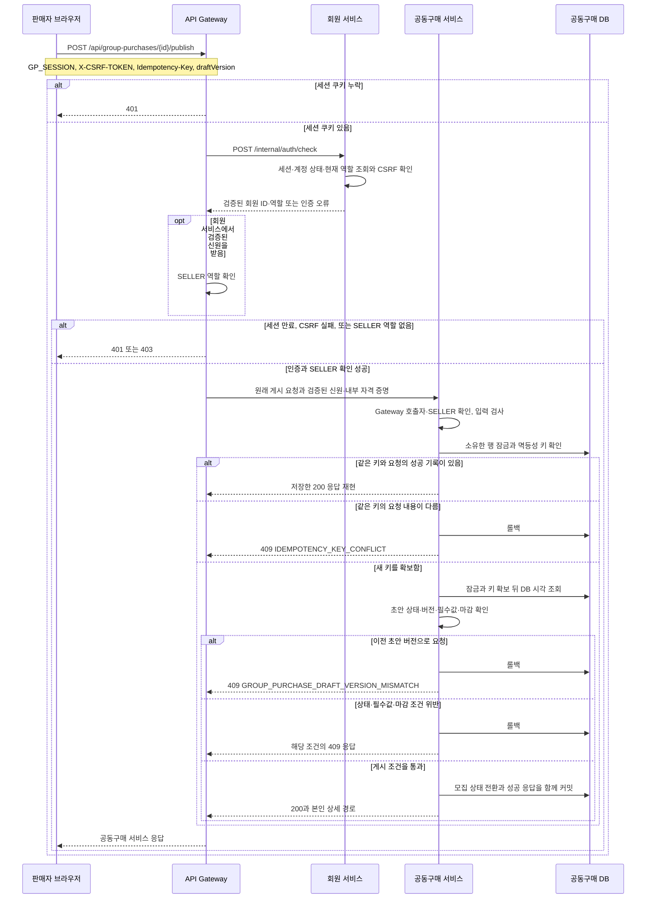
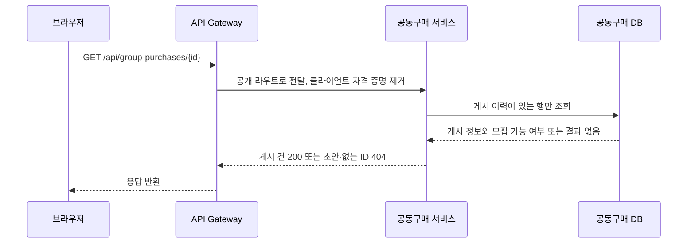

# 009. 공동구매·상품 정보 구현 결과

[합의 계획](plan/009-group-purchase-product.md#execution-summary) · [인계](../handoff.md)

2026-11-12 KST. `feat/group-purchase-product`를 원격 `main`의 `f0a0821e4f4cc90fa2e643790aa035d3b4efe538`에서 만들었다. 착수 시 PR #10의 병합과 최종 head `20718eb`의 두 검사 성공, 병합 커밋의 CI 성공을 확인했다. [PR #10](https://github.com/y0y00700/group-purchase/pull/10) · [PR head CI](https://github.com/y0y00700/group-purchase/actions/runs/43185432231) · [main CI](https://github.com/y0y00700/group-purchase/actions/runs/43196695980)

상태 **로컬 구현·검증 완료**. 2026-11-13 KST에 사용자가 작성한 여섯 구간을 함께 리뷰하고 재검증했다.

## 구현

- 판매자 API는 본인 목록·상세를 읽고 초안을 등록·전체 교체·게시한다. 수정과 게시에서 조회한 `draftVersion`을 비교한다. [HTTP 핸들러](../../services/group-purchase-service/src/main/java/com/example/grouppurchase/purchase/interfaces/GroupPurchaseController.java)
- PostgreSQL에서 같은 공동구매 행을 잠근 뒤 소유권을 확인한다. 같은 키의 성공 기록은 요청 지문을 비교해 재현하고, 새 요청은 초안 상태·버전과 게시 조건을 검사한다. 업무 변경과 성공 응답을 함께 커밋한다. [변경 서비스](../../services/group-purchase-service/src/main/java/com/example/grouppurchase/purchase/application/ChangeGroupPurchase.java) · [Flyway V2](../../services/group-purchase-service/src/main/resources/db/migration/V2__group_purchase_product.sql)
- 공개 목록은 최종 마감 전 모집 건을 읽는다. 게시한 건은 마감 뒤에도 상세에서 볼 수 있다. Gateway는 원시 경로·메서드를 제한하며, 공개 요청의 자격 증명은 제거하고 보호 요청에서 현재 판매자 역할을 확인한다. [Gateway 설정](../../config-repo/api-gateway.yml) · [JDBC 조회](../../services/group-purchase-service/src/main/java/com/example/grouppurchase/purchase/infrastructure/JdbcGroupPurchases.java)

<a id="http-request-flow"></a>

## HTTP 요청 흐름

게시와 공개 상세의 흐름을 재검증한 코드와 대조했다. 각 요청은 [사용자 직접 테스트 방법](#manual-tests)에서 재현할 수 있다.

### 판매자가 초안을 게시할 때

판매자는 로그인한 뒤 본인 상세에서 읽은 `draftVersion`으로 게시한다.



등록·수정과 판매자 목록·상세도 같은 판매자 권한 경계를 거친다. 조회에는 CSRF 토큰과 멱등성 키가 필요하지 않다. 회원 확인 장애에서는 Gateway가 요청을 종료하며, 공동구매 잠금 대기가 제한을 넘으면 서비스가 롤백한 뒤 503을 반환한다. [Gateway 인증 필터](../../infrastructure/api-gateway/src/main/java/com/example/apigateway/AuthRouteFilter.java) · [공동구매 변경 서비스](../../services/group-purchase-service/src/main/java/com/example/grouppurchase/purchase/application/ChangeGroupPurchase.java)

### 익명 사용자가 게시 상세를 볼 때



공개 목록도 회원 서비스 호출 없이 조회한다. 마감된 건은 목록에서 빠지고 상세에서는 `recruitmentOpen: false`로 조회된다.

<a id="final-results"></a>

## 최종 재검증

| 검증 | 2026-11-13 KST 실행과 결과 |
|---|---|
| 전체 Gradle | `gradlew.bat build --offline --no-daemon --max-workers=3` 성공. 공동구매 서비스의 테스트 40개를 다시 실행했고, 다른 네 모듈의 유효한 결과를 합쳐 총 81개, 실패·오류·건너뜀 0이었다. |
| 실제 PostgreSQL | 신규 통합 테스트 8개가 V1 적용 DB의 V2 업그레이드, 두 탭 수정, 수정·게시 양방향 경합, 잠금 대기 중 마감, 행·키 대기 503과 같은 키 재시도, 응답 저장 실패 시 키와 상품 롤백, 동일 시각 페이지 경계, 입력·권한을 확인했다. 별도 테스트 두 개가 지문 v1 고정 해시와 밀리초 마감 경계를 확인했다. |
| Compose | 전용 `group-purchase-009`에서 `docker compose config --quiet`, `docker compose build group-purchase-service`, `docker compose up --no-build --wait --wait-timeout 180` 성공. 공동구매 이미지는 다시 빌드하고 나머지 이미지는 재사용했다. 여섯 서비스가 healthy였고 새 DB의 Flyway V1·V2, `check-gateway.py`와 `check-discovery.py`를 확인했다. |
| Gateway와 Windows 제품 JAR | `python -u scripts/check-gateway-auth.py --dependency-outages --jars` 성공. Compose 8000과 루프백 JAR 18000에서 초안 비노출·오래된 버전 409·게시와 공개 조회·성공 응답 재현·판매자 권한 박탈 및 로그아웃 후 거절을 확인했다. |
| 장애와 복구 | 회원 중단 시 보호 요청 504와 공개 목록·상세 200을 확인했다. DB 중단 시 회원 직접 인증 확인 503과 Gateway 보호 요청 504를 확인했다. 거절된 요청은 공동구매에 전달되지 않았고 두 장애 모두 같은 Gateway에서 보호 조회가 복구됐다. 스크립트 종료 뒤 상품과 키가 0건임을 확인하고 전용 컨테이너와 볼륨을 정리했다. |

2026-11-12 기준 구현에서도 같은 기능 검증을 완료했다. 첫 Gateway 원시 HTTP 검사의 504는 재실행에서 해소됐고, 관측성 테스트와 신규 통합 테스트의 격리 설정을 보완했다.

[게시 잠금과 멱등성 학습 문서](../explanations/group-purchase-publication.md)

<a id="guided-steps"></a>

## 직접 작성 리뷰

여섯 메서드의 실행 코드를 함께 리뷰했다. 행 잠금과 소유권 확인이 성공 응답 재현보다 먼저 실행되며, 새 변경은 그 뒤에 상태와 버전을 검사한다. 검증 후 참고 주석·임시 표식·들여쓰기를 정리하고 다시 컴파일했다. 해당 네 클래스의 `javap -c -p` 출력이 정리 전후 동일했다.

| Step | 작성할 메서드 | 확인할 동작 |
|---|---|---|
| LEARN-01 | [GroupPurchase.revise](../../services/group-purchase-service/src/main/java/com/example/grouppurchase/purchase/domain/GroupPurchase.java) | 초안 상태와 조회 버전을 검사한다. 다섯 입력을 교체하고 버전을 올린다. |
| LEARN-02 | [GroupPurchase.publish](../../services/group-purchase-service/src/main/java/com/example/grouppurchase/purchase/domain/GroupPurchase.java) | 초안과 버전, 필수값과 마감을 검사한다. 목표를 확정하고 모집 상태로 전환한다. |
| LEARN-03 | [ChangeGroupPurchase.changeDraft](../../services/group-purchase-service/src/main/java/com/example/grouppurchase/purchase/application/ChangeGroupPurchase.java) | 소유한 행을 잠그고 키를 확인한 뒤 재전송 또는 새 변경을 처리한다. |
| LEARN-04 | [ChangeGroupPurchase.replay](../../services/group-purchase-service/src/main/java/com/example/grouppurchase/purchase/application/ChangeGroupPurchase.java) | 같은 요청의 성공 응답을 재현하고 다른 요청은 409로 거절한다. |
| LEARN-05 | [JdbcPurchaseIdempotency.claim](../../services/group-purchase-service/src/main/java/com/example/grouppurchase/purchase/infrastructure/JdbcPurchaseIdempotency.java) | 유일 키를 선점하고 충돌하면 별도 SQL 문으로 성공 기록을 읽는다. |
| LEARN-06 | [JdbcGroupPurchases.findPublished](../../services/group-purchase-service/src/main/java/com/example/grouppurchase/purchase/infrastructure/JdbcGroupPurchases.java) | SQL에서 초안을 제외하고 게시한 건의 모집 여부를 계산한다. |

<a id="manual-tests"></a>

## 사용자 직접 테스트 방법

PowerShell 7, Java 21(`JAVA_HOME`), Python 3, Docker Desktop Linux 엔진을 준비한다. 5432·8000·8080·8081·8761·8888을 비우고, 제품 JAR 검사도 실행할 경우 18000·18080·18081·19000을 비운다.

```powershell
Set-Location 'C:\Users\권민혁\Desktop\공부\개인프로젝트\group-purchase'
$env:COMPOSE_PROJECT_NAME = 'group-purchase-009-manual'
.\scripts\prepare-local-secrets.ps1
.\gradlew.bat build --no-daemon
docker compose config --quiet
docker compose up --build --wait --wait-timeout 240
python scripts/check-gateway.py
python scripts/check-gateway-auth.py --jars
```

검사 스크립트는 임시 계정과 상품을 생성하고 정리한다. 회원·DB 중단과 복구도 확인하려면 마지막 명령에 `--dependency-outages`를 추가한다. 이 옵션은 현재 Compose 프로젝트의 회원 서비스와 PostgreSQL을 차례로 중지하고 다시 기동한다.

[최종 재검증](#final-results)에 실제 실행한 명령을 기록했다. 아래 개별 PowerShell 요청은 직접 재현용이며 구문을 확인했다.

### 판매자로 로그인

```powershell
$base = 'http://127.0.0.1:8000'
$purchases = "$base/api/group-purchases"
$login = 'manual009_' + [Guid]::NewGuid().ToString('N').Substring(0, 12)
python scripts/member-tool.py $login --roles BUYER,SELLER

$seed = Invoke-RestMethod "$base/api/auth/csrf" -SessionVariable seller
$password = Read-Host '임시 판매자 비밀번호' -MaskInput
try {
    Invoke-RestMethod "$base/api/auth/login" -Method Post -WebSession $seller `
        -ContentType application/json -Headers @{ 'X-CSRF-TOKEN' = $seed.token } `
        -Body (@{ loginId = $login; password = $password } | ConvertTo-Json -Compress)
} finally {
    Remove-Variable password
}
$csrf = (Invoke-RestMethod "$base/api/auth/csrf" -WebSession $seller).token

function Send-Purchase($uri, $method, $key, $json) {
    Invoke-WebRequest $uri -Method $method -WebSession $seller -SkipHttpErrorCheck `
        -ContentType application/json `
        -Headers @{ 'X-CSRF-TOKEN' = $csrf; 'Idempotency-Key' = $key } -Body $json
}
function Show-Purchase($response) {
    $response.StatusCode
    if ($response.Content) { $response.Content | ConvertFrom-Json }
}
```

### 등록·수정·게시와 재시도

최초 모집 목표는 기준 수량에 20%를 더하고 올림한다. 기준 수량이 11개라면 초안의 예상 목표와 게시 뒤 확정 목표는 모두 14개다.

```powershell
$registerKey = [Guid]::NewGuid().ToString()
$registered = Send-Purchase $purchases Post $registerKey '{}'
Show-Purchase $registered                                 # 201
$receipt = $registered.Content | ConvertFrom-Json
$detail = "$purchases/$($receipt.id)"
$mine = "$base$($receipt.detailPath)"
$draft = Invoke-RestMethod $mine -WebSession $seller        # DRAFT, draftVersion 1
$draft
(Invoke-WebRequest $detail -Method Head -WebSession $seller -SkipHttpErrorCheck).StatusCode # 404

$publish = "$detail/publish"
$firstView = @{ draftVersion = $draft.draftVersion } | ConvertTo-Json -Compress
Show-Purchase (Send-Purchase $publish Post ([Guid]::NewGuid().ToString()) $firstView) # 409 NOT_READY
$reviseKey = [Guid]::NewGuid().ToString()
$replacement = @{
    productName = 'Tea set'
    productDescription = 'Two cups and a teapot'
    unitPrice = 12000
    baseQuantity = 11
    finalDeadline = [DateTimeOffset]::UtcNow.AddDays(1).ToString("yyyy-MM-ddTHH:mm:ss.fffzzz")
    draftVersion = $draft.draftVersion
} | ConvertTo-Json -Compress
$revised = Send-Purchase $detail Put $reviseKey $replacement
Show-Purchase $revised                                    # 200
Show-Purchase (Send-Purchase $publish Post ([Guid]::NewGuid().ToString()) $firstView) # 409 DRAFT_VERSION_MISMATCH

$latest = Invoke-RestMethod $mine -WebSession $seller       # version 2, 예상 목표 14
$latest
$publishKey = [Guid]::NewGuid().ToString()
$publishBody = @{ draftVersion = $latest.draftVersion } | ConvertTo-Json -Compress
$published = Send-Purchase $publish Post $publishKey $publishBody
Show-Purchase $published                                  # 200
(Invoke-RestMethod $purchases).items                       # 모집 목록에 게시 건 포함
Invoke-RestMethod $detail                                 # RECRUITING, 확정 목표 14, recruitmentOpen true

(Send-Purchase $publish Post $publishKey $publishBody).Content -eq $published.Content # True
(Send-Purchase $detail Put $reviseKey $replacement).Content -eq $revised.Content      # True
Show-Purchase (Send-Purchase $publish Post $publishKey $firstView) # 409 IDEMPOTENCY_KEY_CONFLICT
Show-Purchase (Send-Purchase $detail Put ([Guid]::NewGuid().ToString()) $replacement) # 409 NOT_DRAFT
```

### 권한 실패

```powershell
(Invoke-WebRequest "$purchases/mine" -SkipHttpErrorCheck).StatusCode # 401
(Invoke-WebRequest 'http://127.0.0.1:8080/api/group-purchases/mine' -SkipHttpErrorCheck).StatusCode # 403
Show-Purchase (Invoke-WebRequest $publish -Method Post -WebSession $seller -SkipHttpErrorCheck `
    -ContentType application/json -Headers @{ 'Idempotency-Key' = $publishKey } -Body $publishBody) # 403 CSRF_INVALID
(Invoke-WebRequest "$base/api/auth/logout" -Method Post -WebSession $seller `
    -Headers @{ 'X-CSRF-TOKEN' = $csrf }).StatusCode # 204
Show-Purchase (Send-Purchase $publish Post $publishKey $publishBody) # 401 UNAUTHENTICATED
```

### 종료와 복구

```powershell
# 중단 검사 도중 중지된 컨테이너를 복구할 때
docker compose up -d --wait --no-deps postgres member-service
# 위에서 만든 전용 프로젝트의 DB 볼륨을 지워 임시 회원·상품·키를 함께 정리한다.
docker compose -p group-purchase-009-manual down -v
Remove-Item Env:COMPOSE_PROJECT_NAME
```

기존 데이터를 담은 볼륨을 보관하려면 `docker compose down`으로 컨테이너와 네트워크만 종료한다.
