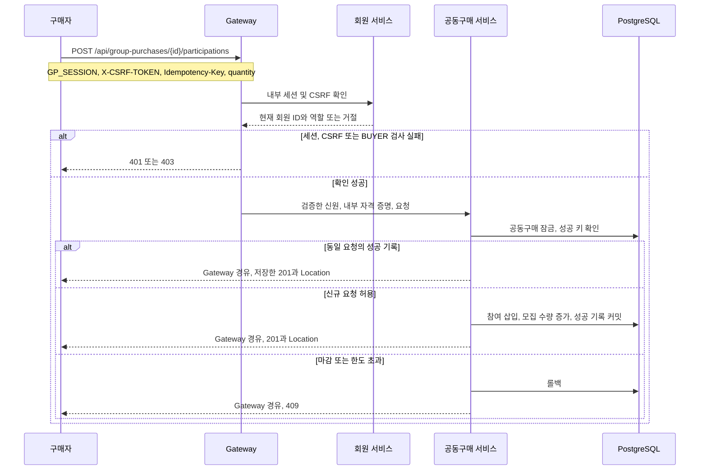
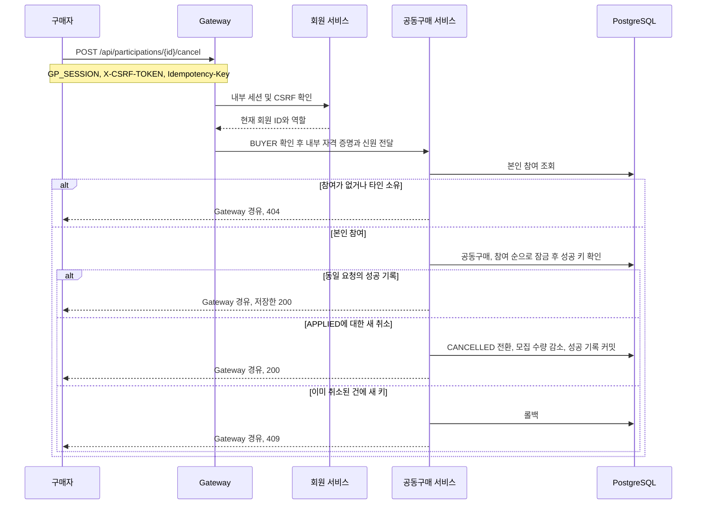

# 010. 공동구매 참여·조회·결제 전 취소 구현 기록

[계획](plan/010-participation.md#execution-summary) · [인계](../handoff.md)

`feat/group-purchase-participation`은 원격 `main`의 `5e5c26e`에서 시작했다. 2026-11-18 KST 착수 시 009 PR 병합과 PR head 및 main의 Build and test, Images and Compose smoke test 성공을 확인했다. [PR #11 검사](https://github.com/y0y00700/group-purchase/pull/11/checks) · [main CI](https://github.com/y0y00700/group-purchase/actions/runs/44243946097)

## 구현 범위

- 게시된 공동구매에 신청하고, 구매자 본인의 목록·상세를 조회하고, 미결제 참여 한 건을 전량 취소한다. Gateway는 보호 라우트의 요구 역할을 검사하고, 서비스는 내부 자격 증명·역할·구매자 소유권을 확인한다. [Gateway 라우트](../../config-repo/api-gateway.yml) · [참여 컨트롤러](../../services/group-purchase-service/src/main/java/com/example/grouppurchase/participation/interfaces/ParticipationController.java)
- 공동구매 행 잠금 아래 모집 잔여량과 구매자별 `APPLIED` 합계를 검사한다. 신청·취소에 따른 참여 상태, 모집 카운터, 성공 응답을 함께 커밋한다. [변경 서비스](../../services/group-purchase-service/src/main/java/com/example/grouppurchase/participation/application/ChangeParticipation.java) · [Flyway V3](../../services/group-purchase-service/src/main/resources/db/migration/V3__participation.sql)
- 목표를 채우면 공개 모집 목록에서 빠진다. 공개 상세의 `recruitmentOpen`은 마감 전 취소로 자리가 나면 다시 `true`가 된다. 마감 뒤의 취소도 수량을 차감하며, 모집은 닫힌 상태로 표시한다. [공개 조회](../../services/group-purchase-service/src/main/java/com/example/grouppurchase/purchase/infrastructure/JdbcGroupPurchases.java)

<a id="http-request-flow"></a>

## HTTP 요청 흐름

아래 흐름은 사용자 작성 코드를 포함한 최종 구현을 따른다. 본인 목록·상세는 GET/HEAD와 세션으로 요청하고, 서비스가 현재 구매자 ID로 조회 범위를 제한한다.





잠금 대기 제한을 넘으면 롤백 후 `503 GROUP_PURCHASE_BUSY`를 반환하며 같은 키로 재시도할 수 있다.

<a id="baseline-results"></a>

## 기준 구현 검증

| 실행 | 확인 결과 |
|---|---|
| `.\gradlew.bat build --console=plain` | 성공. 모듈 전체 결과 87건, 실패·오류·건너뜀 0. PostgreSQL 경합·수량 불변식·마감·롤백·V2에서 V3 업그레이드와 009 성공 응답 재현, Gateway의 구매자 역할·CSRF·경로 및 역할 설정 오류를 확인했다. |
| `docker compose config --quiet`, `docker compose build`, `docker compose up -d --no-build --wait --wait-timeout 240` | 전용 `group-purchase-010`에서 6개 서비스 healthy, 신규 DB의 Flyway V1~V3 적용을 확인했다. `check-gateway.py`와 `check-discovery.py`가 통과했다. |
| `python scripts/check-gateway-auth.py --jars` | Compose Gateway 8000과 Windows 제품 JAR Gateway 18000에서 게시·신청·목록·상세·취소·재참여와 키 재현, 권한 거절을 확인했다. |
| 직접 작성 구간 전환 후 `.\gradlew.bat :group-purchase-service:compileJava :api-gateway:compileJava --console=plain` | 작성 대기 상태로 전환한 시점에 두 모듈 컴파일을 확인했다. 위 기능 검증은 당시 기준 구현에서 실행했다. |

<a id="guided-coding"></a>

## 직접 작성과 리뷰

2026-11-18 KST에 여섯 메서드의 작성 결과를 묶어서 리뷰했다. 실행 로직을 보존하고 참고 주석과 임시 예외를 제거했다. 들여쓰기·공백과 지문 버전 오류 메시지의 오타를 정리했다.

| Step | 메서드 | 리뷰에서 확인한 동작 |
|---|---|---|
| LEARN-01 | [Participation.checkQuantity](../../services/group-purchase-service/src/main/java/com/example/grouppurchase/participation/domain/Participation.java) | 모집 잔여량과 기준 수량 10%를 차례로 검사한다. 두 한도의 정확한 경계를 허용한다. |
| LEARN-02 | [ParticipationChange.fingerprint](../../services/group-purchase-service/src/main/java/com/example/grouppurchase/participation/application/ParticipationChange.java) | 요청 종류에 맞춰 필드를 고정 순서로 직렬화하고 SHA-256 지문을 만든다. |
| LEARN-03 | [JdbcParticipationIdempotency.claim](../../services/group-purchase-service/src/main/java/com/example/grouppurchase/participation/infrastructure/JdbcParticipationIdempotency.java) | 키를 선점하고 다른 요청이 이미 선점한 키의 성공 기록을 별도 SQL 문으로 읽는다. |
| LEARN-04 | [ChangeParticipation.apply](../../services/group-purchase-service/src/main/java/com/example/grouppurchase/participation/application/ChangeParticipation.java) | 구매 행 잠금, 멱등성, 마감·한도 검사, 참여·카운터·응답 저장을 연결한다. |
| LEARN-05 | [ChangeParticipation.cancel](../../services/group-purchase-service/src/main/java/com/example/grouppurchase/participation/application/ChangeParticipation.java) | 본인 확인과 잠금 순서를 지키며 취소와 수량 차감을 한 번 반영한다. |
| LEARN-06 | [AuthRouteFilter.forwardAuthenticated](../../infrastructure/api-gateway/src/main/java/com/example/apigateway/AuthRouteFilter.java) | 라우트 정책과 현재 회원 역할을 대조한 뒤 확인된 신원으로 요청을 전달한다. |

<a id="final-results"></a>

## 최종 검증

| 실행 | 사용자 작성 코드에서 확인한 결과 |
|---|---|
| `.\gradlew.bat build --console=plain` | 87건, 실패·오류·건너뜀 0. 마지막 자리와 구매자 10% 한도 경합, 마감 뒤 취소, 동일 키 재현, 트랜잭션 롤백, V2→V3 데이터와 009 응답 보존, 권한·CSRF·라우트 설정 오류를 확인했다. |
| `docker compose -p group-purchase-010 build group-purchase-service api-gateway` 및 `up -d --no-build --wait --wait-timeout 240` | 변경된 두 이미지를 재빌드하고 나머지 세 앱 이미지를 재사용했다. 6개 서비스 healthy, 신규 DB Flyway V1~V3, 기본 Gateway 라우팅과 Eureka 등록을 확인했다. |
| `python scripts/check-gateway-auth.py --jars` | Compose Gateway 8000과 Windows 제품 JAR Gateway 18000에서 게시·신청·본인 목록·상세·취소·재참여, 키 재현, CSRF 및 구매자 역할 변경을 확인했다. |

전용 검증용 Compose 프로젝트와 데이터 볼륨을 종료·정리했다. 아래 PowerShell 개별 요청 예시는 수동 재현용이며, 같은 API 흐름은 스모크 스크립트로 실행했다. [참여 수량과 멱등성 학습 문서](../explanations/group-purchase-participation.md)

<a id="manual-tests"></a>

## 직접 테스트

Windows의 PowerShell 7에서 Docker Desktop, Java 21, Python 3을 준비한다. 프로젝트 루트에서 실행한다. 기본 로컬 포트 5432, 8000, 8080, 8081, 8761, 8888을 사용하는 다른 프로젝트가 있다면 해당 포트를 비운다.

```powershell
Set-Location 'C:\Users\권민혁\Desktop\공부\개인프로젝트\group-purchase'
.\gradlew.bat :group-purchase-service:test --tests '*GroupPurchaseIntegrationTests' :api-gateway:test --console=plain
$env:COMPOSE_PROJECT_NAME = 'group-purchase-010-manual'
if (!(Test-Path secrets/postgres_password)) { .\scripts\prepare-local-secrets.ps1 }
.\gradlew.bat :member-service:bootJar
docker compose up --build --wait --wait-timeout 240
python scripts/check-gateway-auth.py
```

스모크는 실행마다 새 구매자 계정을 만들고 판매자 역할을 추가해 테스트 상품을 게시한다. 같은 세션으로 신청 201, 목록·상세 200, 취소 200, 재참여 시 새 ID를 확인한다. CSRF 없음과 구매자 역할 박탈은 403, 구매자 한도 초과와 새 키로 재취소는 409를 확인한다. 마감·타인 접근·잠금·롤백은 위 PostgreSQL 통합 테스트의 검증 대상이다.

개별 요청은 구매자 로그인으로 받은 `WebRequestSession`, 새 CSRF 토큰, 게시된 공동구매 UUID를 사용한다. 판매자 계정에 `BUYER,SELLER`를 부여한 뒤 009의 게시 절차까지 실행한다. 같은 세션에서 로그아웃하기 전에 아래 변수에 `$seller`, `$csrf`, 게시한 상품의 `$receipt.id`를 각각 넣어 테스트할 수 있다. [009 직접 테스트](009-group-purchase-product.md#manual-tests)

```powershell
$buyerSession = $seller
$csrfToken = $csrf
$groupPurchaseId = $receipt.id
$base = 'http://127.0.0.1:8000'
$mine = "$base/api/participations/mine"
$headers = @{ 'X-CSRF-TOKEN' = $csrfToken; 'Idempotency-Key' = [guid]::NewGuid().ToString() }
$apply = "$base/api/group-purchases/$groupPurchaseId/participations"
$result = Invoke-WebRequest $apply -Method Post -WebSession $buyerSession -Headers $headers `
  -ContentType 'application/json' -Body '{"quantity":1}' -SkipHttpErrorCheck
$result.StatusCode # 201
$receipt = $result.Content | ConvertFrom-Json
Invoke-RestMethod $mine -WebSession $buyerSession
Invoke-RestMethod "$base$($receipt.detailPath)" -WebSession $buyerSession
$cancel = "$base/api/participations/$($receipt.id)/cancel"
$headers['Idempotency-Key'] = [guid]::NewGuid().ToString()
(Invoke-WebRequest $cancel -Method Post -WebSession $buyerSession -Headers $headers -SkipHttpErrorCheck).StatusCode # 200
(Invoke-RestMethod "$base$($receipt.detailPath)" -WebSession $buyerSession).status # CANCELLED
$headers['Idempotency-Key'] = [guid]::NewGuid().ToString()
(Invoke-WebRequest $cancel -Method Post -WebSession $buyerSession -Headers $headers -SkipHttpErrorCheck).StatusCode # 409
```

스모크가 만든 계정·상품·참여는 스크립트가 정리한다. 수동 실행 데이터도 삭제하려면 전용 프로젝트에만 `down -v`를 적용한다. 데이터를 보관하려면 `-v`를 생략한다.

```powershell
docker compose -p group-purchase-010-manual down -v
Remove-Item Env:COMPOSE_PROJECT_NAME
```

[참여 수량과 멱등성 학습 문서](../explanations/group-purchase-participation.md)
