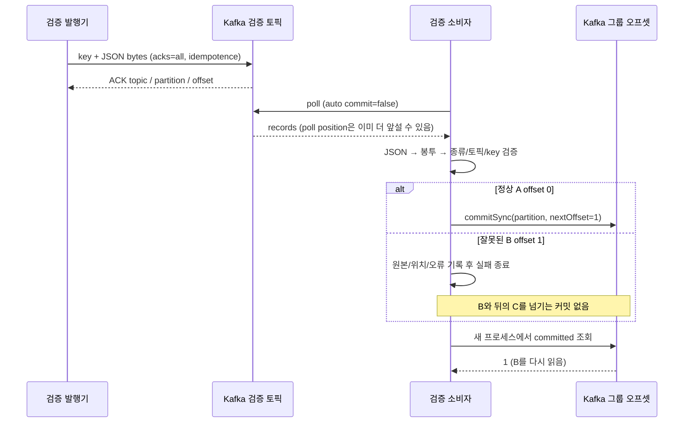

# 011 Kafka 실행·메시지 계약 구현 기록

2026-11-24 KST · **로컬 구현 완료 / 여섯 구간 사용자 작성·묶음 리뷰·재검증 완료**. [확정 계획](plan/011-kafka-message-contract.md). [사용자 코드 최종 결과](#final-results). PR 생성·push 및 011 원격 CI는 아직 수행하지 않았다.

## 착수 기준

- 기존 사용자 변경: `AGENTS.md`, `Docs/README.md`, `Docs/handoff.md`, `Docs/implementation/README.md`, `Docs/implementation/plan/roadmap.md`, 새 011 계획을 보존했다. 자동 stash·reset·문서 덮어쓰기를 하지 않았다.
- 2026-11-24 원격 fetch 및 `gh pr list --state all --head feat/group-purchase-participation`, `gh run list --commit d411960f430062fe53280bef1be5514e016d1daf` 결과는 모두 빈 목록이었다. **010 PR은 없고 head CI도 없다.** 최신 병합 PR은 [009 #11](https://github.com/y0y00700/group-purchase/pull/11)이다.
- 원격 main `5e5c26eab4459448d312501f859f3fd528741ec3`, 최신 [main CI 실행](https://github.com/y0y00700/group-purchase/actions/runs/44251718781)은 completed/success. 010은 로컬/원격 `d411960f430062fe53280bef1be5514e016d1daf`이며 main보다 한 커밋 앞선다.
- 010을 보존하기 위해 이 head에서 `feat/kafka-message-contract`를 만들었다. 011 PR을 준비할 때 010 선행 병합 또는 base 분리가 필요하다. 011 변경은 현재 미커밋이며 PR 생성·push는 하지 않았다.

## 구현과 경계

`compose.yml`에 단일 KRaft Kafka와 일회성 `kafka-init`, `kafka-data` 볼륨을 추가했다. 상시 서비스는 PostgreSQL·다섯 앱·Kafka의 일곱 개이고 init은 exit 0이어야 한다. Kafka는 Config/Eureka에 의존하지 않으며 기존 앱도 Kafka를 기다리지 않는다.

`infrastructure/kafka/topics.txt`가 업무 토픽 세 개의 목록이다. `init-topics.sh`는 없는 토픽만 만들고 3 partitions / replication 1 및 여섯 설정을 대조한다. 불일치 시 실패하며 기존 설정을 바꾸지 않는다. healthcheck는 Kafka API로 준비 여부를 검사한다. 소스 셸 파일은 LF로 유지한다.

공동구매 `infrastructure/messaging`의 `MessageCodec`은 Jackson 3으로 UTF-8·최대 64 KiB·중복 키·후행 토큰·정수/UUID/UTC 마이크로초·종류/버전/업무 ID를 검사한다. `MessageKind`는 실제 토픽과 key를 대조한다. `ContractFailure`는 HTTP 오류와 독립된 분류다. 알 수 없는 선택 필드는 허용하고 원본 바이트는 방어 복사로 보존한다. payload는 객체인지 확인하며 업무별 필수 내용은 후속 단계의 책임이다.

별도 `src/kafkaProbe`의 `ProbeTransport`는 raw Kafka clients로 broker ACK와 수동 커밋을 확인한다. `KafkaProbe`가 유한 시간의 검증 명령을 제공하고 `check-kafka.py`가 새 Java 프로세스·Compose 내부 프로세스·재시작 검사를 조정한다. 제품 앱에 producer/listener·공개 테스트 API·업무 발행·DB 변경은 없다. `verifyKafkaIsolation`은 제품 JAR의 probe/client 비포함과 검증 JAR의 포함을 검사한다.

계획의 클래스명 `ApacheKafkaContainer`는 실제 BOM의 2.0.5 artifact에 존재하지 않았다. 공식 [Apache 이미지용 KafkaContainer](https://java.testcontainers.org/modules/kafka/)인 `org.testcontainers.kafka.KafkaContainer`를 사용한다. deprecated된 `org.testcontainers.containers.KafkaContainer`는 사용하지 않는다. 토픽 생성 응답과 조회 가능 시점 사이의 지연에는 UnknownTopicOrPartition만 유한 재시도한다.

## 메시지 흐름

다음은 기준 구현의 검증 흐름이다. 제품 결제 처리는 아직 없다.



## 실제 검증 근거

모두 **참고 주석 전환 전 기준 구현**의 근거다. 아래 검사를 마친 다음 LEARN-01~06을 한 번에 비웠다. 이 표는 당시 작성 대기 상태의 이력이다. 사용자 작성 후 현재 활성 코드의 검증은 아래 최종 결과에서 구분한다.

| 실제 실행 | 관찰 결과·근거 |
|---|---|
| `gradlew.bat build --console=plain` | 5분 1초, 41 tasks(7 실행/34 up-to-date), 성공. 모듈 결과 99개(공동구매 56/회원 14/Gateway 18/Config 3/Eureka 8), 실패·오류·skip 0. 공동구매 전체 56개는 이번 실행, 나머지 43개는 Gradle이 인정한 기존 유효 결과 재사용. `.tmp/011-baseline/full-build.log`, `full-build-tests.json` |
| 최종 probe 표본 정리 후 `:group-purchase-service:test --tests '*MessageCodecTests' --tests '*KafkaContractIntegrationTests' :group-purchase-service:verifyKafkaIsolation` | 27초, 17 tasks(5 실행/12 up-to-date), 계약 11 + 실제 격리 브로커 통합 1 = 12개 모두 성공. 99개에 포함된 테스트이며 합산해 111개로 세지 않는다. `.tmp/011-baseline/final-kafka.log`, `final-kafka-tests.json` |
| `dependencyInsight` | 실제 해석: kafka-clients 4.1.2 / testcontainers-kafka 2.0.5 / tools.jackson jackson-databind 3.1.7. Spring Kafka는 추가하지 않았다. JDK는 로컬 Microsoft 21.0.12.1, Docker Engine 29.8.1 / Compose 5.5.1 |
| `docker compose -p group-purchase-011 config --quiet`, `up --build -d --wait --wait-timeout 240` | 다섯 앱 이미지 빌드·일곱 상시 healthy. init은 실제 컨테이너 ID의 `docker wait`와 상태 조회로 exit 0 확인. `.011-compose.log`, `.tmp/011-baseline/final-services.log` |
| `python scripts/check-kafka.py --project group-purchase-011 --lifecycle` | run `f8fe94f6fe474ed0aa4c68ef703c44f7`: 39개 검사, 측정 합 200.81초, 최종 `KAFKA_CHECKS_OK`. 불일치 init 2개와 손상 B 2개의 exit 1은 의도한 실패 검증이다. 나머지는 exit 0 |
| 초기화·설정 차이 | 재실행 20.47초, 업무 설정 유지. 검증 토픽의 파티션 1 또는 다른 retention 설정에서 각각 TOPOLOGY/CONFIG_MISMATCH. 이후 describe로 기존 값이 바뀌지 않은 것도 확인 |
| HOST/INTERNAL·순서·그룹 | 호스트 smoke 4.24초, 내부 새 발행/수신 5.35초. 같은 key의 파티션과 발행 metadata↔수신 원본 순서 대조. 두 독립 그룹 각각 11개 수신. 서로 다른 유효 key로 세 파티션에 발행하고 같은 그룹 두 consumer가 2+1로 배분, 합계 12개를 한 번씩 수신 |
| 프로세스 재시작·오류 경계 | 별도 `uncommitted` 프로세스 둘 모두 offset 0 재수신. commit 후 새 consumer committed=1/position=1. A 성공 때 position=3이어도 1만 커밋, B 실패 후 새 프로세스가 B(offset 1) 재수신, C 건너뛰기 없음 |
| 볼륨·중단 복구 | Kafka restart 뒤 보존, 전체 down/up(기동 56.34초) 뒤 시작 0/끝 2/그룹 committed 1 유지. broker 중단 발행 11.27초 내 실패(storage UNKNOWN), 복구 7.49초 뒤 내부 수신·호스트 새 발행 성공. 같은 메시지 두 번 발행은 record 두 개로 남음 |
| HTTP·DB 회귀 | `check-postgres.py --stage application --persistence` 21.49초 / discovery 3.16초 / gateway 55.75초 / member-auth 66.43초 / gateway-auth `--jars` 52초, 모두 exit 0. 세션·CSRF·권한·게시·참여·취소·재요청 및 Windows 제품 JAR 확인. `.tmp/011-regression/summary.json`와 각 로그 |
| 작성 구간 준비 후 | `compileJava compileKafkaProbeJava compileTestJava` 성공(4초). 기능 검증은 재실행하지 않았다. 현재 placeholder의 기능 실패를 테스트 skip이나 완화로 숨기지 않았다. `.011-placeholders-compile.log` |
| 정리 | 각 실행의 검증 토픽·그룹 정리 성공. 마지막 `docker compose -p group-purchase-011 down` 성공, PostgreSQL/Kafka 볼륨 보존. 현재 전용 Compose 컨테이너는 종료 상태. `.011-final-down.log` |

Kafka 이미지 ID와 RepoDigest는 모두 `sha256:5cc2a2fd93fa2687b44015eee04fb2c3edd9e526bd64bf8bec5ff1e268772e0e`다. `.tmp/011-baseline/kafka-image.log`에 원본을 보관했다. 최종 기준 probe JAR SHA-256은 `b094ef2391e02d6fad4f9fe8b69763b18ea9423e848d78521267f8a50ad4f059`이며 각 실행은 이 JAR 사본을 고정한다. 실행별 `artifact.json`과 `.tmp/011-baseline/verified-sha256.json`에 JAR/Java 소스 해시를 기록했다. 이 로컬 진단 자료는 Git 제외 대상이며 장기적인 검증 사실은 이 문서가 소유한다.

실제 실패와 수정도 구분한다. 최초 격리 테스트의 메타데이터 준비 지연을 유한 재시도로 처리했다. Windows 임시 목록의 CRLF로 잘못된 토픽명이 된 실패는 `write_bytes`의 LF로 수정했고 소스 셸/목록의 CR 바이트 0을 확인했다. 검증 중 JAR를 재빌드해 lazy class loading이 실패한 실행은 성공으로 세지 않고, 실행별 JAR 사본·SHA 고정 뒤 전체 lifecycle을 재실행했다. Compose 5의 `compose wait`가 이미 종료한 init을 찾지 못하는 경우는 `ps -a -q`로 ID를 얻어 `docker wait`하는 방식으로 바꿨다. 실패 실행에서 생성된 검증 토픽도 해당 runId로 정리했다.

CI 두 job에는 검사 연결만 추가했으며 **011 원격 CI는 미실행/미확인**이다. job 제한시간 15/20분은 변경하지 않았다. 별도 Kafka 포트 변경 절차와 Linux 호스트에서의 CI 실행은 이번 Windows 로컬 실행 근거에 포함하지 않는다.

<a id="final-results"></a>

## 사용자 작성 코드 최종 결과

2026-11-24 사용자 완료 알림 후 여섯 메서드를 묶음 리뷰했다. UUID/UTC/양의 정수 검증, 종류·토픽·key 대조, JSON 오류 분류, broker ACK 대기, 실패 record 뒤 커밋 금지, committed/position 대조가 기준 구현과 일치했다. 수정이 필요한 기능 오류는 없었다.

| 실제 실행·정리 | 최종 결과 |
|---|---|
| 사용자 활성 코드의 계약·실제 Kafka 통합 테스트 + `verifyKafkaIsolation` | 40초, 17 tasks(8 실행/9 up-to-date), 계약 11개·실제 Kafka 통합 1개 모두 통과, 실패·오류·skip 0. `.011-user-tests.log`, `.tmp/011-user-review/tests.json` |
| 임시 표식 정리 | 세 파일의 참고 제목·직접 작성 위치·주석 처리된 임시 예외를 제거했다. 사용자 실행 코드의 토큰을 정리 전후 대조하여 모두 동일함을 확인했다. 원문 사본과 대조 결과는 `.tmp/011-user-review/*-user.java`, `source-review.json` |
| 정리한 현재 소스의 제품/probe JAR | `:group-purchase-service:verifyKafkaIsolation` 재실행 성공(13초). 두 JAR를 다시 만들고 제품에 probe/client 비포함·검증 JAR에 포함 확인. `.011-user-jars.log` |
| 사용자 코드 이미지·Compose | 다섯 앱 이미지 재빌드, 일곱 상시 healthy + kafka-init 실제 exit 0 확인. 이미지 빌드 이후의 표식 정리는 실행 토큰을 바꾸지 않았다. `.011-user-compose.log`, `.tmp/011-user-review/services.log` |
| 최종 JAR로 HOST/INTERNAL·프로세스 재시작 검증 | `python scripts/check-kafka.py --project group-purchase-011`, run `fd267bd5d3b2407a9c0baf56711c7dc8`, 22개 검사·측정 합 87.67초, `KAFKA_CHECKS_OK`. 두 불일치 init와 두 B 실패의 exit 1은 의도한 거절이며 나머지 성공. `.011-user-kafka.log`, 실행별 `summary.json`, `.tmp/011-user-review/runtime-summary.json` |
| 정상·실패 관찰 | 독립 그룹 각각 11개/공유 그룹 합계 12개, key에 따른 파티션·순서, 미커밋 offset 0 재수신, 커밋 뒤 nextPosition 1, A의 position 3에도 nextOffset 1만 커밋, 새 프로세스가 B offset 1 재수신. 내부 리스너의 새 발행·수신과 보존 표본 수신도 성공 |
| 기존 유효 검증 재사용 | 기준 구현 99개 중 관련 12개를 사용자 코드로 다시 실행했고 변경과 무관한 87개는 기존 결과를 재사용했다. 볼륨 전체 down/up·broker 장애/복구·기존 DB/HTTP/Windows 제품 JAR 회귀는 관련 설정·호출 경계가 그대로여서 위 기준 구현의 유효 근거를 재사용했다. 최종 probe JAR SHA-256도 기준 구현과 같은 `b094ef2391e02d6fad4f9fe8b69763b18ea9423e848d78521267f8a50ad4f059`다 |
| 종료 | 해당 run의 검증 토픽·그룹 정리 성공, 전용 Compose `down` 성공. PostgreSQL/Kafka 볼륨 보존, 다른 프로젝트 중단 없음. `.011-user-down.log` |

현재 소스에 작성 대기 예외나 LEARN 임시 표식은 없다. 여섯 구간의 작성·리뷰·필수 재검증과 학습 문서 갱신을 마쳤으며 **011 로컬 구현 완료**다. 012 업무 Outbox와 013 DB 소비 기록/DLT, 제품 발행·소비 연결은 여전히 이번 범위 밖이다. 새 원격 CI를 실행하거나 이전 main CI를 011 CI로 간주하지 않았다.

<a id="guided-coding"></a>

## 여섯 구간 직접 작성 결과

**LEARN-01~06 모두 사용자 작성·묶음 리뷰·재검증 완료**다. 임시 표식은 정리했고 아래 번호는 작성 이력이다. 현재 메서드 위치는 다음과 같다.

| 순서 | 파일 / 메서드 | 작성 내용 |
|---|---|---|
| LEARN-01 | [MessageCodec.validate, L48](../../services/group-purchase-service/src/main/java/com/example/grouppurchase/infrastructure/messaging/MessageCodec.java) | UUID·시각·context·sequence·payload 검사 |
| LEARN-02 | [MessageKind.key, L26](../../services/group-purchase-service/src/main/java/com/example/grouppurchase/infrastructure/messaging/MessageKind.java) | 결제는 원승인 시도 ID, 알림은 공동구매 ID 선택·대조 |
| LEARN-03 | [MessageCodec.decode, L30](../../services/group-purchase-service/src/main/java/com/example/grouppurchase/infrastructure/messaging/MessageCodec.java) | UTF-8/JSON → 버전 → 종류 → 봉투 검사·원본 보존 |
| LEARN-04 | [ProbeTransport.publish, L40](../../services/group-purchase-service/src/kafkaProbe/java/com/example/grouppurchase/kafkaprobe/ProbeTransport.java) | send future의 broker 확인, metadata 출력 |
| LEARN-05 | [ProbeTransport.validateAndCommit, L48](../../services/group-purchase-service/src/kafkaProbe/java/com/example/grouppurchase/kafkaprobe/ProbeTransport.java) | 검증 성공 record의 offset+1만 명시적 커밋 |
| LEARN-06 | [ProbeTransport.verifyRestartOffset, L68](../../services/group-purchase-service/src/kafkaProbe/java/com/example/grouppurchase/kafkaprobe/ProbeTransport.java) | committed와 position을 각각 기대값과 비교 |

IntelliJ의 Markdown 원문에서 파일 링크를 `Ctrl+클릭`해 열고 메서드명을 검색한다. 파일 링크는 상대경로만 사용하며 GitHub 줄 번호 앵커를 붙이지 않았다. 표의 L번호는 현재 위치 안내다. 필요하면 `Ctrl+G`로 이동한다. [IntelliJ 안내](https://www.jetbrains.com/help/idea/markdown.html#links)

<a id="manual-tests"></a>

## 사용자 직접 테스트

현재 사용자 작성 소스로 아래 절차를 실행할 수 있다. 실행 전 JAR와 이미지를 다시 빌드하면 이전 산출물을 현재 소스의 결과로 혼동하지 않는다. 실제 이번 실행과 재사용한 검증은 위 최종 결과에서 구분했다.

준비: Docker Desktop Linux 엔진, JDK 21, Python 3. 포트 5432/8888/8761/8080/8081/8000/9092가 다른 Compose 프로젝트와 충돌하지 않아야 한다. 기존 secret 준비 스크립트는 있는 값을 보존한다. 작업 디렉터리와 Java는 다음과 같다.

```powershell
Set-Location 'C:\Users\권민혁\Desktop\공부\개인프로젝트\group-purchase'
$env:JAVA_HOME = "$env:USERPROFILE\.jdks\ms-21.0.12.1" # 본인의 JDK 21 경로
$env:COMPOSE_PROJECT_NAME = 'group-purchase-011'
.\scripts\prepare-local-secrets.ps1
.\gradlew.bat build --console=plain
docker compose -p group-purchase-011 config --quiet
docker compose -p group-purchase-011 up --build -d --wait --wait-timeout 240
python scripts/check-kafka.py --project group-purchase-011
```

정상 결과는 마지막 `KAFKA_CHECKS_OK`다. `TOPIC_OK`는 업무 토픽 설정을 조회한 결과이고 업무 토픽에 표본을 발행하지 않는다. 스크립트는 임의 `RUN_ID`로 `verify.<runId>.*` 토픽·그룹을 만들며 출력과 `.tmp/kafka/<runId>/summary.json`, 단계별 `.log`에 근거를 남긴다. 내부 리스너 검사는 기존 공동구매 이미지의 Java에 probe JAR만 읽기 전용으로 마운트한다.

- `ACK topic/key/partition/offset`: producer가 broker 저장 응답을 받은 위치. 같은 토픽의 같은 key는 파티션 수가 고정된 동안 같은 partition에 간다. offset은 partition 안의 위치이므로 서로 다른 partition의 offset 크기로 전역 순서를 비교하지 않는다.
- `RECEIVE ... offset/position`: 현재 처리 record와 poll이 이미 가져온 다음 읽기 위치. position이 3이어도 A만 성공했다면 commit은 1이다.
- `COMMIT ... nextOffset=1`: 성공한 offset 0 다음 위치를 해당 그룹에 저장했다. 다른 그룹의 커밋은 별개다.
- 두 `uncommitted`는 별도 프로세스로 offset 0을 두 번 읽는다. `committed`는 A 커밋 후 새 consumer가 committed=1 / nextPosition=1에서 offset 1을 읽는지 검사한다.
- 두 `bad`는 A→손상 JSON B→정상 C에서 첫 실행 A만 커밋하고 실패, 다음 실행 B(offset 1)를 다시 읽고 실패해야 한다. 의도한 비정상 프로세스 종료를 스크립트가 확인하므로 전체 검사는 성공한다. `REJECT`의 rawBase64는 이 실행이 만든 표본 원본이다.
- 서로 다른 두 그룹은 각각 11개를 수신하며, 같은 그룹의 두 consumer는 총 12개를 한 번씩 받고 파티션을 1+2로 나눈다. 이는 정상 종료·커밋 조건의 분배 검사이며 업무의 exactly-once 보장이 아니다.
- `retained` 토픽에는 같은 메시지를 두 번 발행한다. 프로듀서 멱등성을 켜도 애플리케이션의 재전송은 record 두 개로 남는다. 이 토픽의 시작 offset=0, 끝 offset=2, 그룹 committed=1을 대조한다.

브로커 중단·전체 down/up을 포함하는 별도 명령이다. **전용 프로젝트만 허용**하며 이 프로젝트의 다섯 앱과 PostgreSQL도 잠시 종료된다. 기본 검사는 서비스를 중단하지 않는다.

```powershell
python scripts/check-kafka.py --project group-purchase-011 --lifecycle
```

새 실행의 `seed`로 메시지와 그룹 커밋을 만든 뒤 Kafka restart → 전체 down/up(볼륨 보존) → 브로커 stop 중 발행 제한시간 내 실패 → 복구 후 수신·새 발행을 검사한다. `OUTAGE_FAILURE ... storage=UNKNOWN`은 장애 발행의 미저장을 확정한다는 뜻이 아니다.

단위/격리 통합 테스트만 실행하려면 Compose 없이 다음 명령을 사용한다. Docker는 켜져 있어야 하며 Testcontainers가 임의 포트/새 브로커를 사용한다.

```powershell
.\gradlew.bat :group-purchase-service:test --tests '*MessageCodecTests' --tests '*KafkaContractIntegrationTests' :group-purchase-service:verifyKafkaIsolation --console=plain
```

고정 JSON 표본은 `services/group-purchase-service/src/test/resources/messaging/`에 있다. 정상/호환성 및 잘못된 버전·key·UUID·타입·null·과대 본문은 `MessageCodecTests`에서 재현한다. Kafka 키와 업무 ID가 다르면 `KEY_MISMATCH`, 토픽이 다르면 `TOPIC_MISMATCH`, 버전 2는 `UNSUPPORTED_VERSION`이며 잘못된 JSON과 구분된다. payload의 amount/currency/status는 전송 표본이며 최종 업무 계약이 아니다.

기존 기능 회귀는 다음 명령으로 실행한다. 실행 프로젝트 환경변수를 유지해야 한다.

```powershell
python scripts/check-postgres.py --stage application --persistence
python scripts/check-discovery.py
python scripts/check-gateway.py
python scripts/check-member-auth.py
python scripts/check-gateway-auth.py --jars
```

종료와 실패 복구:

```powershell
# 실패 시 먼저 서비스 복구, 출력에 남은 runId의 검증 토픽·그룹만 삭제
docker compose -p group-purchase-011 up -d --wait --wait-timeout 240
python scripts/check-kafka.py --project group-purchase-011 --cleanup-run (Read-Host '실패 출력의 RUN_ID')
# 평소 종료: PostgreSQL/Kafka 볼륨 보존
docker compose -p group-purchase-011 down
```

정상 검사는 자신의 검증 토픽/그룹을 정리한다. 실패 시 관찰을 위해 남기며 정확한 runId로만 정리한다. 업무 토픽·다른 실행 토픽·볼륨을 정리하지 않는다. `down -v`는 이 프로젝트의 PostgreSQL·Kafka 데이터를 모두 지우므로 일반 종료에 사용하지 않는다. Kafka 포트만 충돌하면 `$env:KAFKA_PORT='19093'`를 설정한 뒤 Compose를 재생성하고 같은 환경에서 검사를 실행한다(이 포트 변경 절차의 별도 실행 여부는 검증 근거와 구분).

학습 설명: [Kafka 메시지 계약](../explanations/kafka-message-contract.md). 후속 012 Outbox·013 DB 소비 기록/오프셋/DLT는 미구현이다. 단일 broker의 acks=all은 다른 노드 복제나 디스크 유실 복구·고가용성을 보장하지 않는다.
