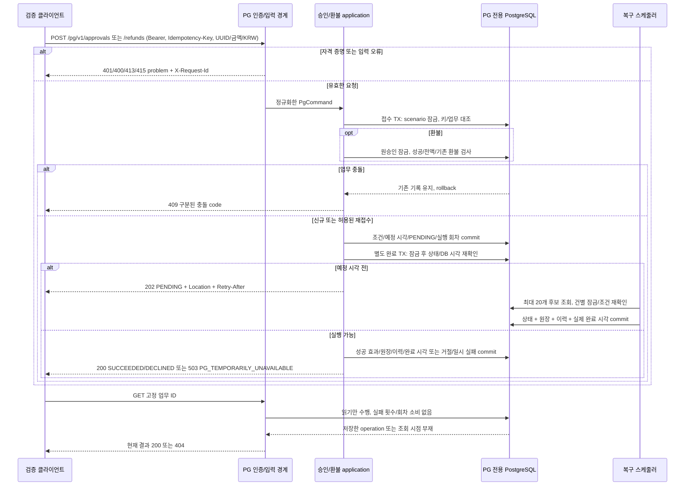
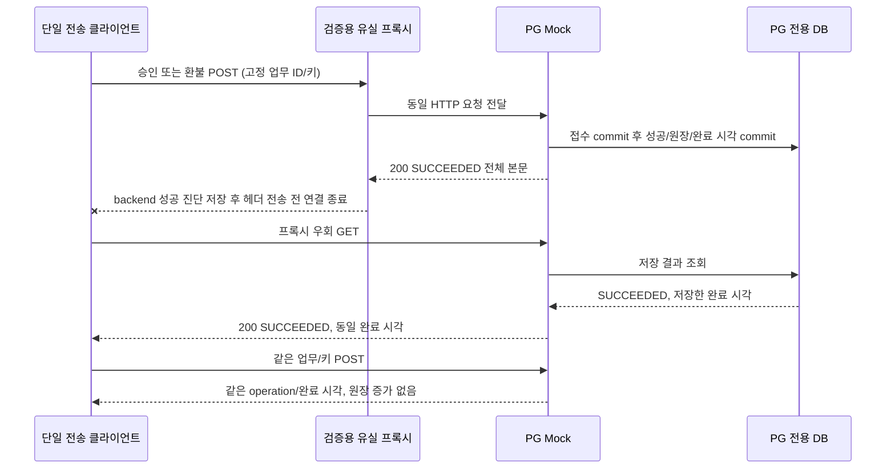

# 014. PG Mock 구현 기록

2026-11-28 KST · **로컬 구현·핵심 6개 사용자 작성·묶음 리뷰/활성 코드 재검증·임시 표식 정리 완료**. [채택한 계획](plan/014-pg-mock.md#execution-summary)

<a id="final-results"></a>

## 사용자 작성 코드 최종 결과

2026-11-28 KST 사용자가 6개 작성 완료와 PR 게시를 요청했다. 최신 main은 `8eb3ac8`로 동일하고 [main CI 성공](https://github.com/y0y00700/group-purchase/actions/runs/46041909583)을 다시 확인했다. PG 브랜치의 기존 원격 PR/브랜치가 없어 `feat/pg-mock`의 최초 PR을 준비했다.

- 6개 실행 본문을 묶음 리뷰해 기준 구현과 실행 토큰이 같음을 확인했다. 원본 사용자 소스를 `.tmp/014-user-review/user-source/`에 보존했다. 오류 수정 없이 학습용 표식/대기 예외 주석과 들여쓰기만 정리했으며, 정리 전후 실행 토큰이 같다. 정리한 6개 파일은 기준 소스와 파일 내용도 완전히 같다.
- 현재 소스로 전체 `build :pg-mock:crashProbeJar --no-daemon` **25초 통과**(54 tasks 중 3 실행/51 UP-TO-DATE). 이어 `:pg-mock:test --rerun-tasks --no-daemon`으로 **PG 25개를 캐시 없이 새 실행·51초 통과**, 실패/오류/skip 0. 변경 없는 136개 기존 결과와 합친 유효 결과는 161개이며 이번에 모두 새 실행했다고 표시하지 않는다.
- 현재 PG 이미지 build·전용 Compose 기동·HOST HTTP 6묶음을 새 실행했다. 정상/중복/업무·키 충돌/전액 환불/일시 실패 재접수/거절/두 지연/승인·환불 실제 응답 유실·조회/원장 대사를 통과했다. 프록시는 finally 정리, 전용 `group-purchase-014`는 down 종료했고 named volume 3개와 기존 진단을 보존했다.
- PG 소스/설정/검증 도구 **35개 파일 SHA-256**이 검증한 기준과 일치한다. 현재 컴파일한 클래스/리소스 **31개**가 제품 JAR과 같고 제품/probe JAR 해시도 기준과 같다. 따라서 기존 14묶음 전체 수명·Windows·DB 장애 분리·전체 down/up·기존 회귀 근거를 재사용한다. 상태/동시성/저장/복구 로직이 변하지 않아 무거운 전체 행렬을 다시 반복하지 않았다.
- 제품 JAR SHA-256 `9b3146ea2b93c96391ee57dafe4fd14a3051a729353eabeb4f942dff17920a6d`, probe JAR `3b5e6a69fb6330a36121b5eda3b2d467f462dae077fda1343bdbccf791af97f2`. 제품 JAR에 `com/example/pgprobe/` 클래스가 없음을 재확인했다. 임시 학습 표식/작성 대기 예외는 제품 소스에서 제거했다.

이번 실행 근거는 `.tmp/014-user-review/user-review.json`, `cleaned-review.json`, `verification.json`, `build.log`, `pg-tests-fresh.log`, `pg-image.log`, `compose.log`, `smoke.json`, `proxy.json` 또는 UUID별 proxy 진단, `smoke.log`, `down.log`다. 이전 기준 검증 기록은 아래 절에 보존한다. 다음은 [014 PR](https://github.com/y0y00700/group-purchase/pulls?q=is%3Apr+head%3Afeat%2Fpg-mock)의 원격 CI 결과 확인이며, 015는 별도 계획/요청으로 진행한다.

## 실제 변경

- 독립 Gradle `:pg-mock`을 `infrastructure/pg-mock`에 추가했다. Java 21·기존 Boot 4.0.9 BOM·MVC/JDBC/Flyway를 사용한다. 자체 YAML·고정 HTTP URL이며 Config/Eureka/Gateway/Kafka 의존성이 없다.
- 별도 PostgreSQL 18.6·`pg_mock` DB·`mock_pg_app` 제한 계정·전용 secret/볼륨을 추가했다. 기존 업무 DB bootstrap과 V1~V5는 수정하지 않는다. API/DB 호스트 포트는 기본 8082/55433, loopback이며 Compose 변수로 변경할 수 있다. native 앱도 기본 loopback 바인딩이다.
- 승인/전액 환불 POST와 고정 업무 ID GET을 제공한다. UUID/정수 원화/KRW·16~128자 키·엄격한 JSON·16KiB 본문 제한을 검사한다. API와 제어 Bearer 자격 증명, stateless·no-store·problem JSON·요청 ID 경계를 분리한다.
- 접수 트랜잭션은 scenario 잠금·키/업무 대조·원승인 잠금·PENDING/실행 회차/예정 시각/조건 바인딩을 저장한다. 완료 트랜잭션은 잠금 후 상태/예정 시각을 재확인해 상태·원장·이력·DB 완료 시각을 함께 커밋한다. 지연/전송은 트랜잭션 밖이다.
- 원승인당 환불 업무 하나를 접수 때부터 고정한다. 일시 실패는 기존 키/입력의 POST만 다음 회차로 접수한다. GET·중복 PENDING·복구 스케줄러는 실패 회차를 재접수하지 않는다. 복구는 500ms/최대 20건, pool 5·트랜잭션 2초·잠금 1초다.
- 기본 비활성 제어 API는 사전 scenario PUT/GET·업무별 대사만 제공한다. 바인딩 후 다른 조건은 409다. 대사는 최대 2개 operation, 독립 원장/실행 이력 커서, 기본 50/최대 100, numeric 금액 합계를 사용한다.
- 검증 전용 Python 프록시는 지정한 승인/환불의 첫 **200/SUCCEEDED 전체 본문**을 backend에서 받은 뒤 클라이언트 헤더를 보내기 전에 연결을 끊는다. 재시도하지 않는 HTTP 클라이언트로 EOF/reset과 직접 조회·원장 1건을 함께 검사한다.
- JSON 업무 이벤트/HTTP 로그, 유한 tag 지표·timer·대기 수/나이를 추가했다. health/probes는 익명·세부 비공개, info/metrics는 API 자격 증명으로 보호한다. 비밀값·키 원문·본문은 로그에 넣지 않는다.
- Compose는 상시 9개와 kafka-init exit 0이다. 기존 이미지 Dockerfile은 새 Gradle 프로젝트의 build.gradle을 포함한다. CI에 PG 빌드/이미지·작은 HTTP/실제 유실 smoke를 누적했고 기존 검사에 014 전용 프로젝트와 9 healthy 검사를 추가했다. 무거운 수명 행렬은 로컬 전용이다.

### 착수 기준과 조정

착수 시 미커밋 `Docs/README.md`, `Docs/handoff.md`, `Docs/implementation/README.md`, `Docs/implementation/plan/roadmap.md`와 새 014 계획을 확인했다. 변경 diff와 원래 계획을 `.tmp/014-baseline/preexisting.patch`, `original-plan.md`에 보존했다. PR #14 merged·최종 head `1bfdc9e`를 확인하고 fetch한 main **`8eb3ac8e759ae583c66dcf063cced32422bd9ff8`**에서 `feat/pg-mock`을 만들었다. 미커밋 문서를 유지했다. [main CI 성공](https://github.com/y0y00700/group-purchase/actions/runs/46041909583)을 착수 때 확인했다. 최초 요청은 로컬 기준 구현/작성 대기까지였다. 후속 요청으로 사용자 작성 리뷰·관련 재검증·정리를 마치고 `feat/pg-mock` → `main` PR 게시 범위까지 진행한다. 원격 CI 성공은 로컬 검증과 구분하며 PR 게시 뒤 완료 대기·반복 조회는 하지 않는다.

계획의 역할명 `pg_mock_app`은 PostgreSQL의 예약 접두사 때문에 생성할 수 없다. 실제 PostgreSQL 18.6 initdb가 이를 거절했고, [PostgreSQL 소스](https://doxygen.postgresql.org/user_8h.html)도 `pg_` 역할명 금지를 명시한다. 역할명만 **`mock_pg_app`**으로 조정했다. 대안 `pgmock_app`도 가능하지만 같은 제한 권한의 명칭 조정으로 해결했다. DB명·secret명·업무/API 계약·범위는 유지한다. Step 4는 완료를 지시하는 application 메서드 대신 실제 DB 시각/원장/이력을 저장하는 `JdbcPgStore.finish`로 정해 트랜잭션 핵심을 직접 작성하도록 했다.

HTTP 스택은 헤더 문법의 바깥 OWS를 파싱 과정에서 정규화한다. 애플리케이션은 키에 trim을 적용하지 않는다. 도메인에서 앞뒤 공백 키 거절, 실제 HTTP에서 내부 공백 키 거절을 각각 검사한다.

## HTTP 요청 흐름

아래는 사용자 작성·리뷰·재검증한 현재 활성 코드와 대조한 흐름이다.



제어 영역은 기본 404이며 명시적 활성화 시 별도 자격 증명을 요구한다. API 자격 증명으로 제어 호출은 403이다. 시나리오 PUT과 최초 접수는 같은 scenario 행 잠금으로 경합하고, 완료/복구는 원승인→환불 순서를 유지한다.



**503은 효과 없음 보장이 아니며 404는 조회 시점의 부재다.** 타임아웃 후 새 키/업무로 바꾸지 않는다. 결제 서비스의 결과 불명 추적은 015, 기한/Saga 판단은 016, 업무 운영 복구는 018이다.

<a id="verification"></a>

## 검증 기록

검증 중 생성한 로그·JSON·산출물·원래 문서는 `.tmp/014-baseline/`에 보존한다. 최초의 컴파일/초기화/검사 실패도 로그를 덮어쓰지 않고 구분한다. 최종 검증 수·해시·성공/미검증 구분은 이 절의 최종 기록을 따른다.

### 최종 기준 구현 결과

- 전체 `build :pg-mock:crashProbeJar :group-purchase-service:kafkaProbeJar :group-purchase-service:outboxProbeJar :group-purchase-service:inboxProbeJar --no-daemon` 통과: **11분 28초**, 54 tasks(12 실행/42 UP-TO-DATE). 이 실행에서 공동구매 93·PG 24를 새 실행했고 나머지 43개 결과를 재사용했다. `build.log`에 실제 task 상태를 남겼다.
- 추가 로그 검사에서 발견한 중복 JSON 키를 수정하고 `:pg-mock:build :pg-mock:crashProbeJar`, 새 로그 회귀를 포함한 `:pg-mock:build`를 수행했다. **PG 최종 25개 새 실행(환불 충돌 우선순위까지 추가 확인)·실패/오류/skip 0**. 최종 유효 결과는 **161개**(공동구매 93, 회원 14, Gateway 18, Config 3, Eureka 8, PG 25)이며 전부를 이번에 새 실행했다고 표시하지 않는다.
- 여섯 앱 이미지 빌드와 전용 **9 healthy/kafka-init exit 0**, 최종 PG 이미지 재빌드·HOST HTTP 6묶음·INTERNAL `http://pg-mock:8082` 승인/환불·HOST 재조회/대사 통과. Windows/Docker 제품의 클래스·리소스 **31개 내용 일치**와 제품 probe 클래스 부재를 검사했다.
- 최종 PG 이미지에서 기본 Compose의 **제어 404·control secret 미마운트·정상 승인**, 명시적 override에서 제어 활성화, JSON 로그의 requestId/route·실제 secret 미노출·지표 event/kind/status tag를 확인했다. 지표에 업무 ID/키 tag를 넣지 않는다.
- Windows 제품 JAR의 독립 기동·제어 secret 없는 비활성 기동·바인딩 PENDING/일시 실패 회차 재시작 유지, 같은 JVM에서 PG DB 중단/복구·readiness DOWN→UP·liveness UP·기존 시각/원장 불변을 확인했다. native `local` YAML/configtree의 실제 파일 주입도 별도 PowerShell 자식에서 검사했다.
- 수명 행렬 **14묶음** 통과. 승인/환불 각각 접수 커밋 전/후·완료 커밋 전/후의 **자식 JVM 강제 종료 8개**에서 접수 전 부재 또는 PENDING/완료 상태, 원장/회차 부분 저장 0·복구 후 효과 1건을 확인했다. 업무 DB만 중단해도 PG 승인/조회가 유지되고 복구 뒤 회원/Gateway 경로가 회복됐다. 제한 계정·다른 DB CONNECT 거절, 전용 전체 down/up 후 operation/원장/시각/키/조건/이력 보존·전역 원장/최신 회차 정합성 검사를 통과했다.
- 기존 Kafka 양쪽 리스너·제품 Outbox·Inbox·DB 권한/영속성·발견·Gateway·회원 Windows 제품 JAR/세션·공동구매 참여/취소·관측/동일 컨테이너 업무 DB 복구의 **9개 기존 스크립트**를 전용 014에서 실행해 통과했다. 검증이 만든 `verify.<runId>` 토픽/그룹·임의 fixture만 해당 스크립트가 정리했고 일반/013 데이터와 진단은 보존했다.
- 아래 PowerShell 승인/중복/두 충돌/환불 일시 실패/재접수/대사와 같은 요청을 `manual-http.ps1`로 실제 실행했다. 원장 2·이력 3과 고정 시각을 확인했다. PowerShell 지연 예시 전체를 따로 복사 실행한 것은 아니며 동일 의미의 두 지연/타임아웃/유실은 실제 Python HTTP 검사로 검증했다.

| 근거 | 위치 |
|---|---|
| 전체 build·최종 PG 25 | `.tmp/014-baseline/build.log`, `pg-refund-priority-build.log`, `test-results/` |
| 최종 HOST·실제 승인/환불 유실 | `smoke-contract-final.json`, `proxy*.json`, `smoke-contract-final.log` |
| Windows·DB/중단/전체 수명 | `lifecycle-contract-final.json`, `lifecycle-contract-final.log`, `lifecycle-f65b75ee/` |
| INTERNAL·기본 제어·로그/지표 | `extra-checks.json`, `extra-checks-contract-final.log`, `pg-compose-audit.log` |
| PowerShell·native local 파일 주입 | `manual-http.log`, `local-jar-final-ip-check.log`, `local-jar.out.log` |
| 기존 회귀 | `check-*.py.log`, 원본 실행별 `.tmp/kafka/`, `.tmp/outbox/`, `.tmp/inbox/` |
| 기준 소스/산출물·내용 해시 | `source/`, `artifacts/`, `baseline-manifest.json`, `learning-state.json` |
| 현재 작성 대기 상태·참고 본문 일치·컴파일 | `learning-state.json`, `waiting-compile-final.log`, `final-qa.json` |

기준 제품 JAR SHA-256은 `9b3146ea2b93c96391ee57dafe4fd14a3051a729353eabeb4f942dff17920a6d`, crash probe JAR은 `3b5e6a69fb6330a36121b5eda3b2d467f462dae077fda1343bdbccf791af97f2`다. Docker JAR은 `9b3146ea2b93c96391ee57dafe4fd14a3051a729353eabeb4f942dff17920a6d`, 보존 이미지 `group-purchase-014-pg-mock:baseline-20261128`은 `sha256:850ac3b2193f8ffebc5f87710fb86d44156f0579e60ecf00174b2c38cbbfa885`다. 모든 경로는 로컬 프로젝트 안이며 `.tmp`는 Git 제외 상태로 보존한다. 작성 대기 전환 뒤 현재 소스와 이 기준 산출물을 구분한다.

### 실패·수정·근거 재사용

초기 컴파일 오류(Exception/RuntimeException 관측 인자), PostgreSQL 예약 역할명, 새 Gradle 디렉터리를 복사하지 않은 기존 Dockerfile 빌드 실패, HTTP 클라이언트의 바깥 헤더 공백 정규화로 인한 잘못된 테스트를 수정했다. `compile.log`, `tests*.log`, `compose.log`에 최초 근거를 유지했다.

추가 관측 검사에서 MDC의 requestId와 명시적 key-value의 requestId가 중복되어 Logback JSON appender가 HTTP 완료 로그를 누락하는 문제를 발견했다. **MDC에서 한 번만 기록**하고 route는 문자열로 저장하도록 고쳤다. 실제 HTTP 이벤트의 MDC/route·중복 JSON 키 부재를 검사하는 회귀를 추가했다. `extra-checks.log`는 실패 근거, `pg-log-fix-final-build.log`와 `extra-checks-final.log`는 로그 수정 후 근거이며 최종 계약 보강은 `pg-refund-priority-build.log`로 구분한다.

최종 계약 대조에서 이미 접수된 환불 ID에 다른 키와 다른 원승인을 함께 보낼 때도 `BUSINESS_KEY_CONFLICT`를 먼저 반환하도록 불변 식별자 대조를 원승인 검사 앞으로 보강했다. 같은 키로 원승인을 바꾸면 `IDEMPOTENCY_CONFLICT`다. 이 두 경우를 통합 테스트에 추가하고 PG 25개 전체를 40초에 새 실행했다. 최종 소스/JAR/이미지에서 **14묶음 수명 행렬을 다시 전부 실행**했고 HOST/실제 유실·INTERNAL·기본 제어·로그/지표·native/PowerShell도 확인했다. 앞선 실행·로그 수정 전 source/JAR/manifest와 재사용 분석은 별도 보존하며 최종 행렬 근거와 구분한다. native local 검사의 첫 실패는 PowerShell 검증 스크립트가 제거하려던 환경변수를 빈 값으로 남긴 원인이었으며 `Remove-Item Env:`로 고쳤다. 이 PC의 native PowerShell localhost 조회는 기한을 넘겼고 같은 JAR의 127.0.0.1 조회는 통과했으므로 native 안내에는 명시적 loopback IPv4를 사용한다.

### 미완료·미검증

- 원격 CI 성공은 아직 확정하지 않는다. PR 게시 뒤 한 번 확인한 상태와 최종 head/Checks 링크를 최종 응답으로 안내하고 완료를 기다리거나 반복 조회하지 않는다.
- DB COMMIT ACK 자체를 네트워크 프록시로 없애는 별도 검사는 하지 않았다. 저장 원자성은 실제 SQL 트랜잭션의 커밋 전후 JVM 종료·롤백·DB 중단/복구로 확인했다. 실제 HTTP 성공 응답 유실은 승인/환불 모두 확인했다.
- 문서의 모든 PowerShell 문장을 별도 수동 복사 실행한 것은 아니다. 실제 실행한 요청 블록/자동 검증·native 기동과 사용자가 재현할 절차를 위에서 구분했다.
- 실제 PG·카드·결제 서비스 결과 불명 추적(015)·Saga/기한 판정(016)·운영 복구(018)·운영 부하/알림은 이번 범위에 포함하지 않았다.

<a id="guided-coding"></a>

## 핵심 6개 직접 작성

사용자가 아래 6개 본문을 작성한 뒤 묶음 리뷰했다. 실행 토큰은 기준 구현과 같았고 오류가 없었다. 사용자 실행 코드를 보존하며 학습용 참고 표식·주석 처리한 대기 예외·호출 흐름 임시 주석과 들여쓰기를 정리했다. 유지할 설명은 [적용 설명](../explanations/pg-mock.md)에 모았다. 아래 표식은 이력이며 제품 코드에는 남기지 않는다.

| 순서 | 파일/메서드 | 확인할 핵심 |
|---|---|---|
| 1 | [PgOperation.match](../../infrastructure/pg-mock/src/main/java/com/example/pgmock/domain/PgOperation.java) · LEARN-01 | 키/업무/정규화 입력 대조, 충돌 종류 |
| 2 | [AcceptApproval.accept](../../infrastructure/pg-mock/src/main/java/com/example/pgmock/application/AcceptApproval.java) · LEARN-02 | scenario 잠금·바인딩·키/업무 이중 식별·짧은 접수 TX |
| 3 | [AcceptRefund.accept](../../infrastructure/pg-mock/src/main/java/com/example/pgmock/application/AcceptRefund.java) · LEARN-03 | 원승인 잠금·성공/전액 검사·한 환불 업무 |
| 4 | [JdbcPgStore.finish](../../infrastructure/pg-mock/src/main/java/com/example/pgmock/infrastructure/JdbcPgStore.java) · LEARN-04 | 잠금 후 DB 시각·회차/효과·상태/원장/이력 원자성 |
| 5 | [RetryPgOperation.retryOrReturn](../../infrastructure/pg-mock/src/main/java/com/example/pgmock/application/RetryPgOperation.java) · LEARN-05 | 같은 입력만 RETRYABLE_FAILURE에서 다음 회차, 확정 상태 유지 |
| 6 | [RecoverPendingOperations.recover](../../infrastructure/pg-mock/src/main/java/com/example/pgmock/application/RecoverPendingOperations.java) · LEARN-06 | 유한 후보 조회·건별 실패 격리·완료 시 재확인·다음 주기 복구 |

6개 작성·묶음 리뷰·관련 재검증·임시 표식 정리를 완료했다. 테스트를 skip하거나 placeholder를 우회하지 않았으며 제품 소스에는 작성 대기 예외/표식이 없다.

<a id="manual-tests"></a>

## 사용자 직접 테스트

PowerShell·Docker Desktop Linux 엔진·Python 3·JDK 21이 필요하다. 작업 디렉터리는 `C:\Users\권민혁\Desktop\공부\개인프로젝트\group-purchase`다. 전용 프로젝트 `group-purchase-014`만 사용하며 5432/55433/8000/8080/8081/8082/8761/8888/9092가 다른 환경에서 사용 중이면 먼저 포트 충돌을 해결한다. 기존 환경을 중단하지 않는다. 비밀값 파일은 준비 스크립트가 이미 있으면 보존한다.

### 현재 활성 소스의 Compose 기동

현재 활성 소스로 이미지를 빌드한다. 전체 스택이 필요 없으면 아래처럼 `pg-mock-postgres pg-mock`만 기동한다. 최초 기준 소스/JAR/이미지는 로컬 진단에 보존하지만 현재 실행 절차는 `.tmp` 기준 산출물에 의존하지 않는다.

```powershell
Set-Location 'C:\Users\권민혁\Desktop\공부\개인프로젝트\group-purchase'
.\scripts\prepare-local-secrets.ps1
$env:COMPOSE_PROJECT_NAME = 'group-purchase-014'
# 기본 제어 비활성: secret 마운트 없이 404를 먼저 확인한다.
$env:COMPOSE_FILE = 'compose.yml'
docker compose up -d --build --wait --wait-timeout 180 pg-mock-postgres pg-mock
curl.exe --silent -o NUL -w '%{http_code}' http://localhost:8082/__admin/v1/scenarios/APPROVAL/00000000-0000-0000-0000-000000000001
# 위 결과 404. 아래에서 검증 환경의 제어를 명시적으로 켠다.
$env:COMPOSE_FILE = 'compose.yml;infrastructure/pg-mock/compose-verification.yml'
docker compose up -d --no-build --wait --wait-timeout 180 pg-mock-postgres pg-mock
if ($LASTEXITCODE -ne 0) { throw 'PG 기동 실패: docker compose logs --tail=100 pg-mock pg-mock-postgres 확인' }
Invoke-RestMethod http://localhost:8082/actuator/health/readiness
python scripts/check-pg-mock.py --output .tmp/014-manual-smoke.json
```

스모크는 인증·정상/중복/충돌·전액 환불·일시 실패 재접수·거절·두 지연 경계·승인/환불 실제 응답 유실을 검사한다. 새 UUID 거래와 대사 기록은 남기고, 자신의 프록시 자식만 finally에서 종료한다. 일반 Compose는 제어 secret을 마운트하지 않으며, 위 verification override에서만 제어를 켠다.

### PowerShell로 승인·충돌·전액 환불·대사

```powershell
$base = 'http://localhost:8082'
$api = (Get-Content -Raw secrets/pg_mock_api_credential).TrimEnd("`r", "`n")
$control = (Get-Content -Raw secrets/pg_mock_control_credential).TrimEnd("`r", "`n")
$payment = [guid]::NewGuid().ToString()
$refund = [guid]::NewGuid().ToString()
$headers = @{ Authorization = "Bearer $api"; 'Idempotency-Key' = "approve:$payment" }
$body = @{ paymentAttemptId=$payment; amount=1000; currency='KRW' } | ConvertTo-Json -Compress
$first = Invoke-RestMethod "$base/pg/v1/approvals" -Method Post -ContentType application/json -Headers $headers -Body $body
$again = Invoke-RestMethod "$base/pg/v1/approvals" -Method Post -ContentType application/json -Headers $headers -Body $body
if ($first.status -ne 'SUCCEEDED' -or $first.operationId -ne $again.operationId -or $first.approvedAt -ne $again.approvedAt) { throw '승인 멱등성 실패' }

# 금액 변경: 409 IDEMPOTENCY_CONFLICT. 기존 승인/원장 유지.
$changed = @{ paymentAttemptId=$payment; amount=1001; currency='KRW' } | ConvertTo-Json -Compress
try { Invoke-RestMethod "$base/pg/v1/approvals" -Method Post -ContentType application/json -Headers $headers -Body $changed; throw '409가 필요함' }
catch { if (-not $_.Exception.Response -or [int]$_.Exception.Response.StatusCode -ne 409) { throw }; $_.ErrorDetails.Message }
# 같은 업무·다른 키: 409 BUSINESS_KEY_CONFLICT.
$otherKey = @{ Authorization="Bearer $api"; 'Idempotency-Key'="other:$payment" }
try { Invoke-RestMethod "$base/pg/v1/approvals" -Method Post -ContentType application/json -Headers $otherKey -Body $body; throw '409가 필요함' }
catch { if (-not $_.Exception.Response -or [int]$_.Exception.Response.StatusCode -ne 409) { throw }; $_.ErrorDetails.Message }

# 환불 일시 실패를 최초 접수 전에 바인딩.
$admin = @{ Authorization="Bearer $control" }
$scenario = @{ processingDelayMs=0; firstResponseDelayMs=0; approvalDecision='APPROVE'; transientFailures=1 } | ConvertTo-Json -Compress
Invoke-RestMethod "$base/__admin/v1/scenarios/REFUND/$refund" -Method Put -ContentType application/json -Headers $admin -Body $scenario
$refundHeaders = @{ Authorization="Bearer $api"; 'Idempotency-Key'="refund:$refund" }
$refundBody = @{ refundId=$refund; paymentAttemptId=$payment; amount=1000; currency='KRW' } | ConvertTo-Json -Compress
try { Invoke-RestMethod "$base/pg/v1/refunds" -Method Post -ContentType application/json -Headers $refundHeaders -Body $refundBody; throw '503이 필요함' }
catch { if (-not $_.Exception.Response -or [int]$_.Exception.Response.StatusCode -ne 503) { throw }; $_.ErrorDetails.Message }
$failed = Invoke-RestMethod "$base/pg/v1/refunds/$refund" -Headers @{Authorization="Bearer $api"}
if ($failed.status -ne 'RETRYABLE_FAILURE' -or $null -ne $failed.refundedAt) { throw '일시 실패 상태 오류' }
$refunded = Invoke-RestMethod "$base/pg/v1/refunds" -Method Post -ContentType application/json -Headers $refundHeaders -Body $refundBody
$refundAgain = Invoke-RestMethod "$base/pg/v1/refunds" -Method Post -ContentType application/json -Headers $refundHeaders -Body $refundBody
if ($refunded.status -ne 'SUCCEEDED' -or $refunded.operationId -ne $refundAgain.operationId -or $refunded.refundedAt -ne $refundAgain.refundedAt) { throw '환불 멱등성 실패' }
$audit = Invoke-RestMethod "$base/__admin/v1/transactions?paymentAttemptId=$payment" -Headers $admin
if ($audit.ledger.Count -ne 2 -or $audit.attempts.Count -ne 3) { throw '원장/회차 대사 실패' }
$audit | ConvertTo-Json -Depth 8
```

승인·환불 원장 각 1건/1000원, 실행 이력 승인 1+환불 2, 승인 `approvedAt`과 환불 `refundedAt`은 각각 재조회/재요청에서 동일해야 한다. 원승인은 환불 후에도 SUCCEEDED다. 다른 환불 ID는 `FULL_REFUND_ALREADY_REGISTERED`, 금액 불일치는 `REFUND_AMOUNT_MISMATCH`로 접수를 거절한다.

### 지연·인증·실제 유실

```powershell
# 승인 전 타임아웃: 서버는 접수하고 나중에 성공할 수 있다.
$slow = [guid]::NewGuid().ToString()
$scenario = @{processingDelayMs=3000; firstResponseDelayMs=4000; approvalDecision='APPROVE'; transientFailures=0} | ConvertTo-Json -Compress
Invoke-RestMethod "$base/__admin/v1/scenarios/APPROVAL/$slow" -Method Put -Headers $admin -ContentType application/json -Body $scenario
$slowBody = @{paymentAttemptId=$slow; amount=1000; currency='KRW'} | ConvertTo-Json -Compress
$slowHeaders = @{Authorization="Bearer $api"; 'Idempotency-Key'="approve:$slow"}
try { Invoke-RestMethod "$base/pg/v1/approvals" -Method Post -Headers $slowHeaders -ContentType application/json -Body $slowBody -TimeoutSec 1 }
catch { '클라이언트 타임아웃: 실패 확정 아님' }
Start-Sleep -Seconds 5
Invoke-RestMethod "$base/pg/v1/approvals/$slow" -Headers @{Authorization="Bearer $api"}

# 인증 없음 401, API 자격 증명의 제어 호출 403.
curl.exe --silent -o NUL -w '%{http_code}' "$base/pg/v1/approvals/$slow"
curl.exe --silent -o NUL -w '%{http_code}' -H "Authorization: Bearer $api" "$base/__admin/v1/transactions?paymentAttemptId=$slow"

# 실제 유실은 아래 자동 smoke가 임시 loopback 프록시를 기동/종료해 둘 다 검증한다.
python scripts/check-pg-mock.py --base $base --output .tmp/014-manual-loss.json
if ($LASTEXITCODE -ne 0) { throw '유실 검증 실패: JSON/로그 확인' }
```

승인 후 응답 타임아웃은 새 UUID의 scenario를 `processingDelayMs=0`, `firstResponseDelayMs=4000`으로 바꾸어 같은 절차를 따른다. 첫 클라이언트가 타임아웃한 직후 GET에서 이미 SUCCEEDED여야 하고 원장은 1건이다. 바인딩 후 기존 UUID의 조건을 바꾸면 409이므로 항상 새 UUID로 실험한다. 거절은 새 승인 scenario의 `approvalDecision=DECLINE`, 지연/실패 0으로 설정하면 200/DECLINED·원장 0건이다.

### Windows 제품 JAR와 무거운 복구 행렬

기준 JAR은 `.tmp/014-baseline/artifacts/`에 보존한다. 아래는 현재 활성 소스의 제품 JAR을 빌드해 실행한다. 단독 JAR은 local 프로필에서 `secrets` configtree를 읽고 전용 DB만 필요하다. 아래는 별도 터미널의 foreground 실행이며 Ctrl+C로 종료한다.

```powershell
$env:JAVA_HOME = 'C:\Users\권민혁\.jdks\ms-21.0.12.1' # 본인의 JDK 21 경로
.\gradlew.bat :pg-mock:bootJar --no-daemon
if ($LASTEXITCODE -ne 0) { throw 'PG JAR build 실패' }
$savedPort = $env:PG_MOCK_PORT
try {
    $env:PG_MOCK_PORT = '18084'
    & "$env:JAVA_HOME\bin\java.exe" -jar infrastructure/pg-mock/build/libs/pg-mock-0.0.1-SNAPSHOT.jar
} finally { $env:PG_MOCK_PORT = $savedPort }
```

다른 터미널에서 `Invoke-RestMethod http://127.0.0.1:18084/actuator/health/readiness`와 API 자격 증명의 업무 요청을 사용한다. 기본 제어 404다. 제어가 필요한 자동 수명 검사는 자체 자식 환경에만 명시적으로 켠다.

추후 상태 전이·저장·복구 로직이나 환경을 바꾸면 최신 활성 소스의 전체 행렬은 다음과 같이 실행한다. 이 스크립트는 전용 014 앱/PG DB/업무 DB 중단과 전체 down/up, 자신이 만든 자식 JVM 강제 종료를 수행한다. 일반 프로젝트에는 실행을 거부하며 볼륨을 삭제하지 않는다. 안정된 거래·시각·키·시나리오·회차를 비교하고 실패 시 진단 경로를 남긴다.

```powershell
.\gradlew.bat build :pg-mock:crashProbeJar --no-daemon
if ($LASTEXITCODE -ne 0) { throw 'build 실패' }
$env:COMPOSE_FILE = 'compose.yml;infrastructure/pg-mock/compose-verification.yml'
docker compose up -d --build --wait --wait-timeout 240
python scripts/check-pg-mock-lifecycle.py --project group-purchase-014 --output .tmp/014-user-lifecycle.json
if ($LASTEXITCODE -ne 0) { throw '수명 검사 실패: 출력의 진단 경로 확인' }
```

### 종료·복구

```powershell
# 실패한 수명 검사 뒤 같은 전용 DB·앱을 원복하고 확인한다.
docker compose start pg-mock-postgres postgres
docker compose up -d --no-build --wait --wait-timeout 180 pg-mock
docker compose logs --no-color --tail=100 pg-mock pg-mock-postgres
# 이 프로젝트의 컨테이너·네트워크 종료, PG/업무 DB·Kafka 볼륨 보존.
docker compose down
Remove-Item Env:COMPOSE_PROJECT_NAME -ErrorAction SilentlyContinue
Remove-Item Env:COMPOSE_FILE -ErrorAction SilentlyContinue
```

시작 전에 같은 환경변수가 있었다면 삭제 대신 원래 값으로 돌린다. 프록시와 JAR 자동 검사는 자신이 시작한 자식만 finally에서 종료한다. `--wait`에는 상한이 있으며 조회 루프/프로세스 대기도 유한하다. native 수동 실행은 Ctrl+C다. `down -v`, volume prune, 일반 프로젝트/DB 초기화는 이 절차에 없다. PG 거래·시나리오·이력과 검증 자료는 남긴다. 이미 사용한 업무를 초기화된 DB에 재전송하는 보장은 없다.

## 적용 설명과 남은 작업

[PG Mock의 기본 개념·프로젝트 역할·실제 적용 예시](../explanations/pg-mock.md). 사용자 작성·리뷰/재검증·임시 표식 정리를 완료했다. 이번 단계가 결제 서비스나 Saga의 결과 불명 복구까지 구현한 것은 아니다.

종료 상태: 마지막 9 healthy/init exit 0 상태를 `final-compose-state.json`에 기록한 뒤 전용 `group-purchase-014`를 **down**으로 종료했다. `pg-mock-postgres-data`, `postgres-data`, `kafka-data` named volume과 모든 진단을 보존했다. 작성 대기 당시에는 컴파일만 확인했다. 현재 활성 코드 검증은 아래 최종 결과가 소유한다.
