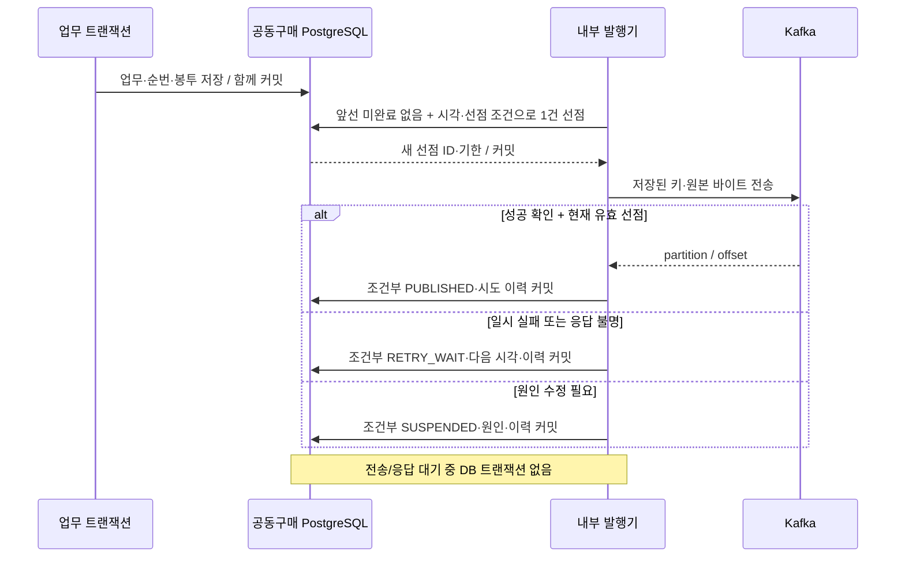

# 012. Outbox 발행 계획

작성일 2026-11-25 KST · 상태 **완료 / 사용자 코드 관련 검증 완료**

2026-11-25 사용자 요청으로 이 계획의 추천값·저장 모델·검증 연결에 진행 합의하고 구현에 착수했다. 미커밋 계획·안내 문서와 기존 학습 기록을 보존했다. PR #12 병합 및 head `2e4bd22` CI 성공, 최신 main `85f7be7`의 Build/Compose CI 성공을 확인했다([main CI](https://github.com/y0y00700/group-purchase/actions/runs/45431750385)). `origin/main`에서 `feat/outbox-publishing`을 만들었다. 착수 당시 push·PR 생성은 요청 범위 밖이었으며, 로컬 완료 후 별도 요청으로 [PR #13](https://github.com/y0y00700/group-purchase/pull/13)을 생성했다. 실제 변경·검증·PR 근거는 [012 결과](../012-outbox-publishing.md)에 기록한다.

하위 상태: **기준 구현 검증 완료 → 사용자 작성 → 묶음 리뷰·관련 재검증·임시 표식 정리 완료**. 여섯 구간을 마쳤으며 현재 제품 소스에 작성 대기 예외가 없다. 실제 근거는 [012 최종 결과](../012-outbox-publishing.md#final-results)를 따른다. 제품의 기본 정책은 유지했고 공동구매 Compose 종료 유예는 70초다. 강제 종료 검사의 선점 단축은 검증 도구에만 적용한다.

처음 읽을 때: [Outbox를 보낼 편지함으로 이해하는 입문 설명](../../learning/questions/outbox-012-plan-explained.md)

## 실행 요약

- 목표는 업무 변경과 발행할 메시지를 같은 PostgreSQL 트랜잭션으로 저장하고, 서비스 내부 발행기가 Kafka 전달을 재개할 수 있게 하는 것이다.
- 기존 합의인 서비스별 Outbox 소유권, DB 폴링, 선점 ID·기한, 결제 시도·전달 방향별 순번, 앞 메시지 완료 후 다음 선점을 유지한다.
- 폴링 초기값은 **10초 간격·회차당 최대 50건**, 재시도 대기 상한은 **60초**다. 아래 세부값을 포함해 진행 합의했다.
- 첫 적용 위치는 공동구매 서비스다. 회원·결제·알림 서비스나 공유 메시지 모듈을 새로 만들지 않는다.
- 제품에는 Outbox 저장 어댑터·내부 스케줄러·Kafka 발행기를 추가한다. 기존 참여 신청·취소 API에서 임시 결제·알림 메시지를 생성하지 않는다.
- 아직 결제 접수·시도 엔티티가 없으므로, 업무와 Outbox의 원자성은 격리 테스트의 조합 서비스에서 기존 참여 처리를 호출해 검증한다. 실제 결제 접수 연결은 016이다.
- 업무 저장 호출은 기존 트랜잭션에 필수로 참여한다. 저장·순번 증가·봉투 직렬화·Outbox INSERT 중 하나라도 실패하면 모두 롤백한다.
- `app.outbox_streams`, `app.outbox_messages`, `app.outbox_delivery_attempts`를 새 Flyway `V4`로 추가한다. 기존 V1~V3와 업무 스키마는 보존한다.
- 결제 명령은 시도·방향별 순번을 부여하고, 알림은 011 계약대로 순번을 넣지 않는다. 봉투는 011 `MessageCodec`으로 검증한 바이트를 그대로 저장·재발행한다.
- 발행기는 짧은 DB 트랜잭션에서 한 건씩 선점한다. Kafka를 기다리는 동안 DB 연결·트랜잭션·행 잠금을 보유하지 않는다.
- 같은 시도의 앞선 미완료 메시지가 있으면 후속 메시지를 선점하지 않는다. 다른 시도·알림은 자신의 조건을 만족하면 진행할 수 있다.
- 선점 기한은 초기 60초, 인스턴스당 전송 작업은 1개로 추천한다. 한꺼번에 50건을 선점해 전송 대기열에 쌓지 않는다.
- 성공·실패 반영은 현재 선점 ID와 유효 기한을 조건으로 갱신한다. 만료·재선점 이후 이전 담당자의 늦은 반영은 0건으로 끝낸다.
- Kafka 성공 확인 뒤 완료 저장 전 중단은 같은 메시지 ID·순번·원본 바이트의 재발행으로 복구한다. 중복 전달은 가능하며 소비 업무 중복 방지는 013 이후의 책임이다.
- 일시 장애·발행 여부 불명은 영속 재시도, 원인 수정이 필요한 오류는 영속 중단으로 구분한다. 중단된 메시지를 자동 완료하거나 후속 메시지를 먼저 보내지 않는다.
- 011에서 검증 JAR에만 있던 `kafka-clients`를 제품 의존성으로 옮기고, 제품 JAR 검사도 실제 발행기 포함·검증 도구 제외 기준으로 변경한다.
- PostgreSQL·Kafka 통합 테스트, 두 발행기 경합, 실제 프로세스 중단·재시작, Compose·Windows 제품 JAR를 검증한다. 테스트 데이터는 격리 DB·브로커에만 넣는다.
- 기준 구현 검증 후 핵심 여섯 구간을 한 번에 직접 작성하도록 준비한다. 사용자 작성·묶음 리뷰·관련 재검증·임시 표식 정리까지 마쳐야 완료다.
- 결과·직접 테스트 방법은 구현 뒤 같은 번호의 결과 문서에, 적용 설명은 `Docs/explanations/outbox-publishing.md`에 기록한다.
- 기준 구현·필수 검증·여섯 구간 작성 준비·결과와 인계 갱신까지 진행한다. 사용자 작성 구간을 대신 채우지 않으며 push·PR은 별도 요청을 따른다.

## 출발점과 원격 확인 시점

001~011의 로컬 구현·사용자 작성·관련 검증은 완료했다. 계획 작성 당시 읽은 로컬 브랜치는 `feat/kafka-message-contract`, HEAD는 `2e4bd22`였다. 이후 미커밋 계획·안내 문서를 보존한 채 위 착수 기록대로 최신 main 기반 브랜치를 만들었다. [011 최종 결과](../011-kafka-message-contract.md#final-results) · [최신 인계](../../handoff.md)

계획 작성 때에는 **2026-11-24 인계 기록**만 읽었으며 당시 PR #12 Checks 결과는 미확인이었다. 2026-11-25 구현 착수 때 최신 PR/main/head CI와 로컬 변경을 조회해 병합·성공을 확인했다. 현재 기준 브랜치는 위 착수 기록, 실제 조회 근거는 [012 결과](../012-outbox-publishing.md)를 따른다.

현재 `ChangeParticipation`은 READ COMMITTED 트랜잭션 안에서 공동구매 잠금·참여·모집 수량·요청 멱등성을 처리한다. 메시지 공통 봉투는 `infrastructure/messaging`에 있지만 `KafkaProducer`는 별도 `kafkaProbe` source set에만 있다. 현재 제품에는 Outbox 테이블·스케줄러·Kafka 발행 의존성이 없다.

## 범위와 후속 단계

| 구분 | 이번 단계의 경계 |
|---|---|
| 포함 | Outbox 저장 포트·JDBC 어댑터, 순번 할당, 원자성, 선점·재선점, 전송·완료 기록, 재시도·중단, 발행 시도 이력, 내부 스케줄러 |
| 업무 연결 검증 | 테스트 전용 조합 서비스가 기존 참여 처리를 호출하고 표본 Outbox를 함께 저장. 제품 HTTP 흐름의 메시지 생성은 추가하지 않음 |
| 013 | 소비 처리 기록·업무 중복 방지·DB 커밋 후 오프셋·DLT·파티션 보류 |
| 014~017 | PG Mock, 결제 업무별 본문과 상태, 실제 결제 접수·Saga·환불·알림 전달 |
| 018~019 | 운영자 조회·중단 해제 API·권한·조작 이력, 공통 장애 묶음, Prometheus/Grafana·운영 알림 |

012에서는 중단 상태와 원인을 영속화하고 조회 SQL·구조화 로그를 제공한다. 원인 수정 후 제품에서 중단을 해제하는 운영 절차는 018에서 구현한다. 012 직접 테스트는 격리 데이터의 중단 보존을 확인하며, 일반 DB를 수동 UPDATE해 재개하는 방법을 정상 운영 절차로 안내하지 않는다.

## 저장 경계와 코드 배치

`outbox/application`에 `StoreOutgoingMessage` 포트와 순수 Java 입력·반환 자료형을 둔다. 입력은 메시지 종류·업무 연결 ID·추적 ID·원인 ID·업무 본문이며 Kafka 토픽명이나 선점 정보를 외부 입력으로 받지 않는다. 본문은 JSON 라이브러리에 의존하지 않는 Java 값으로 전달한다. 기존 `purchase`·`participation` 도메인에 Kafka·Jackson·JDBC 의존성을 추가하지 않는다.

`outbox/infrastructure`는 JDBC 저장·조회·선점과 011 봉투 매핑을, `infrastructure/messaging`은 Kafka 전송을, `config`는 설정·스케줄링 연결을 맡는다. 봉투 생성·직렬화는 어댑터의 책임이다. 이미 저장된 봉투를 발행 때 현재 업무 데이터로 다시 만들지 않는다.

저장 어댑터는 기존 업무와 **같은 DataSource·트랜잭션 매니저**를 사용하고 트랜잭션이 없으면 실패한다. `MANDATORY` 전파 또는 동등한 명시 검사로 강제하며 자체 트랜잭션을 열어 독립 커밋하지 않는다. 반대로 선점·결과 기록은 요청 트랜잭션과 분리된 짧은 트랜잭션이다. 발행 루프 전체에 `@Transactional`을 붙이지 않는다.

메시지 ID는 최초 저장 때 UUID로 만들고 반환한다. 호출자는 해당 업무·HTTP 멱등성 기록과 함께 생성 여부를 관리해야 한다. Outbox는 같은 업무를 서로 다른 메시지 ID로 두 번 저장한 것을 자동으로 업무 중복이라 판단하지 않는다. 이미 사용한 메시지 ID의 충돌도 무조건 무시하지 않는다.

### 최초 저장 순서

1. 호출한 업무가 기존 잠금 순서로 조건·멱등성을 판단하고 업무 데이터를 변경한다.
2. 결제 명령이면 같은 트랜잭션에서 해당 시도·방향의 순번 행을 확보하고 다음 순번을 할당한다.
3. 메시지 ID·UTC 마이크로초 시각·추적·문맥·순번·본문으로 봉투를 구성하고 011 계약으로 검증한다.
4. 논리 토픽·키·메타데이터와 직렬화한 원본 바이트를 저장한다. 공동구매 서비스는 결제 명령·알림 의뢰만 저장하며 결제 결과의 발행 소유권을 갖지 않는다.
5. 업무·요청 멱등성·순번·Outbox를 함께 커밋한다. 직렬화·검증·INSERT·업무 후속 저장 실패는 전체 롤백이다.

업무 잠금을 먼저, 순번 행을 나중에 잠근다. 한 트랜잭션에서 여러 순번 행이 필요하면 방향·시도 ID의 고정된 순서로 접근한다. 발행기는 업무 행을 잠그지 않는다.

## DB 모델과 순번

| 테이블 | 주요 정보·제약 |
|---|---|
| `app.outbox_streams` | `(direction, payment_attempt_id)` 복합 PK, `last_sequence bigint >= 0`. 공동구매에서 시작하는 방향은 `PAYMENT_COMMANDS` |
| `app.outbox_messages` | `message_id uuid` PK, 종류·논리 토픽·키·업무/추적 연결, 방향·시도 ID·순번, 봉투 `bytea`, 생성 시각, 상태, 다음 시도 시각, 선점 ID·기한, 선점 횟수·재시도 횟수, 최초/최근 실패, 발행 시각·Kafka partition/offset |
| `app.outbox_delivery_attempts` | `claim_id uuid` PK, 메시지 FK, 선점 차수·시작/기한·종료 시각, 결과·오류 코드·Kafka 위치. 선점과 결과 갱신에 맞춰 남기는 이력 |

결제 명령의 방향·시도·순번은 모두 필수이며 순번은 1 이상이다. `(direction, payment_attempt_id, sequence)`에 유일성을 둔다. 알림은 이 세 필드를 NULL로 두고 `groupPurchaseId`를 키로 사용한다. 두 형태를 CHECK로 구분하고 봉투와 저장 메타데이터도 저장 직전 비교한다. 결제 결과 방향은 해당 서비스를 구현할 때 그 서비스 소유 DB에 적용한다.

순번 행은 `INSERT ... ON CONFLICT DO NOTHING`으로 준비한 다음 같은 트랜잭션의 `UPDATE ... RETURNING`으로 증가·회수한다. 같은 스트림의 동시 생성은 행 잠금으로 직렬화되고 롤백 시 증가도 취소된다. `MAX(sequence)+1` 조회나 PostgreSQL SEQUENCE 객체로 업무 순서를 대신하지 않는다. bigint 상한 도달은 롤백·명시 오류로 처리한다.

발행 상태·선점 정보의 일관성, 64 KiB 원본 크기, 양수 순번과 비음수 횟수에 제약을 둔다. 선점/재시도 조회용 인덱스와 `status <> 'PUBLISHED'`인 스트림의 앞 메시지 탐색용 인덱스를 둔다. 원본·업무 연결·순번은 생성 후 바꾸지 않으며 초기 자동 삭제는 없다. [기존 보관 기준](../../design/operations.md#operating-values)

모든 관리 시각은 `timestamptz(6)`로 저장한다. 선점·만료·재시도 비교는 PostgreSQL 시각을 사용하고 한 SQL 안의 기준 시각은 한 번 평가해 사용한다. 애플리케이션 서버 시각으로 선점 권한을 판단하지 않는다. 시간 함수의 차이는 [PostgreSQL 18 시각 함수](https://www.postgresql.org/docs/18/functions-datetime.html#FUNCTIONS-DATETIME-CURRENT)를 확인했다.

## 상태와 발행 흐름

| 상태 | 뜻·다음 처리 |
|---|---|
| `READY` | 저장 완료, 순서·시각 조건을 만족하면 선점 가능 |
| `IN_FLIGHT` | 선점 ID·기한 보유. 유효 기한 동안 다른 발행기는 제외 |
| `RETRY_WAIT` | 일시 실패·발행 여부 불명. `next_attempt_at` 이후 선점 가능 |
| `SUSPENDED` | 원인 수정 필요. 자동 선점 제외·후속 순번 차단 유지 |
| `PUBLISHED` | Kafka 성공 확인과 현재 선점의 완료 기록 커밋. 소비 업무 완료를 뜻하지 않음 |

### 선점과 후속 순번 차단

READ COMMITTED의 짧은 트랜잭션에서 후보를 `FOR UPDATE SKIP LOCKED`로 한 건 잠그고 조건을 확인해 갱신한다. 조회와 갱신은 같은 트랜잭션에서 수행하며, 대기열에서 행 잠금 경합을 피하는 선택으로 사용한다. [PostgreSQL 18 잠금 절](https://www.postgresql.org/docs/18/sql-select.html#SQL-FOR-UPDATE-SHARE)

- `READY`, 시각이 된 `RETRY_WAIT`, 기한이 지난 `IN_FLIGHT`만 후보로 삼는다. 재시도 대기·영속 중단을 기한 만료로 우회하지 않는다.
- 결제 명령은 같은 시도·방향에서 더 낮은 순번의 **모든 미완료 상태**가 없는지 `NOT EXISTS`로 확인한다. 앞 행이 잠겨 `SKIP LOCKED`로 제외되어도 후속 행은 이 조건으로 차단한다.
- 새 선점 ID·DB 시각 기준 기한·선점 횟수를 저장하고 같은 트랜잭션에서 시도 이력을 시작한다. 재선점이면 이전 미종료 시도를 만료 처리한다.
- 후보 정렬은 다음 시도 시각·생성 시각·메시지 ID를 사용한다. 다른 시도는 독립 선점할 수 있지만 전역 FIFO·공정성·처리시간을 보장한다고 표시하지 않는다.
- 선점을 커밋한 뒤 한 건을 전송하고 결과를 기록한 다음 다음 건을 선점한다. 회차당 최대 50건이며 기한을 가진 50건을 먼저 확보하지 않는다.

순번의 업무 순서와 발행 대상 차단은 DB가 담당한다. 같은 Kafka key만으로 여러 발행기의 생성·전송 순서가 일치한다고 가정하지 않는다.

### 결과 갱신과 중단 복구

완료·실패 UPDATE는 `message_id`, `status = IN_FLIGHT`, `claim_id` 일치 및 **DB 시각에서 아직 유효한 기한**을 모두 조건으로 삼는다. 변경 1건일 때만 같은 트랜잭션에서 해당 시도 이력을 종료하고 메시지의 활성 선점 ID·기한을 비운다. 변경 0건은 권한 상실로 처리하며 새 선점·기존 완료·이력을 덮어쓰지 않는다. 기한 만료 뒤 새 담당자가 아직 없어도 이전 담당자의 갱신은 허용하지 않는 보수적 선택이다.

Kafka 성공 확인 뒤 완료 저장이 실패하거나 커밋 여부가 불명확하면 실제 DB 상태를 기준으로 복구한다. 이미 `PUBLISHED`가 커밋된 행은 다시 선점하지 않고, 미완료 행은 기한 후 새 담당자가 원본을 재전송한다. DB 응답 실패만으로 성공·롤백 어느 쪽도 단정하거나 새로운 메시지 ID를 만들지 않는다. 실제 Kafka에는 중복 기록될 수 있다. 성공·실패 콜백은 독립적으로 무조건 UPDATE하지 않고 이 조건부 결과 처리 한 경로를 사용한다.

선점 기한은 발행 담당 권한의 기한이며 결제 업무·수량 확보·결제 기한의 만료 조건으로 사용하지 않는다. 이전 프로세스의 늦은 실제 Kafka 전송까지 막을 수 없으므로 중복·역순 도착의 소비 검증은 013·016에 남는다.

## 실행 설정과 제한시간

| 항목 | 추천 초기값·동작 |
|---|---|
| 폴링 | 이전 회차 종료 후 10초, 회차당 최대 50건. 회차 중 새 전송 시작 예산은 10초이며 시작한 한 건은 제한시간 안에서 마침 |
| 실행 | 인스턴스당 전용 작업 1개, 겹치는 회차·무제한 내부 큐 없음. 타임아웃 한 건이 다른 시도를 영구 차단하지 않음 |
| 선점 | 60초, 자동 연장 없음. 한 건을 전송하기 직전에 확보 |
| Kafka | 기존 011과 같은 `acks=all`, `enable.idempotence=true`, `retries=2147483647`, `max.in.flight.requests.per.connection=5` |
| 제한시간 | `max.block.ms=10000`, `request.timeout.ms=10000`, `delivery.timeout.ms=30000`, `linger.ms=0`, 전송 Future 대기 35초 |
| DB | 선점·결과의 짧은 트랜잭션에 유한한 잠금/문장 제한 적용. 기존 연결 획득 3초·소켓 5초 설정과 함께 확인 |
| 주소 | local `localhost:${KAFKA_PORT:9092}`, docker `kafka:19092`; 중앙 설정에서 주입 |
| 기동·헬스 | 빈 Outbox에서 Kafka 호출 없음. Kafka 장애가 기존 HTTP 기동·readiness/liveness를 직접 실패시키지 않음 |
| 종료 | 새 선점 중단 → 진행 한 건의 제한된 대기 → producer 종료. 강제 중단은 영속 선점 만료로 복구 |

설정 이름은 `app.outbox.*`, `app.messaging.kafka.*` 아래에 두고 양수·상한 및 제한시간 관계를 시작 시 검증한다. producer는 서비스가 관리하며 재시도마다 새로 만들지 않는다. 제품은 검증 도구 `ProbeTransport`를 호출하지 않는다. 기존 Compose의 앱→Kafka 기동 의존을 추가하지 않아 브로커 장애 중에도 기존 DB 업무를 유지한다.

Kafka의 `max.block.ms`와 전송 완료 제한은 별개이므로 Future 대기만 선점 기한과 비교하지 않는다. 초기 조합은 메타데이터/버퍼 대기 10초 + Future 대기 35초와 DB 처리 여유를 고려한 60초다. 긴 GC·스케줄링 지연까지 성공을 보장하지 않으며 기한이 지나면 조건부 갱신으로 차단한다. 클라이언트 재시도는 한 전송 안의 제한이고 Outbox 재시도는 DB에 남기는 별도 전달 회차다. [Kafka 4.1 producer 설정](https://kafka.apache.org/41/configuration/producer-configs/)

폴링 10초는 고정 지연이며 장애 전송이 길어지면 실제 다음 조회는 더 늦어진다. 실제 적체·처리시간을 측정하기 전 임의로 초기값을 낮추거나 성능 완료를 선언하지 않는다.

## 실패 분류와 재시도

| 실패 | 처리 |
|---|---|
| 저장 전 봉투·크기·종류·키 오류 | 호출 트랜잭션 전체 롤백, Outbox·순번·업무 변경을 남기지 않음 |
| 네트워크·브로커 일시 장애·메타데이터/전송 타임아웃·응답 유실 | 발행 여부 불명을 포함해 `RETRY_WAIT`, 동일 원본 재발행 |
| 저장 원본 계약 불일치, 직렬화·크기·잘못된 토픽·인증/권한 등 수정 필요 | `SUSPENDED`, 오류 코드·시도 이력 보존. 실제 예외 클래스별 매핑을 구현 결과에 기록 |
| 예상하지 못한 발행 예외 | 자동 무한 반복 대신 원인 확인이 필요한 `SUSPENDED`로 보존, 구조화 오류 기록 |
| DB 선점 실패 | 전송하지 않음. 다음 회차에서 다시 조회 |
| 전송 후 DB 결과 저장 실패·프로세스 중단 | 성공을 단정하지 않고 현재 선점을 남김. 만료 후 새 선점으로 복구 |

존재하지 않는 토픽의 메타데이터 타임아웃을 성공으로 바꾸거나 토픽 자동 생성으로 우회하지 않는다. 재시도 가능한 Kafka 예외와 원인 수정 오류의 분류를 테스트로 고정한다. 스케줄러의 한 회차 예외로 이후 실행이 사라지지 않게 한다.

영속 재시도 횟수를 `n`이라 할 때 기본 대기는 `min(60초, 1초 × 2^(n-1))`, 최종 대기는 기본값의 80~100% 무작위 값으로 추천한다. 계산은 포화시켜 오버플로를 피한다. DB 시각 + 산출한 대기를 `next_attempt_at`으로 저장하고 실제 전송은 다음 폴링 이후일 수 있다. 첫 실패 시각은 유지하며 재시도 횟수·마지막 코드·각 시도 이력을 갱신한다. 일시 장애는 횟수 초과만으로 영속 중단하지 않는다.

중단·실패 로그는 메시지 ID·시도 ID·순번·선점 ID·오류 코드·다음 시각만 기록하고 원본 본문·비밀값을 출력하지 않는다. 미완료 수·최장 대기·중단·후속 대기를 볼 조회 SQL을 직접 테스트 문서에 제공한다. 장기화 임계값·Kafka를 거치지 않는 운영 알림은 019에서 연결한다.

## 변경 예정 파일

| 위치 | 예정 변경 |
|---|---|
| `services/group-purchase-service/src/main/resources/db/migration/V4__outbox.sql` | Outbox·스트림·시도 이력과 제약·인덱스 |
| `.../grouppurchase/outbox/application/` | 저장 포트·순수 Java 입력/반환, 업무 트랜잭션 연결 계약 |
| `.../grouppurchase/outbox/infrastructure/` | JDBC 저장·순번·선점·조건부 갱신·재시도 계산과 이력 |
| `.../grouppurchase/infrastructure/messaging/` | 기존 봉투 재사용·메시지 생성 매핑, 제품 Kafka 전송·실패 분류 |
| `.../grouppurchase/config/` | 검증된 설정·producer 생명주기·전용 스케줄러 |
| `services/group-purchase-service/build.gradle` | `kafka-clients`를 implementation으로 이동, 제품 JAR에 클라이언트/발행기 포함·probe 제외 검사 |
| `config-repo/group-purchase*.yml` | 폴링·선점·제한시간·환경별 bootstrap 주소 |
| `src/test/`, 별도 `outboxProbe` source set | 격리 통합·동시성 테스트, 외부 프로세스 중단 지점과 표본 저장/관찰 도구 |
| `scripts/check-outbox.py`, CI | 격리 재현·정상 발행 smoke. probe JAR 실행 준비와 결과 수집 |
| `Docs/implementation/012-outbox-publishing.md`, `Docs/explanations/outbox-publishing.md` | 실제 결과·사용자 작성 위치·직접 테스트·역할/적용 설명 |

새 클래스의 세부 분할은 구현에서 조정할 수 있지만 트랜잭션·소유권·원본 보존 경계는 유지한다. 기존 JAR 검사 중 **제품에서 Kafka 클라이언트를 금지한 조건만** 이번 제품 기능에 맞게 변경한다. 제품 JAR에 `kafkaprobe`·`outboxprobe` 클래스, 테스트 라이브러리·장애 주입 명령이 들어가지 않는 검사는 유지한다.

## 검증 계획과 직접 테스트 산출물

아래는 실행할 검사이며 이번 계획 작성에서 통과한 결과가 아니다. Testcontainers의 격리 PostgreSQL·Kafka와 임시 secret을 기본으로 한다. 실제 프로세스·Compose 검사는 `group-purchase-012` 전용 프로젝트·포트·볼륨을 사용한다. 표본 결제 메시지는 이 검증 전용 브로커 안의 계약 토픽에만 넣고, 일반 개발 프로젝트의 DB·Kafka·토픽은 사용하지 않는다.

| 검사 | 필수 확인 |
|---|---|
| 같은 트랜잭션 | 테스트 전용 Spring 조합 서비스가 기존 `ChangeParticipation.apply`와 저장 포트를 호출. 정상 시 참여·수량·요청 멱등성·순번·Outbox 함께 커밋, Outbox 실패 및 저장 뒤 예외 시 모두 롤백 |
| 트랜잭션 누락 | 저장 포트 단독 호출이 실패하고 순번·Outbox가 부분 커밋되지 않음 |
| 마이그레이션 | 빈 DB의 V1~V4 기동과 기존 참여 데이터가 있는 V3→V4 적용, 기존 업무·멱등성 데이터 보존 |
| 순번 | 같은 시도 동시 생성·롤백·다른 시도 독립 진행, 유일성·봉투 일치·알림 순번 생략 |
| 두 발행기 | 별도 DB 연결/인스턴스로 같은 후보를 경합. 유효 선점 하나만 획득, 앞 행 잠금·전송·대기·중단·미확인 중 후속 차단 |
| 실제 전달 | 저장한 ID·키·순번·바이트가 실제 Kafka 수신과 일치하고 ACK 후 DB 완료·시도 이력에 partition/offset 저장 |
| 전송 전 중단 | Outbox 커밋 직후 및 선점 커밋 직후 자식 JVM 강제 종료. 재시작 뒤 동일 메시지와 새 선점 ID로 전달 |
| ACK 뒤 중단 | 실제 브로커 ACK 뒤 완료 DB 저장 전 자식 JVM 종료. 재시작 시 같은 ID·순번·바이트 재발행, 완료 전 후속 차단·완료 후 허용 |
| 이전 담당자 | 만료·재선점 후 이전 성공/실패 반영이 0건이며 새 상태·원본·시도 이력을 덮어쓰지 않음. 늦은 실제 전송의 중복 가능성도 관찰 |
| 재시도 | broker 중단/복구·응답 불명, 첫 실패·횟수·무작위 대기 범위·다음 시각·재시작 후 대기 유지. 정상 스트림도 가능한 범위에서 진행 |
| 영속 중단 | 수정 필요 오류 후 프로세스 재시작·기한 경과로 재발행/자동 완료/후속 선점되지 않음 |
| DB 장애 | 선점 DB 실패 시 Kafka 미전송. ACK 후 DB 실패·커밋 응답 유실은 영속 상태 기준으로 복구하고 완료 행을 되돌리지 않음. 정상 복구 후 반복 스케줄링 |
| 트랜잭션 해제 | Kafka 응답을 지연하는 동안 다른 연결이 관련 DB 행을 잠글 수 있고 연결이 반환되어 있음 |
| 제품·회귀 | 전체 Gradle 필수 검사, 제품/probe JAR 경계, 이미지·7 healthy/init 0, 기존 회원·인증·참여 API, Windows 제품 JAR와 HOST/INTERNAL 주소 |

프로세스 중단 지점은 검증 source set의 어댑터/동기화 장치로 제어하고 제품에 공개 테스트 API·강제 종료 설정을 넣지 않는다. 단순 예외 던지기만으로 실제 프로세스 재시작 검증을 대체하지 않는다. 제품 JAR 자체의 스케줄러 정상 발행도 격리 DB·브로커에서 별도로 확인한다.

기존 CI의 `Build and test`에는 자동 통합 검사를 포함하고 Compose smoke에는 제한된 정상 발행·제품 경계 검사를 연결한다. 긴 강제 종료·전체 down/up·broker 중단 복구는 로컬 필수 근거로 기록한다. 무관한 유효 검증은 재사용할 수 있지만 Kafka의 제품 도입·V4 마이그레이션·실행 설정이 바뀌는 경계는 새로 확인한다.

결과 문서에는 PowerShell 기준 준비 도구·작업 디렉터리·명령·별도 터미널, 저장/수신/DB 조회 예시, 정상·주요 실패의 기대 상태, 로그 위치, 종료·복구·검증 자원 정리 방법을 제공한다. 사용자 비밀값은 출력하지 않으며 실제 실행한 항목과 안내만 한 절차를 구분한다.

## 핵심 여섯 구간 직접 작성

| Step | 대상 구간 | 학습 목적·주요 확인 |
|---|---|---|
| 1 | JDBC Outbox 저장·순번 할당 | 업무 트랜잭션 참여와 순번·직렬화 실패의 전체 롤백 |
| 2 | 선점 후보·원자적 선점 | 가장 앞선 미완료·재시도 시각·SKIP LOCKED·새 선점 ID |
| 3 | Kafka 전송을 잇는 한 건 처리 | 선점 커밋 뒤 DB 트랜잭션 밖 전송, 원본 보존 |
| 4 | 조건부 완료 반영 | ACK와 발행 완료 구분, 기한·선점 ID와 늦은 담당자 차단 |
| 5 | 실패 분류·영속 재시도/중단 | 불명확한 발행 결과·무작위 대기·중단·이력 보존 |
| 6 | 제한된 폴링 회차·복구 | 한 건씩 선점·회차 한도·예외 후 재실행·종료 시 복구 |

기준 구현·필수 검증 뒤 같은 파일에 여섯 참고 주석과 직접 작성 위치를 동시에 준비한다. 실제 클래스·메서드·표식·호출 시점·정상/실패 확인 방법은 결과 문서에서 안내한다. 사용자 작성 대기를 구현 완료로 표시하지 않고 작성 후 묶음 리뷰·관련 재검증·표식 정리를 마친다. [직접 작성 규칙](../README.md#guided-coding)

## 선택 근거와 대안

- **DB 폴링:** 기존 합의와 실행 환경을 사용한다. CDC/Debezium은 구성·운영 범위가 늘어나므로 적체·조회 비용 측정 뒤 비교한다.
- **한 건씩 선점·전송:** 많은 메시지를 먼저 선점한 채 대기시켜 기한을 소모하지 않는다. 처리량 한계는 측정 대상이며 여러 인스턴스도 같은 DB 조건을 적용한다.
- **별도 순번 행:** 아직 결제 시도 테이블이 없고 순번 증가도 롤백되어야 한다. 전역 증가값으로 서로 다른 업무를 묶지 않는다.
- **원본 바이트 보관:** 재시도 때 JSON 재생성·현재 코드/업무 값 변화로 같은 ID의 내용이 바뀌는 것을 피한다. 저장 공간·이력 증가 비용이 있다.
- **DB와 Kafka의 분리:** DB 업무·메시지 저장의 원자성과 이후 재발행으로 복구한다. DB/Kafka 이중 직접 쓰기·메모리 큐·Kafka 트랜잭션만으로 이 경계를 대신하지 않는다.

## 완료 기준과 남은 결정

2026-11-25 진행 요청으로 추천값·저장 모델·검증 연결에 합의했다. 구현 중 설계 변경이 필요하면 이 계획에 근거와 영향을 기록한다.

완료는 사용자 코드 기준으로 원자성·순번·선점·재시작·늦은 반영·재시도/중단·제품 발행·관련 회귀의 필수 검사가 통과하고, 여섯 작성 구간과 결과·직접 테스트·학습 설명·짧은 인계를 마친 상태다. 소비 업무 중복 방지·실제 결제·운영 재개·운영 알림까지 완료했다고 표시하지 않는다.

원격/브랜치 기준과 코드 분할을 확정했고 사용자 코드 기준 필수 검증·직접 작성·리뷰·표식 정리를 마쳤다. 012에 남은 작성 작업은 없다. 정책 변경이 필요하면 범위·검증 영향을 이 계획에 먼저 기록한다. 이후 PR/push가 요청되면 최종 head와 Checks 링크·당시 상태를 안내하고 CI 완료를 기다리거나 반복 조회하지 않는다.

## 관련 설계

- [Outbox 저장·폴링·선점·순번·재시도](../../design/payment-and-messaging.md#section-8)
- [메시지 계약과 발행 완료](../../design/payment-and-messaging.md#section-11)
- [011 봉투·토픽·실행 계약](011-kafka-message-contract.md#execution-summary)
- [업무·Outbox 실패 시나리오](../../design/verification.md#payment-scenarios)
- [구현·검증·기록 규칙](../README.md#workflow)
