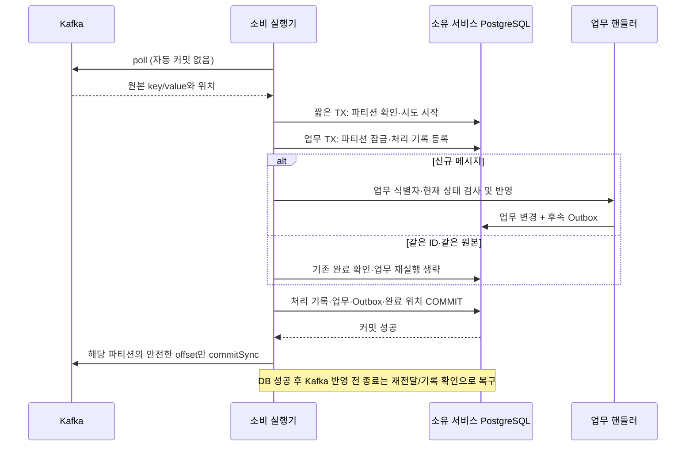

# 013. 메시지 소비 안정성 계획

작성일 2026-11-26 KST · 상태 **완료 / 사용자 요청으로 직접 작성 생략·활성 코드 검증·임시 표식 정리**

2026-11-26 사용자가 상세 추천안 전체 채택과 구현 진행에 합의했다. 아래 추천 선택을 구현 기준으로 확정한다. 최초 요청은 push·PR·병합을 제외했으나, 후속 요청으로 이번 직접 작성을 생략하고 주석 정리·커밋·push·PR 생성까지 진행한다. 병합은 제외한다. 일반적인 직접 작성 규칙은 유지한다.

## 실행 요약

- 현재는 **013 로컬 구현·검증·임시 표식 정리 완료**다. 사용자 요청으로 이번 직접 작성을 생략하고 검증한 여섯 본문을 복원했다. 활성 코드의 관련 22개를 새 실행하고 JAR 격리를 확인했다. 제품/probe JAR가 기준과 같아 기존 환경 검증 근거를 재사용한다. [최종 결과·직접 테스트](../013-message-consumption-reliability.md#final-results)를 따른다. 사용자 작성 완료로 기록하지 않는다.
- PR 준비 최신 확인: PR #13 병합·main `356bcd5` [CI 성공](https://github.com/y0y00700/group-purchase/actions/runs/45837640728). main과 기존 기준의 트리가 같아 미커밋 자료를 보존하며 fast-forward했다. 커밋·push·main 대상 PR 생성 후 최종 head CI 상태만 안내하고 병합하지 않는다.

- 착수 확인: PR #13은 open/unmerged, head `0e6ccbd1a53e12022bdd723e8a3891b31ecaa8a4` [CI 성공](https://github.com/y0y00700/group-purchase/actions/runs/45624698724). fetch한 최신 main `85f7be78a4c2391354c55489dc62cba30fc865e4` [CI 성공](https://github.com/y0y00700/group-purchase/actions/runs/45431750385). 012 의존 코드가 있는 PR head에서 로컬 `feat/message-consumption-reliability`를 만들었다. PR 병합은 하지 않았다.
- 기존 미커밋 설계 다섯 파일을 보존했다. 변경 전 patch·013 원문은 Git 제외 `.tmp/013-baseline/`에 보존하며 `Docs/learning/`·`Docs/explanations/` 제외 정책을 유지한다.

- 목표는 Kafka 재전달·처리 중 종료·재할당에도 소비 단계의 DB 업무 효과가 중복되거나 실패 원본이 누락되지 않게 하는 것이다.
- 출발점은 012 Outbox의 로컬 완료 상태다. 설계 당시 브랜치 `feat/outbox-publishing`, HEAD `0e6ccbd1a53e12022bdd723e8a3891b31ecaa8a4`이며 미커밋 변경은 없었다. 이후 작성한 미커밋 설계를 보존해 구현 브랜치로 이어 왔다.
- 최초 설계의 원격 근거는 2026-11-25 PR #13 생성 기록까지였으며, 구현 착수 때 위 최신 PR/main/head CI를 새로 확인했다.
- 기존 합의: 역할+메시지 ID 중복 방지, 업무·소비 기록·후속 Outbox의 같은 DB 트랜잭션, DB 커밋 후 오프셋 반영을 유지한다.
- 기존 합의: DLT 보관만으로 원본을 완료 처리하지 않으며 같은 그룹·토픽·파티션의 후속 업무를 보류한다.
- 첫 구현 위치는 공동구매 서비스다. 결제·알림 서비스나 공유 메시지 모듈은 새로 만들지 않는다.
- 실제 결제 결과 본문·업무 반영은 015~016의 책임이다. 013에서 011의 전송 표본을 제품 업무 계약으로 승격하지 않는다.
- 추천: 기존 BOM 관리 `kafka-clients`의 `KafkaConsumer<byte[], byte[]>`와 한 전용 poll 스레드를 사용한다. Spring Kafka는 추가하지 않는다.
- 추천: 제품 소비는 `app.inbox.enabled=false`로 시작한다. 실제 업무 핸들러가 없는 상태에서 활성화를 요청하면 기동 실패로 처리한다.
- 소비 기반의 실행·원자성은 별도 `inboxProbe`와 테스트용 업무 핸들러로 검증한다. 제품 JAR에 검증 핸들러·표본·장애 주입을 넣지 않는다.
- 추천: 새 Flyway V5에 소비 완료·파티션 진행/보류·실패 원본·시도 이력의 네 테이블을 추가하고 V1~V4는 보존한다.
- 동일 ID의 원본 내용이 다르면 정상 중복으로 넘기지 않는다. 다른 ID의 같은 업무 중복은 업무 핸들러의 식별자·잠금·상태 검사로 막는다.
- 한 record씩 짧은 DB 트랜잭션으로 처리한다. 파티션 행 잠금과 할당 토큰으로 재할당 전후의 늦은 DB 반영을 제한한다.
- 자동 커밋을 끄고 파티션별 연속 처리 완료 범위만 명시해 커밋한다. 실패·보류·불명확한 DB 결과를 넘기는 커밋은 금지한다.
- 추천: 제품 `max.poll.records=1`, 인스턴스당 소비 스레드 1개, DB 트랜잭션 5초, `poll` 대기 500ms로 시작한다.
- 추천: 개별 일시 오류는 최초 포함 최대 5회, 대기는 1·2·4·8초에 최대 20% 무작위 차이를 더한다. 예산과 다음 실행 시각을 DB에 남긴다.
- 공통 DB 장애는 그 DB를 쓰는 해당 인스턴스의 소비 전체를 보류하고 복구를 확인한다. 장애 record들을 DLT로 밀어 넣지 않는다.
- 영구적인 메시지 오류·한도 소진은 실패 원본과 보류를 먼저 DB에 원자적으로 기록하고, DB 트랜잭션 밖에서 DLT로 전달한다.
- DLT 전송은 DB의 실패 원본을 이용해 재개하며 중복 보관될 수 있다. 보관 성공·실패 어느 쪽도 원본 오프셋을 전진시키지 않는다.
- 보류·재시도 대기를 재시작·재할당 때 복원하며 pause 중에도 poll을 계속한다. 다른 정상 파티션은 진행할 수 있다.
- 추천: 제품 `auto.offset.reset=none`; DB의 연속 완료 위치·Kafka 커밋·보존 시작점·토픽 ID를 대조해 누락/위치 충돌을 감지하고 자동 중단한다.
- 018의 운영 요청·권한·재처리·종결·보류 해제 API는 제외한다. 013의 격리 검증 전용 복구 동작을 제품 운영 절차로 안내하지 않는다.
- 검증은 PostgreSQL/Kafka 통합, 실제 두 소비자 재할당·강제 종료, HOST/INTERNAL, 전용 Compose·Windows JAR·기존 HTTP 회귀까지 포함한다.
- 핵심 여섯 구간은 기준 구현 검증 후 한 번에 직접 작성하도록 준비하고, 사용자 작성·묶음 리뷰·재검증·임시 표식 정리까지 마친다.
- 결과·직접 테스트는 구현 후 `Docs/implementation/013-message-consumption-reliability.md`, 적용 설명은 `Docs/explanations/message-consumption-reliability.md`가 소유한다.

## 출발점과 기존 합의

현재 제품에는 `MessageCodec`·`MessageKind`, 업무 트랜잭션 필수 참여인 `StoreOutgoingMessage`/`JdbcOutbox`, 별도 스케줄러의 `OutboxPublisher`가 있다. Outbox는 공동구매에서 나가는 결제 명령과 알림 의뢰만 저장한다. 제품용 소비자·소비 완료 테이블·DLT 발행기는 없다. 기존 Kafka 프로브의 커밋 검사는 제품 업무 소비의 완료 근거가 아니다.

기존 설계 [8.10~8.14 소비 기록·실패·보류](../../design/payment-and-messaging.md#section-8-10), [8.15~8.20 운영 복구](../../design/payment-and-messaging.md#section-8-15), [011 토픽·역할](011-kafka-message-contract.md#topics), [012 실행 요약](012-outbox-publishing.md#execution-summary)을 따른다. 운영 복구의 원칙은 유지하되 구현 시점은 018이다. 새 구체값은 본 계획의 검토 대상이며 기존 합의를 변경한 것으로 기록하지 않는다.

| 구분 | 013 범위 |
|---|---|
| 포함 | 소비 기록·트랜잭션 실행기·수동 커밋·영속 재시도/보류·실패 원본·DLT 전달·재할당/재시작·보존 범위 검사·구조화 로그/기본 지표 |
| 검증용 업무 | 격리 DB에서 기존 참여 처리와 후속 알림 Outbox를 호출하는 조합 핸들러. 별도 검증 테이블로 업무 ID 중복·서로 다른 결과의 상태 전이도 확인 |
| 제품 활성화 | 실제 결제 결과 핸들러가 없는 013에서는 기본 비활성. 활성화와 필요한 두 결과 종류의 핸들러 등록을 함께 검사 |
| 014~017 | PG Mock·승인/환불 업무·결제 결과의 본문과 유효 전이·Saga·실제 알림 처리. 각 서비스의 소유 DB에 기반 적용 |
| 018 | 영속 운영 요청, 운영 권한·이력, 실패 원본의 재처리·근거 있는 종결, 보류 해제와 실행권 복구 |
| 019 | Prometheus/Grafana와 Kafka에 의존하지 않는 운영 알림 전달 경로. 013은 관측 자료를 제공하며 알림 전달 완료로 표시하지 않음 |

## 제품 활성화와 코드 경계

실제 소비 대상은 향후 `gp.payment.results.v1`, 그룹 `group-purchase-service.payment-results.v1`, 역할 `purchase-payment-result-handler`다. 역할은 배포·인스턴스·그룹 변경 시 새로 만들지 않는다. 토픽·그룹을 바꾸는 경우 기존 진행·보류·토픽 ID의 이관 계획을 요구한다.

`inbox/application`에는 프레임워크 객체를 받지 않는 수신 메타데이터·처리 결과, `IncomingMessageHandler` 포트와 소비 저장 포트를 둔다. 업무 핸들러는 타입별 입력 매핑 뒤 자신의 application/domain 규칙을 호출한다. `inbox/infrastructure`는 JDBC 처리 기록·트랜잭션 조율·실패 저장을, `infrastructure/messaging`은 Kafka poll·커밋·DLT 전송과 011 봉투 해석을, 루트 `config`는 조립·설정을 맡는다. `purchase`·`participation` domain에 Kafka·Jackson·JDBC 타입을 전달하지 않는다.

공통 실행기는 토픽/키/봉투 검증 후 등록된 종류별 핸들러를 호출한다. 핸들러 없음은 성공이 아니다. 활성화 때 두 결제 결과 종류의 등록과 중복 등록·토픽 불일치를 검사하고 실패 시 소비를 시작하지 않는다. 등록 후 알 수 없는 버전·종류가 도착하면 계약 오류로 보류한다. 예외를 삼키고 처리 기록만 쓰는 기본 핸들러는 두지 않는다.

`inboxProbe`는 동일 실행기·JDBC·Kafka 어댑터를 조립하는 별도 source set/JAR다. 테스트용 조합 핸들러·프로세스 중단 지점·전용 토픽 매핑은 이 JAR 또는 test에만 둔다. 011/012의 제품 JAR 격리 검사를 확장한다. 검증용 토픽 매핑은 허용 토픽과 메시지 종류·키 검사를 유지하고 제품 고정 라우팅을 느슨하게 만들지 않는다. 기존 참여 HTTP API에 임시 메시지 생성·소비 엔드포인트를 추가하지 않는다.

## 저장 모델 추천

모든 테이블은 공동구매의 `app` 스키마·동일 DataSource/트랜잭션 매니저를 쓴다. Kafka 위치는 정수 partition과 bigint offset, ID는 UUID, 시각은 `timestamptz(6)`·DB 시간이다. 업무·소비·실패·시도 기록은 초기 자동 삭제 없이 보관한다.

| 테이블 | 주요 필드·제약·책임 |
|---|---|
| `app.inbox_processed_messages` | PK `(consumer_role,message_id)`, 종류·업무 연결 ID·sequence·원본 key/value 지문·최초 topic ID/partition/offset·처리 시각. **커밋된 소비 단계의 완료만** 저장 |
| `app.inbox_partition_states` | PK `(consumer_group,topic,partition)`, 고정 역할·Kafka topic ID·`next_offset`·`owner_token`·`state_version`·상태·실패 위치/ID·재시도 시각/예산·사유·갱신 시각. 같은 파티션의 직렬화와 재시작 기준 |
| `app.inbox_failures` | `failure_id` PK, UNIQUE `(consumer_group,topic_id,partition,offset)`, 역할·가능한 메시지/업무 ID·원본 key/value/headers·timestamp/leader epoch·오류 코드·최초/최근 실패 시각·복구 여부·DLT 상태/다음 시각/선점 ID·기한/결과 위치. 파싱 불가 원본도 보관 |
| `app.inbox_attempts` | `attempt_id` PK, 원본 위치·역할·단계(`HANDLE`/`DLT`)·시작/종료 시각·결과/오류·예산 산입 여부·시도 번호. 프로세스 중단과 공통 장애를 구분하는 영속 이력 |

`inbox_processed_messages`는 group이 아닌 역할로 중복을 판별한다. 지문은 **null 표시와 길이를 포함한 원본 key/value 바이트**의 SHA-256으로 만든다. headers·수신 시각·Kafka offset은 메시지 동일성에 포함하지 않는다. 동일 ID 재발행은 다른 offset에서도 같은 지문이어야 한다. 동일 ID에 공백·선택 필드를 포함한 원본 value가 바뀌어도 보수적으로 `MESSAGE_ID_CONFLICT`로 처리한다. 012의 원본 바이트 재발행 계약과 일치하며 JSON 의미 정규화는 도입하지 않는다.

원본 key/value는 null과 빈 바이트를 구분한다. headers는 이름 중복과 순서·바이너리 값을 유지한다. 실패 원본에는 정상 봉투의 64KiB 제한을 적용해 잘라 저장하지 않는다. 현재 브로커가 허용한 원본을 온전히 보관하되, 저장할 수 없는 크기·DB 장애이면 해당 파티션을 메모리에서 즉시 보류하고 영속화를 재시도한다. 정상 완료·DLT 성공으로 표시하지 않는다.

파티션 상태는 `ACTIVE`, `RETRY_WAIT`, `HALTED`, `OFFSET_GAP`로 시작한다. `HALTED`는 DLT 전송 대기/완료와 독립적이다. RETRY_WAIT/HALTED의 실패 위치는 완료 위치보다 앞일 수 없고 `next_offset`은 처리로만 단조 증가한다. ACTIVE에는 실패 참조가 없고 RETRY_WAIT/HALTED에는 실패 원본을 연결한다. OFFSET_GAP은 보존 손실뿐 아니라 기존 완료 prefix의 불일치도 표현하며 관측 위치가 D보다 작을 수 있다. 원본이 있으면 별도 실패 기록으로 보관하고 없으면 위치 진단을 보존한다. 상태별 필수/금지 컬럼과 외래키·부분 인덱스를 V5에서 명시한다. 실패 이력은 처리 성공 뒤에도 삭제하지 않는다.

개별 재시도 중인 실패 원본의 DLT 상태는 `NOT_REQUIRED`로 두고 전송 대상에서 제외한다. RETRY_WAIT의 같은 원본이 정상 처리되면 업무 트랜잭션 안에서 실패 이력을 `RECOVERED`로 표시하고 파티션을 ACTIVE로 바꾼다. 최대 횟수 소진/영구 오류로 HALTED를 저장하는 트랜잭션에서만 DLT를 PENDING으로 전환한다. 임시 장애 기록이 있다는 이유만으로 DLT 작업자가 전송하지 않게 한다.

조회 인덱스는 미전송 DLT의 다음 전송 시각, 그룹별 보류 상태, 역할별 업무 ID·처리 시각, 원본별 시도 번호를 대상으로 한다. 기존 업무 테이블에 소비 기반용 임시 컬럼을 넣지 않는다. 018의 운영 요청 테이블·종결 상태를 미리 구현하지 않는다.

## 정상 처리·중복·로컬 트랜잭션

처리 기록의 등록에는 `INSERT ... ON CONFLICT (consumer_role,message_id) DO NOTHING RETURNING ...`을 사용하고, 실제 삽입 여부로 신규/중복을 구분한다. 삽입이 없으면 다음 SQL 문에서 커밋된 기존 지문을 조회·대조한다. 다른 DB 오류나 별도 업무 유일성 위반을 메시지 중복으로 간주하지 않는다. PostgreSQL의 충돌 대상·RETURNING 동작은 [공식 INSERT 문서](https://www.postgresql.org/docs/18/sql-insert.html)를 근거로 한다.

처리 순서는 다음과 같다.

1. 현재 할당·준비 완료 상태를 확인하고 raw key/value를 받은 뒤 엄격한 UTF-8 key·011 `MessageCodec.receive`·핸들러 입력 매핑을 검증한다. key도 ByteArrayDeserializer로 받아 파싱 실패 전 원본을 잃지 않는다.
2. 짧은 트랜잭션으로 파티션 행을 잠그고 현재 owner token·보류/재시도 조건을 확인해 HANDLE 시도 시작을 기록한다. Kafka API를 호출하지 않는다.
3. 별도의 업무 트랜잭션에서 같은 파티션 행을 먼저 잠근 뒤 token과 대상 위치를 재확인하고 처리 기록을 등록한다. 신규면 업무 식별자·현재 상태 검사를 거쳐 업무 변경과 `StoreOutgoingMessage.store`를 실행한다.
4. 처리 기록·업무·후속 Outbox·시도 성공·연속 완료 위치를 함께 커밋한다. 오류면 전부 롤백한다. 성공 후에는 `next_offset=max(기존 값,record.offset+1)`을 적용하되 읽은 순서의 앞선 미처리 원본이 없는 경우에만 허용한다.
5. 동일 역할/ID·지문이면 업무 핸들러와 후속 Outbox를 재실행하지 않고 현재 수신 위치만 완료 범위에 반영한다. ID는 같지만 지문이 다르면 전체 롤백 후 실패 경로로 간다. 기존 D보다 작은 위치에서는 커밋된 동일 역할/ID/지문을 증명하지 못하는 경우(미등록 ID·파싱 불가·원본 변경 포함) 신규 업무를 실행하지 않고 OFFSET_GAP으로 보류한다.
6. 트랜잭션 반환 뒤에만 Kafka 오프셋을 명시적으로 반영한다. 이때 실패해도 커밋된 업무를 되돌리거나 업무 핸들러를 즉시 다시 호출하지 않는다.

처리 기록이 다른 메시지 ID의 같은 업무 중복까지 막지는 않는다. 업무 핸들러는 업무 식별자의 유일성·현재 상태와 일관된 행 잠금으로 업무 중복을 막는다. 결과 확인 중→승인 성공처럼 새로운 유효 결과는 받아들이고 이전/중복 결과로 상태를 역행시키지 않는다. 결제 sequence는 추적·충돌 판단 자료이며 단순히 최대 sequence 이하라는 이유로 메시지를 버리거나 `+1` 도착을 강제하지 않는다. 실제 결제 전이는 015~016, 013에서는 검증 전용 상태 모델로 이 경계를 확인한다.

기존 업무 행 잠금 순서에 **파티션 진행 행 → 공동구매 → 참여 → 결제 시도**를 추가한다. HTTP 업무는 파티션 행을 잠그지 않으며 역방향으로 inbox를 호출하지 않는다. 처리 실행기는 `TransactionTemplate`의 READ COMMITTED·5초 제한을 추천한다. 업무 핸들러의 `REQUIRES_NEW`, 비동기 업무 반영·다른 DB 쓰기·PG HTTP/Kafka 전송은 금지한다. `JdbcOutbox`의 MANDATORY 경계를 재사용한다. [Spring의 프로그램 방식 트랜잭션 설정](https://docs.spring.io/spring-framework/reference/data-access/transaction/programmatic.html)은 참고이며 실제 프로젝트 조합 검증은 구현 단계다.

## poll·커밋·재할당

기존 클라이언트를 재사용하는 직접 KafkaConsumer 방식을 추천한다. 순차 poll 스레드가 consumer 생성·poll·pause/seek/resume·commit·close를 모두 소유한다. 종료 요청만 다른 스레드에서 `wakeup()`을 호출한다. 장시간 sleep, handler pool, 자동 커밋, 인자 없는 commitSync, 읽어 온 배치의 마지막 위치 일괄 커밋을 사용하지 않는다. DLT 전송은 별도 작업자여서 poll을 막지 않는다.

추천값은 `enable.auto.commit=false`, `allow.auto.create.topics=false`, `auto.offset.reset=none`, `group.protocol=classic`, 인스턴스당 스레드 1, `max.poll.records=1`, `max.poll.interval.ms=300000`, `session.timeout.ms=45000`, `heartbeat.interval.ms=3000`, `default.api.timeout.ms=5000`, `request.timeout.ms=10000`이다. 커밋 호출에는 5초 제한을 명시한다. 처리 제한·메타데이터 조회·콜백을 포함한 실제 poll 간격을 기록해 상한 안인지 검증한다. 이 값은 측정 전 초기값이다. [Kafka 4.1 소비자 설정](https://kafka.apache.org/41/configuration/consumer-configs/)

메모리에는 파티션별 **연속 완료 범위와 현재 할당 토큰**만 유지한다. 완료 offset은 마지막으로 안전하게 처리한 record의 offset+1이며, 원본 offset 숫자가 항상 연속이라는 가정은 하지 않는다. DB의 `next_offset`은 그 범위를 복원·대조하기 위한 근거다. 실패 위치 이후를 완료로 계산하지 않는다. 인위적으로 `max.poll.records>1`인 검사에서도 같은 파티션의 실패 뒤 이미 받아 둔 record를 업무 처리하거나 커밋하지 않는지 확인한다.

커밋 타임아웃은 Kafka 저장 여부 불명으로 취급한다. 현재 할당에 속한 안전한 범위만 재확인해 재시도하고, 소유권을 잃었으면 재커밋하지 않는다. 이미 DB에 반영한 메시지의 재전달은 지문 확인 뒤 완료 범위만 갱신한다. 관련 API의 스레드 제약·명시 커밋·pause 특성은 [KafkaConsumer 4.1.2 문서](https://kafka.apache.org/41/javadoc/org/apache/kafka/clients/consumer/KafkaConsumer.html)를 따른다.

| 시점 | 할당·DB·오프셋 처리 |
|---|---|
| `onPartitionsAssigned` | 받은 파티션을 먼저 pause하고 준비 대기 상태로 둠. 이후 poll 루프에서 유한 시간의 메타데이터/DB 검사를 나누어 수행. 파티션 행 잠금 아래 새 owner token을 저장하고 기존 보류·완료 위치를 복원한 파티션만 resume |
| 정상 처리 | 매 업무/실패 트랜잭션에서 파티션 잠금·현재 token을 검사. 새 담당자가 token을 바꾼 뒤 이전 담당자의 갱신은 실패. 이전 DB 트랜잭션이 먼저 잠갔다면 그 커밋/롤백 후 새 담당자가 최신 기록을 읽음 |
| `onPartitionsRevoked` | 새 처리를 멈추고 해당 파티션의 안전한 완료 범위만 제한시간 내 커밋을 시도. 실패는 재전달로 복구하며 로컬 버퍼·token을 폐기. 보류를 삭제하지 않음 |
| `onPartitionsLost` | 이미 소유권이 없으므로 커밋/새 DB 작업을 하지 않고 해당 로컬 진행만 폐기 |
| 보류/재시도 | pause 상태로 poll을 계속하고 DB 시각의 재시도 기한·보류를 확인. 재시도 허용 시 실패 원본 위치로 seek한 뒤 resume. HALTED는 운영 해제 전 자동 resume하지 않음 |

Kafka 할당과 PostgreSQL 잠금은 분산 트랜잭션이 아니다. 재할당 직전 시작한 짧은 DB 처리가 소유권 상실을 알기 전에 커밋할 수 있다. 파티션 직렬화·role/ID 유일성·token·완료 위치로 새 담당자의 이중 반영과 후속 건의 추월을 막으며, 모든 늦은 실행을 물리적으로 취소한다고 주장하지 않는다. token은 DB에서 받은 작업 권한이며 Kafka 그룹 세대의 대체물이 아니다. 재할당에서 pause 상태가 유지된다고 가정하지 않는 이유와 lost/revoked의 차이는 [공식 재할당 콜백](https://kafka.apache.org/41/javadoc/org/apache/kafka/clients/consumer/ConsumerRebalanceListener.html)을 따른다.

## 실패 분류·영속 재시도

업무 트랜잭션의 실패 기록은 롤백 이후 **별도 짧은 트랜잭션**으로 남긴다. 원본 실패 저장과 파티션 RETRY_WAIT/HALTED 전환은 함께 커밋하고 owner token을 확인한다. 그 기록에 실패하면 해당 인스턴스의 영향받는 소비를 멈추고 영속화부터 재개한다. 메모리 기록만으로 복구 가능하다고 표시하지 않는다.

| 분류 | 예·판정 기준 | 처리 |
|---|---|---|
| 정상 업무 결과 | 중복 업무의 동일 결과, 기한 경과에 따른 신규 승인 차단 등 핸들러가 정상 저장한 결과 | 처리 기록·업무·필요한 Outbox를 함께 커밋 |
| 메시지 영구 오류 | 파싱/버전/종류/키 오류, 동일 ID 원본 충돌, 업무 ID의 금액·대상 충돌 | 즉시 HALTED + 실패 원본 저장, DLT 전달 예약 |
| 개별 일시 오류 | deadlock/serialization failure/한정된 lock timeout 등 명확한 SQLState 및 예외 매핑 | 최초 포함 최대 5회, 1·2·4·8초 + 0~20% jitter 후 동일 원본 재시도 |
| DB 공통/가용성 의심 | SQLState 연결 계열, DB 재시작, pool 획득 실패 등 | 해당 DB를 쓰는 인스턴스의 모든 할당 pause, 5초 간격 연결·필수 inbox 조회 복구 검사. 개별 메시지 DLT로 전환하지 않음 |
| DB 커밋 불명 | 연결 유실·타임아웃으로 최종 커밋 결과를 확정하지 못함 | 완료 기록/지문/파티션 위치를 먼저 재조회. 확인 불가 중 커밋·DLT 판정 금지 |
| Kafka 공통 장애 | poll/commit/메타데이터 실패 | DB 완료·보류 보존, 유한 API 제한과 재접속. DB 업무 실패 예산에 산입하지 않음 |
| 인증/설정 오류 | Kafka 권한·잘못된 설정·활성화 시 핸들러 누락 | 소비를 중단하고 원인 수정 필요 상태와 로그/지표 제공. 자동 성공/무한 빠른 재생성 금지 |
| 미분류 핸들러 오류 | SQLState/계약 오류로 확정되지 않는 일반 RuntimeException | 최초 포함 최대 5회 후 HALTED. 코드 문제를 정상 처리로 삼키지 않음 |

5회 예산은 프로세스 메모리가 아닌 원본 위치별 시도 기록이 소유한다. 시도 시작을 먼저 남기고, 공통 장애로 판정한 시도는 예산에서 제외하며 재시작 후에도 제외 결과를 유지한다. 시작만 남고 종료되지 않은 시도는 완료 기록 확인 후 `INTERRUPTED`로 정리하고 예산에 산입한다. 횟수 소진 검사 **전**에 DB 완료 여부를 확인해 커밋 후 종료된 메시지가 오판으로 DLT에 들어가지 않게 한다. DB가 없어 제외/종료를 확정하지 못하면 복구 전까지 예산 확정을 보류한다.

업무 예외를 잡아 같은 실패 트랜잭션에 처리 완료를 덧쓰거나, 모든 DataIntegrityViolationException을 중복으로 바꾸지 않는다. 장애 분류는 코드 표와 SQLState 근거를 테스트한다. 공통 장애의 장기 알림·여러 서비스 전체의 통합 중단 제어는 019와 연결하고, 013에서는 인스턴스 단위 안전 중단과 재시작 복원을 검증한다.

DB 복구 검사가 성공해도 모든 파티션을 일괄 resume하지 않는다. 현재 할당·owner token·영속 HALTED/OFFSET_GAP·재시도 기한과 완료 위치를 다시 읽어 각각의 원래 상태로 복원한다. DB 장애 전에 있던 영구 보류를 공통 장애 복구로 해제하지 않는다.

## DLT 보관·실패 파티션 유지

이번 첫 적용에는 `gp.payment.results.dlt.v1` 하나를 추가하는 안을 추천한다. 파티션 3·복제 1·min ISR 1·delete/7일·segment 1시간은 기존 업무 토픽의 초기값과 맞춘다. DLT 값의 최대 크기는 4MiB, DLT 전송기 `max.request.size=4194304`를 추천한다. 원본 최대 1MiB와 key/headers, Base64 및 진단 필드가 포함된 실제 직렬화 크기를 경계 테스트로 확인한다. 원본·headers가 이 보관 한도를 넘으면 잘라 보내지 않고 DB 원본을 유지한 채 `DLT_BLOCKED`로 표시한다. [토픽 크기·보존 설정](https://kafka.apache.org/41/configuration/topic-configs/)

DLT JSON은 업무 봉투와 별도 계약인 `dltSchemaVersion=1`, `failureId`, 역할/그룹, topic 이름·ID/partition/offset, 원본 timestamp/leader epoch, key/value Base64 또는 명시적 null, headers 배열, 선택적인 message/business ID, 오류 코드·시도 요약·최초/최근 실패 시각을 갖는다. 실패 원본을 복원할 수 있어야 한다. 오류 요약·stack trace를 무제한 본문에 넣지 않고, 원본 본문·인증 값은 일반 로그에 출력하지 않는다. DLT key는 안정적인 failureId다.

1. DB에 실패 원본과 HALTED를 함께 저장한다. 실패 원본마다 안정적인 failureId를 부여한다. 파싱 불가 메시지도 topic ID/partition/offset으로 유일하게 추적한다.
2. 전용 DLT 작업자가 DB의 전송 대기를 한 건씩 60초 선점 ID/기한으로 가져온다. 시도 이력은 HANDLE과 구분한다. 같은 파티션의 소비 담당자와 무관하게 한 유효 선점만 전송한다.
3. DB 트랜잭션을 종료한 뒤 Kafka에 `acks=all`·producer 멱등성으로 전송하고 broker 확인을 기다린다. 012의 전송 제한값을 재사용하되 업무용 Outbox의 종류/테이블 제약은 바꾸지 않는다.
4. 현재 선점 ID·유효 기한을 조건으로 `DLT_STORED`와 실제 DLT 위치를 기록한다. 실패/확인 불명은 동일 failureId·원본으로 재시도하고, 재시도 대기는 지수 증가·상한 60초·jitter로 관리한다. 크기/설정 등 수정 필요 오류는 `DLT_BLOCKED`로 남긴다.
5. 보관 성공 후 DB 기록 전 종료·선점 만료는 DLT 중복을 만들 수 있다. 중복은 failureId로 연결하며 DB의 원본은 변경하지 않는다. 이전 선점자의 늦은 갱신은 0건으로 끝낸다.

DLT는 `PENDING → IN_FLIGHT → DLT_STORED/RETRY_WAIT/DLT_BLOCKED`로 진행하지만 **파티션 HALTED는 유지**한다. DLT 실패가 다른 정상 파티션의 poll을 막지 않는다. DB에 이미 보관된 원본은 Kafka/DLT의 7일 보존 종료 뒤에도 유지되지만, 이 사실로 원본 토픽의 유실된 후속 메시지까지 복구 가능하다고 주장하지 않는다.

018 전에는 영구 보류를 제품에서 수동 UPDATE·오프셋 reset·DLT 자동 재주입으로 해제하지 않는다. 격리 테스트에서만 같은 실행기를 사용한 검증 전용 복구 드라이버가 원본을 재처리해 DB 반영 전/후 차이와 후속 재개를 확인한다. 이것은 제품 운영 API·권한·실행권 복구의 완료 근거가 아니다. 실제 운영 재처리는 현재 할당 소비자의 흐름에서 영속 요청·대상 버전·실행권을 확인하도록 018에서 연결한다.

## 보존 기간 초과·오프셋 유실·토픽 재생성

제품은 `earliest/latest` 자동 reset으로 누락을 숨기지 않는다. 할당 준비 때와 실행 중 30초 간격으로 topic ID·보존 시작 offset(B)·끝 offset(E)·Kafka 커밋(K)·DB 연속 완료 위치(D)를 조회한다. Kafka 조회는 DB 트랜잭션 밖에서 제한시간을 주고 수행한다. 이후 poll의 OffsetOutOfRange 등도 같은 실패 경로로 보낸다. 검사 순간 이후 보존이 진행될 수 있으므로 주기 검사만으로 안전을 주장하지 않는다.

| 관측 | 추천 처리 |
|---|---|
| DB 행 존재, `B ≤ D ≤ E`, K가 D 이하이며 보존 범위 안 | K부터 읽어 DB 미확인 구간과 이미 처리한 재전달을 구분. D 미만의 원본은 기존 역할/ID/지문 완료를 확인한 경우만 통과. D 미만에 미등록 ID가 있으면 위치 충돌로 중단 |
| DB 행 존재, K가 없거나 B보다 작고 `B ≤ D ≤ E` | DB가 전체 완료 prefix를 증명하므로 D로 명시 seek. 재시작한 현재 할당에서 D까지만 Kafka 커밋을 복원. K 소실을 무조건 최초 소비로 해석하지 않음 |
| K > D, D > E, 저장한 topic ID 변경, 또는 역할/그룹/파티션 구성 불일치 | 외부 offset 이동·DB 복원 불일치·로그 유실 가능성으로 OFFSET_GAP/위치 충돌 보류. 자동 정정하지 않음 |
| D < B, 또는 현재 실패 원본/다음 미처리 범위가 보존 시작 전으로 밀림 | Kafka 보존으로 미처리 누락 가능. OFFSET_GAP 영속화·pause·진단 제공. DLT에 첫 원본이 있어도 후속 전체 복구 가능으로 단정하지 않음 |
| DB 행 없음 | 기본은 초기화 거절. 처음 활성화할 때만 명시한 `bootstrap-mode=from-origin`으로 B=0·K 없음·기대 토픽 ID/파티션 수를 확인하고 D=0을 저장. B>0이나 기존 K가 있으면 자동 편입하지 않음 |

기본 `bootstrap-mode=disabled`로 제안한다. 최초 적용은 토픽 생성 시점·전체 이력 존재 여부를 확인한 별도 절차로 초기화하고 설정을 되돌린다. 016 활성화 시점에 7일보다 오래된 검증 데이터가 있는 일반 토픽을 초기화하려고 삭제하지 않는다. 이관이 필요하면 관련 업무·Outbox·원본 대사와 별도 계획이 먼저다.

offset 숫자의 자연스러운 공백을 손실로 단정하지 않는다. 현재 delete 토픽의 보존 경계·DB prefix·topic ID를 대조하며 임의 중간 record 삭제나 모든 Kafka 저장 손상을 검출하는 보장으로 확대하지 않는다. DLT/소비 지연과 보존 여유를 관측하고 토픽 보존값은 R-10/R-19 조건으로 재검토한다.

OFFSET_GAP에서는 DB의 D를 낮추거나 Kafka 커밋을 D로 복원하지 않는다. 완료 prefix 자체가 의심스러운 경우의 기존 원본은 DB에 보존하고, 원인 대사·복구 계획 전에는 소비와 오프셋 변경을 모두 중단한다. 이 진단을 일반 개별 메시지 재시도/DLT 자동 전달로 우회하지 않는다.

## 관측·실행 수명

구조화 로그에는 역할·그룹·topic/partition/offset·가능한 message/correlation/business ID·failureId·attempt/owner token·분류·상태를 넣는다. payload·원본 bytes·secret·무제한 예외 메시지는 출력하지 않는다. DB 장애로 영속 이력을 남기지 못한 경우 로그에도 미저장 상태를 명시한다.

기본 Micrometer 지표는 신규/중복 처리·실패 분류·재시도·보류 파티션 수·미전송 DLT 수/최고 대기시간·커밋 실패·poll 간격·보존 범위 초과를 제공한다. message ID/offset 같은 무한 증가 값은 metric tag로 쓰지 않는다. 외부 readiness에는 기존 DB 기준을 유지하고, 소비 보류만으로 제품 liveness를 실패시켜 재시작 반복을 만들지 않는다. 소비 활성/미활성·보류 상태는 별도 진단으로 구분한다.

종료 시 새 업무 시도·DLT 선점을 멈추고 consumer를 wakeup한 뒤 poll 스레드가 현재 짧은 DB 처리를 마치고 안전한 범위만 커밋·close한다. DLT는 현재 전송만 유한 대기한다. 기존 공동구매 종료 유예 70초 안에서 끝나는지 검증하며, 강제 종료 시에도 DB 완료/보류·시도 이력으로 재개한다. 다른 스레드에서 consumer close를 경합 호출하지 않는다.

## 선택 근거와 대안

| 추천 선택 | 선택 이유·비용 | 이번에 채택하지 않는 대안 |
|---|---|---|
| 직접 KafkaConsumer·순차 1건 | 기존 의존성으로 pause/seek/commit 경계를 드러냄. 콜백·수명·오류 처리를 직접 구현하는 비용과 낮은 초기 처리량 | Spring Kafka container: 운영 기능을 재사용하기 좋지만 현재의 원본 보류·영속 DLT·수동 복구 계약을 별도로 맞춰야 함 |
| 서비스 DB 처리 기록·업무 잠금 | 업무와 같은 트랜잭션으로 완료를 증명. DB 쓰기·보관·파티션 잠금 비용 | 메모리/캐시 중복 필터·Kafka 트랜잭션만으로 업무 DB 원자성을 대체 |
| 원본 파티션 보류 | 알 수 없는 업무 ID·순서 조건에서도 실패 뒤 추월 방지. 같은 파티션의 다른 시도도 대기 | 재시도 토픽 이동·DLT 후 원본 커밋·업무 키별 별도 큐: 기존 보류 합의와 다르고 순서 복구가 복잡 |
| 실패 원본의 DB 저장 후 DLT 전송 | DB/Kafka 사이 중단에도 원본과 전송 필요성을 복구. 별도 전송 상태·선점 비용 | 소비 poll 안에서 DLT 성공까지 장시간 대기하거나 DLT 실패를 완료로 삼킴 |
| 제품 소비 기본 비활성 | 미구현 결제 결과를 성공 처리하지 않음. 실제 결과 통합은 016까지 검증되지 않는 한계 | 빈 handler·표본 payload를 제품 결제 계약으로 처리 |

## 변경 예정 위치

| 위치 | 구현 요청 후 변경 범위 |
|---|---|
| `services/group-purchase-service/src/main/.../inbox/application`, `inbox/infrastructure` | 포트·실행 모델·원자적 처리·JDBC·실패/시도/보류 저장 |
| `.../infrastructure/messaging`, `.../config` | 소비 루프·할당/커밋·DLT 전송·활성화/핸들러 검사·설정. 기존 MessageCodec/Outbox 계약 보존 |
| `.../src/main/resources/db/migration/V5__inbox.sql` | 네 테이블·제약·인덱스. V1~V4 수정 없음 |
| `config-repo/group-purchase*.yml`, `services/group-purchase-service/build.gradle` | 기본 비활성 소비 설정·환경별 접속·inboxProbe source set/JAR·제품 격리 검사 |
| `infrastructure/kafka/topics.txt`, `init-topics.sh` | 첫 DLT 생성/설정 대조. 업무 토픽과 DLT 크기 정책 구분·재실행 시 기존 설정 자동 변경 금지 |
| `.../src/test`, `.../src/inboxProbe` | PostgreSQL/Kafka 통합·계약/실패 분류·조합 핸들러·실제 프로세스 중단/재할당 검증 |
| `scripts/check-inbox.py`, 기존 Kafka 검사·CI | 전용 프로젝트 HOST/INTERNAL·수명 검증·DLT 메타데이터·JAR 경계와 필요한 회귀. CI는 유한 시간 자동 검사만 추가 |
| `Docs/implementation/013-message-consumption-reliability.md`, `Docs/explanations/message-consumption-reliability.md` | 구현 결과·직접 테스트·실제 적용 설명. 설계 단계에는 성공 결과 문서를 미리 만들지 않음 |

## 핵심 코드 직접 작성 여섯 구간과 이번 예외

2026-11-26 후속 사용자 요청으로 이번 013의 직접 작성은 생략했다. 아래 책임의 검증된 본문을 복원하고 참고 주석·임시 표식·작성 대기 예외를 제거했다. 관련 22개 새 실행·JAR 격리를 통과했다. 다음 문단의 일반 절차는 이번 요청의 예외로 대체하며 이후 단계의 일반 규칙은 유지한다.

| 구간 | 예정 파일/메서드 책임 | 학습·확인할 동작 |
|---|---|---|
| LEARN-01 | `JdbcInbox` 처리 기록 등록/대조 | 충돌 대상을 지정한 INSERT·신규/동일 중복/원본 충돌과 DB 오류 구분 |
| LEARN-02 | `InboxProcessor` 트랜잭션 실행 | 처리 기록·업무·후속 Outbox·완료 위치의 원자성과 실패 롤백 |
| LEARN-03 | `InboxConsumerLoop` 완료 위치 반영 | DB 성공 이후 현재 할당의 안전한 offset만 커밋·실패 뒤 추월 방지 |
| LEARN-04 | `ConsumptionFailurePolicy` 및 실패 전환 | 개별/공통/커밋 불명 구분, 영속 예산·대기·HALTED 판정 |
| LEARN-05 | `DltPublisher` 선점 후 결과 반영 | DB 밖 전송·확인 불명 재전송·현재 선점 조건부 완료·원본 보류 유지 |
| LEARN-06 | 할당 준비의 `restorePartition` | topic ID/보존 경계/완료·보류 복원, owner token·seek/pause 판단 |

정확한 클래스/메서드명은 구현 분리에 따라 조정하되 여섯 책임과 검증 범위를 유지한다. 기준 구현을 검증한 뒤 같은 파일에 참고 주석·호출 위치/시점/역할·직접 입력 구간과 작성 대기 예외를 한 번에 마련한다. 기존 사용자 코드는 보존하고 사용자 대신 빈 구간을 채우지 않는다. 사용자 작성·묶음 리뷰·관련 재검증·중복 참고 주석/임시 표식 정리 뒤에만 최종 완료로 표시한다.

## 검증 행렬·완료 기준

| 검증 | 실패 주입·확인할 근거 |
|---|---|
| 신규/동일 재전달 | DB 기록·실제 업무·후속 Outbox 각각 한 번, 새 위치에서 동일 ID도 업무 재실행 없음 |
| 같은 ID 다른 원본 | MESSAGE_ID_CONFLICT, 업무 롤백·원본 보관·보류·실패 위치를 넘지 않는 Kafka 커밋 |
| 동시 중복·다른 ID 같은 업무 | 실제 두 처리기/소비자·DB 유일성/잠금, 업무 효과 한 번. 서로 다른 유효 결과는 반영 |
| 트랜잭션 원자성 | 처리 기록 이후·업무 이후·Outbox 저장 실패 시 전부 롤백. 처리 기록 등록 오류를 중복으로 숨기지 않음 |
| DB/Kafka 중단 경계 | 실제 자식 프로세스 강제 종료를 DB 커밋 전/후·Kafka 커밋 전에 주입. 재시작 후 완료 기록으로 누락/중복 방지 |
| 커밋 실패/불명 | broker 응답 유실·타임아웃·재할당, 안전한 범위만 반영·이미 반영된 업무 반복 없음 |
| 일시 오류 예산 | 시도 중 강제 종료·재할당에도 5회 예산·next retry 유지, 공통 장애 제외·완료 확인 우선 |
| DB 공통 장애 | 동일 프로세스에서 DB 중단/복구. 모든 영향 소비 pause·무더기 DLT 없음·복구 후 재조회/재처리 |
| 잘못된 원본 | null key/value·UTF-8 오류·64KiB 초과·버전/종류·업무 충돌. headers 포함 원본 복원·로그 본문 미노출 |
| DLT 전달 중단 | DB 실패 보관 전/후·전송 전/후·완료 저장 전 종료, 동일 failureId로 복구·중복 추적·선점 만료와 늦은 반영 차단 |
| DLT 장애/크기 | 브로커 중단·DLT 설정/크기 오류에도 원본과 HALTED 유지·다른 정상 파티션 진행 |
| 파티션 보류 | 실패 뒤 같은 poll에 들어온 후속 건 업무 0·커밋 추월 0, 다른 파티션은 처리. pause 중 poll 간격 정상 |
| 재시작·재할당 | 실제 두 소비자 가입/이탈·lost/강제 종료 후 새 owner가 보류 복원. 오래된 token의 DB 갱신 거절 |
| 복구 경계 | 격리 전용 드라이버에서 같은 원본의 재처리 DB 성공 전에는 후속 보류, 성공 후 안전한 위치부터 재개. 운영 API 완료로 표시하지 않음 |
| 보존 범위·토픽 신원 | 전용 토픽에서 보존 경계 이동·K 부재/앞섬·토픽 재생성·D 범위 초과·자연 offset 공백을 구분. 임의 earliest/latest reset 없음 |
| 실행/기존 회귀 | HOST/INTERNAL·Windows probe JAR·기본 비활성 제품 JAR/이미지·7 healthy/init 0·전체 down/up·기존 회원/공동구매 HTTP와 011/012 경계 검사 |

1. 구현 착수 때 PR #13·main/head CI·로컬 변경을 최신 조회해 기준 브랜치를 결정하고, 미커밋 설계·학습 기록을 보존한다. 설계만으로 브랜치를 전환하거나 PR을 병합하지 않는다.
2. V5·저장/트랜잭션·poll/실패·DLT·복원 순으로 기준 구현을 만들고 위 행렬의 실제 검증 명령·대상 SHA/JAR 해시·유한 제한시간·진단 경로를 결과에 기록한다.
3. Testcontainers와 별도 `group-purchase-013` 프로젝트의 격리 DB/브로커만 사용한다. 기존 011/012 프로젝트·일반 DB·기존 토픽/그룹은 중단·초기화·삭제하지 않는다.
4. 정리 대상은 해당 실행이 만든 검증 토픽/그룹/프로세스로 제한한다. Compose는 down으로 종료하고 볼륨 보존을 기본으로 하며 삭제가 필요한 검사는 대상/영향을 명시한다.
5. 전체 build/필수 패키징·환경 검사를 완료하되 변경 없는 유효한 검증의 재사용 근거를 구분하고 불필요한 재실행을 반복하지 않는다. 제품의 실제 결제 결과 통합 검증은 미완료로 남긴다.
6. 여섯 직접 작성 구간·리뷰·재검증을 마친 활성 코드로 최종 결과를 정리한다. 문서 링크·코드/설정 이름·실제 실행과 미검증 항목을 대조한다.
7. push·PR은 요청 범위에 따르며 작업 시 기존 규칙대로 CI 완료 대기/반복 조회 없이 PR·최종 head·Checks 링크와 조회 당시 상태를 안내한다.

## 결과에 제공할 사용자 직접 테스트

작업 디렉터리는 프로젝트 루트다. 준비 사항은 PowerShell·Docker Desktop Linux 엔진·JDK 21/JAVA_HOME·Python 3·기존 방식의 로컬 secret이며, 전용 프로젝트 포트/볼륨·토픽/그룹 접두어를 명시한다. 다음은 **구현 예정 절차**로 현재 실행 가능한 명령이나 검증 결과가 아니다.

- 구현 후 확정한 Gradle 검사와 `check-inbox.py` 명령을 복사 가능하게 제공한다. 정상 전달 → 동일 메시지 재전달 → DB 실패 → 실제 강제 종료/재시작 → DLT/보류 → 다른 파티션 진행 → 재할당 복원 순서로 확인한다.
- 각 단계에 DB 처리 기록 수·업무/후속 Outbox 수·state/failureId·Kafka committed offset의 기대값과 로그 이벤트를 함께 적는다. DLT 원본 복원과 역할/ID/지문 충돌 확인도 포함한다.
- DB/브로커 복구와 개별 영구 보류를 구분한다. 후자의 제품 운영 해제는 018 대기이며, 격리 검증 도구의 재처리를 일반 DB 수동 수정 방법으로 안내하지 않는다.
- 직접 실행할 Windows/HOST·Compose/INTERNAL 명령, 유한 대기/실패 종료·진단 폴더, 원복/종료·데이터 보존 범위를 명시한다. AI가 실행한 결과와 사용자가 재현할 절차를 분리한다.

## 검토 항목과 구현 세션 인계

2026-11-26 사용자가 **① 직접 KafkaConsumer와 실제 핸들러 연결 전 제품 비활성 ② V5 네 테이블·파티션 직렬화/완료 위치 ③ 최초 포함 5회 재시도·DB 선보관 DLT·엄격한 보존 경계**의 추천안을 채택하고 진행에 합의했다. 018의 운영 복구 구현은 분리한다. 이번 단계는 후속 요청에 따라 직접 작성을 생략하고 활성 코드 재검증·임시 표식 정리를 마쳐 로컬 완료로 기록한다.

구현 세션은 `AGENTS.md`·[인계](../../handoff.md)·본 실행 요약부터 읽고 합의 범위만 구현한다. 실제 결제 모델 부재·기존 메시지 계약과 충돌이 생기면 해당 범위와 대안을 알리고 계획을 먼저 맞춘다. [실제 결과·직접 테스트](../013-message-consumption-reliability.md)가 실행 근거와 작성 상태를 소유한다.

[구현 목록](../README.md) · [로드맵](roadmap.md#next-implementation)
