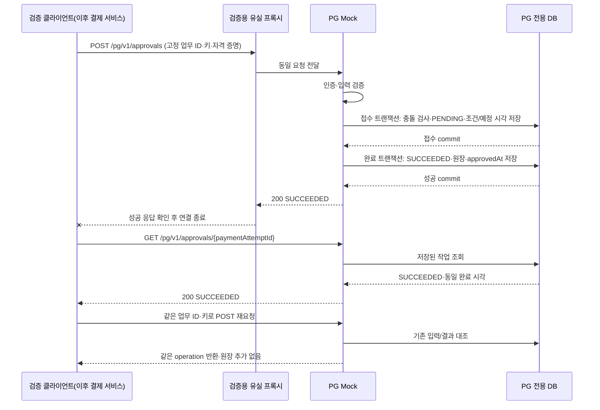

# 014. PG Mock 계획

작성일 2026-11-28 KST · 상태 **완료 / 로컬 구현·핵심 6개 사용자 작성·묶음 리뷰/재검증·임시 표식 정리 완료**

2026-11-28 사용자가 추천안을 전체 채택하고 로컬 구현·검증·문서화와 핵심 6개 직접 작성 대기 준비를 요청했다. 아래 추천 표기의 선택은 모두 이번 단계의 확정 기준이다. 실제 변경·실행 근거·현재 학습 상태는 [결과](../014-pg-mock.md)가 소유한다.

## 실행 요약

- 목표: 결제 서비스가 별도 HTTP 서버를 호출하며 승인·전액 환불·결과 조회와 결과 불명 복구를 검증할 PG Mock을 만든다.
- 현재: 001~013 로컬 구현·검증 완료. 014 추천안 전체 채택·로컬 구현/사용자 작성·관련 검증 완료. 실제 결제 서비스·Saga는 아직 없고 제품 메시지 소비는 기본 비활성이다.
- 2026-11-28 확인: PR #14 최종 head `1bfdc9e6f5f5829c8cf457ffe3bc02bf494a8cb0`의 CI 성공, 병합 main `8eb3ac8e759ae583c66dcf063cced32422bd9ff8`의 CI는 조회 당시 실행 중이었다. 최신 상태는 [인계](../../handoff.md)가 소유한다.
- 로컬 출발점: `feat/message-consumption-reliability`, HEAD `1bfdc9e6f5f5829c8cf457ffe3bc02bf494a8cb0`, 설계 시작 전 미커밋 변경 없음. 이번 설계에서 브랜치를 전환하지 않는다.
- 포함: 독립 실행 모듈·PG 전용 영속 저장소·기계 간 인증·승인/환불/조회·멱등성·거래 원장·장애 시나리오·이미지/Compose/CI·직접 테스트 안내.
- 제외: 실제 PG/카드 정보·부분 환불·여러 가맹점 관리·PG 승인 취소 API·웹훅·결제 서비스·Kafka 연결·Saga·운영 복구 API.
- 기존 합의: 외부 PG 대역은 결제 서비스와 별도 프로세스이며 승인·환불·조회와 지연·응답 유실·거절·환불 실패를 재현한다.
- 기존 합의: 승인 키는 같은 결제 시도에서 고정하고, 원승인당 전액 환불 업무 하나와 환불 ID를 재사용한다.
- 기존 합의: 타임아웃·응답 유실·단순한 시간 경과를 미승인/환불 실패 확정으로 사용하지 않는다.
- 추천: `infrastructure/pg-mock`의 Java 21·기존 Boot BOM·MVC/JDBC/Flyway를 사용한다. 버전 업그레이드·Cloud 의존성은 추가하지 않는다.
- 추천: 별도 `pg-mock-postgres` 컨테이너·`pg_mock` DB·제한된 앱 계정·전용 볼륨으로 외부 거래 기록을 보존한다. 기존 업무 PostgreSQL과 장애를 분리한다.
- 추천: PG Mock은 자체 YAML과 고정 URL을 사용하고 Config/Eureka/Gateway에 연결하지 않는다. 이후 결제 서비스가 호출할 URL을 자신의 설정에서 관리한다.
- 추천: API `8082`, 전용 DB 호스트 포트 `55433`, 검증용 응답 유실 프록시 `18082`를 사용한다. 호스트 공개는 모두 loopback으로 제한한다.
- 추천: API와 Mock 제어 자격 증명을 분리한다. 제어 API는 명시적으로 켠 환경에서만 제공하며, 업무 API에 장애 지정 헤더를 받지 않는다.
- 추천: 승인·환불은 각각 고정 업무 ID와 `Idempotency-Key`를 함께 저장한다. 같은 키/다른 본문과 같은 업무/다른 키는 409로 거절한다.
- 추천: 금액은 양의 64비트 정수 원화, 통화는 `KRW`, 업무 ID는 UUID다. 부분 환불·카드 토큰·공동구매 수량/기한 판단은 넣지 않는다.
- 추천: `PENDING → SUCCEEDED/DECLINED/RETRYABLE_FAILURE`와 재시도 가능한 실패의 재접수를 구분한다. 승인 거절은 확정 결과이며 일시 실패는 같은 업무/키로 재시도한다.
- 추천: 접수와 완료를 나눈 짧은 DB 트랜잭션, DB에 저장한 실행 예정 시각·시나리오, 복구 스케줄러로 연결 종료·재시작 후에도 접수한 작업을 잇는다.
- 추천: 성공 상태·원장·완료 시각은 같은 트랜잭션에서 저장한다. 원장 제약과 원승인 잠금으로 승인/환불 효과를 각각 한 번만 만든다.
- 추천: `approvedAt/refundedAt`은 효과 기록 단계의 PG DB 시각으로 한 번 저장하며 조회·재요청에서 유지한다. 접수 시각이나 클라이언트 시각으로 대체하지 않는다.
- 추천: 지연·확정 거절·처리 전 일시 실패는 Mock의 영속 시나리오로 제공한다. 실제 응답 유실은 별도 검증 프록시가 성공 응답을 받은 뒤 클라이언트 연결을 끊어 재현한다.
- 추천: 거래·멱등성·미완료·장애 바인딩·실행 이력은 자동 삭제하지 않는다. DB/볼륨을 초기화한 환경에 과거 업무를 재전송하는 것은 보장 범위 밖이다.
- 검증: 실제 PostgreSQL·HTTP·동시 요청/두 앱·강제 종료·PG/업무 DB 장애 분리·응답 유실·Windows JAR·Compose와 기존 HTTP/메시지 회귀를 다룬다.
- 학습: 기존 규칙대로 기준 구현 검증 후 핵심 6개 구간을 함께 준비한다. 013의 직접 작성 생략은 014에 자동 적용하지 않는다.
- 완료: 사용자 작성·묶음 리뷰·관련 재검증·임시 표식 정리, 결과/직접 테스트와 적용 설명까지 마친 범위를 완료로 기록한다.
- 확정: 추천안 전체 채택·직접 작성 생략 없음. PostgreSQL 예약 역할명 때문에 계정만 `mock_pg_app`으로 조정한다. 업무/API 계약은 유지한다. Step 4는 실제 원자 저장이 있는 `JdbcPgStore.finish`로 정했다.

## 출발점과 책임 경계

기존 합의는 [PG Mock 범위](../../design/payment-and-messaging.md#section-9), [업무/외부 키](../../design/payment-and-messaging.md#section-8-11), [실제 승인 시각](../../design/payment-and-messaging.md#section-6-1), [HTTP 제한시간](../../design/operations.md#operating-values), [전체 검증](../../design/verification.md#verification-scope)을 따른다.

| 구분 | 책임 |
|---|---|
| 014 PG Mock | PG가 접수한 작업·실제 외부 효과를 나타내는 자체 원장·조회·Mock 내부 미완료 복구·장애 재현 |
| 015 결제 도메인 | 승인/중단/환불 의뢰의 영속 진행, PG 호출·결과 불명 추적, 같은 키 재사용·결과 발행 |
| 016 공동구매 Saga | 접수 기한·수량 확보·승인 시각 판정·취소/마감 경합·늦은 승인 환불 조정 |
| 018 운영 복구 | 각 업무 서비스의 운영 권한·복구 요청·재처리·종결·재개 |

014의 결과 조회 클라이언트는 검증 도구다. 결제 서비스의 결과 불명 복구나 전체 Saga를 구현한 것으로 표시하지 않는다. PG Mock은 공동구매 DB·회원 세션·Kafka·회차 기한을 읽지 않는다. PG Mock의 내부 복구는 자신의 접수 작업만 완료한다. 외부에서 이미 접수된 승인을 강제로 중단하는 API는 제공하지 않는다.

## 실행·저장소 선택

### 추천 구성과 대안

`infrastructure/pg-mock`을 Gradle `:pg-mock`으로 추가하고 Spring MVC·Validation·Security·Actuator·JDBC·Flyway와 PostgreSQL 드라이버를 기존 BOM으로 관리한다. PG의 거래 규칙은 `com.example.pgmock` 아래 `domain/application/interfaces/infrastructure/config`로 나눈다. 서비스 엔티티·회원 인증 코드·JDBC 저장소를 공유 모듈로 추출하지 않는다. HTTP 오류 형식·요청 ID·JSON 로그의 기존 계약은 PG 모듈에도 적용한다.

| 선택 | 이유·비용 |
|---|---|
| **추천: 별도 PostgreSQL 인스턴스** | 업무 DB 중단 중에도 PG 거래가 남고 조회될 수 있다. 같은 DB 제품·JDBC/Flyway를 재사용하지만 컨테이너·메모리·초기화 설정이 추가된다. |
| 대안: 기존 PostgreSQL의 별도 DB | 구성은 작지만 서버 중단 때 결제 서비스와 외부 PG 대역이 함께 멈춘다. 외부 거래 대사를 위한 장애 분리 검증이 제한된다. |
| 대안: 메모리/H2 파일 | 기동은 가볍지만 메모리는 재시작 기록을 잃고, H2는 별도 동시성·파일 접근 조건을 검증해야 한다. 이번 원장·동시 처리 검증은 PostgreSQL로 통일한다. |

별도 인스턴스 선택은 기존 업무 서비스의 단일 PostgreSQL 합의를 바꾸지 않는다. PG Mock 저장 방식은 기존 설계에서 이번 단계로 남겨 둔 결정이다. 같은 Docker 호스트의 중단까지 분리하는 구성이나 실제 외부 PG의 보장 수준을 뜻하지 않는다.

### 설정·이미지·비밀값

- `application.yml`, `application-local.yml`, `application-docker.yml`에 비밀값을 제외한 PG 설정을 둔다. `spring.application.name=pg-mock`, 설정 식별자는 `service=pg-mock`, `revision=014-v1`로 구분한다.
- PG API는 HOST `http://localhost:8082`, Compose `http://pg-mock:8082`; PG DB는 HOST `localhost:55433`, Compose `pg-mock-postgres:5432`다. 호스트 포트는 환경변수로 바꿀 수 있게 한다.
- `pg-mock-postgres`는 기존과 같은 `postgres:18.6-bookworm`을 별도 볼륨 `pg-mock-postgres-data`와 함께 사용한다. 앱은 `mock_pg_app`으로 자기 `pg_mock` DB만 접근하며 superuser·DB/role 생성 권한을 갖지 않는다.
- 새 secret은 `pg_mock_postgres_password`, `pg_mock_password`, `pg_mock_api_credential`, `pg_mock_control_credential`이다. 기존 준비 스크립트를 확장하되 이미 존재하는 파일은 보존한다. 제어 비활성 환경에는 제어 secret을 요구하거나 마운트하지 않는다.
- DB bootstrap은 PG 전용 디렉터리에 둔다. 기존 `infrastructure/postgres/init/010-service-databases.sh`·업무 DB·V1~V5·기존 볼륨은 변경/초기화하지 않는다. 기존 데이터가 있는 전용 볼륨은 재기동 시 Flyway 검증으로 이어간다.
- PG 앱은 자기 DB healthy 뒤 기동한다. Config/Eureka/Kafka와 시작 의존성을 만들지 않는다. 전체 Compose는 기존 상시 7개에 PG 앱·PG DB를 더한 **상시 9개 + 일회성 kafka-init(exit 0)**를 구분한다.
- 일반 기동의 Mock 제어는 `app.mock-control.enabled=false`가 기본이다. 검증 프로젝트의 명시적인 override/환경변수로만 켠다. 제어 비활성 상태에서도 이미 접수해 바인딩된 작업은 저장된 조건으로 완료한다.
- PG 스케줄러 초기값은 500ms 간격·한 번에 최대 20개, DB pool 최대 5, 트랜잭션 2초·잠금 대기 1초로 제안한다. 처리 지연을 DB 트랜잭션 제한시간으로 구현하지 않는다. 측정 후 조정하면 결과에 기록한다.

## 인증·HTTP 계약

### 기계 간 인증과 노출

한 검증 가맹점 `local-merchant`를 설정으로 고정한다. 가맹점 ID를 요청 본문이나 임의 헤더에서 받지 않는다. `/pg/v1/**`는 `Authorization: Bearer <PG_API_CREDENTIAL>`, `/__admin/v1/**`는 별도 제어 자격 증명을 요구한다. 두 자격 증명은 다르게 설정하고 누락·빈 값·잘못된 형식은 기동/요청 단계에서 실패시킨다.

PG API는 stateless이며 세션 로그인·사용자 쿠키·CSRF 토큰을 사용하지 않는다. 이 범위에만 CSRF 예외를 두며 기존 회원/Gateway 정책을 변경하지 않는다. 자격 증명 없음/오류는 401, 유효한 API 자격 증명으로 제어 영역 호출은 403이다. 제어 비활성 시 제어 경로는 404이고 상태 변경이 없다. Gateway에는 PG/제어/Actuator 라우트를 추가하지 않는다.

### 업무 API

| 메서드·경로 | 입력 | 결과 |
|---|---|---|
| `POST /pg/v1/approvals` | 필수 `Idempotency-Key`; `paymentAttemptId`, `amount`, `currency` | 즉시 확정된 승인/거절 200, 접수 후 처리 대기 202 |
| `GET /pg/v1/approvals/{paymentAttemptId}` | 자신 가맹점의 결제 시도 ID | 현재 작업 200, 조회 시점에 접수 기록 없음 404 |
| `POST /pg/v1/refunds` | 필수 키; `refundId`, `paymentAttemptId`, `amount`, `currency` | 전액 환불 확정 200, 접수 후 처리 대기 202 |
| `GET /pg/v1/refunds/{refundId}` | 자신 가맹점의 환불 ID | 현재 작업 200, 조회 시점에 접수 기록 없음 404 |

UUID는 파싱 후 표준 표기로 비교한다. 금액은 `0 < amount <= Long.MAX_VALUE`인 JSON 정수·PostgreSQL bigint, `currency`는 정확히 `KRW`만 허용한다. 소수·문자열 금액·범위 초과·미지원 통화·필수값 누락·알 수 없는 JSON 필드·중복 필드·본문 뒤 추가 JSON은 400이다. 지원하지 않는 Content-Type은 415, 메서드는 405다. 키는 ASCII 영숫자·`-_.:`의 16~128자로 제한하고 앞뒤 공백을 자동으로 제거하지 않는다. 본문은 최대 16KiB로 제한해 초과 시 413을 반환한다.

응답에는 `operationId`, `kind`, `paymentAttemptId`, 환불의 `refundId`, `amount`, `currency`, `status`, `acceptedAt`, `approvedAt` 또는 `refundedAt`, `failureCode`를 정해진 null 규칙으로 둔다. `operationId`는 PG가 최초 접수 때 생성한 UUID이며 결과 불명 상태에서도 이후 조회와 연결된다. 환불의 응답에는 `approvalOperationId`도 넣는다. 완료 시각은 성공 상태에서만 non-null이다. 202에는 해당 조회 경로의 `Location`과 `Retry-After: 1`을 제공한다.

PG의 업무상 승인 거절은 HTTP 통신이 성공한 200/`DECLINED`다. 처리 전 일시 실패는 503/`PG_TEMPORARILY_UNAVAILABLE`와 `Retry-After: 1`, 저장소 접근/커밋 결과 불명은 503/`PG_UNAVAILABLE`로 구분한다. **503 자체는 효과 없음의 보장이 아니다.** 클라이언트는 같은 업무와 키로 조회/재시도하며, 015의 재시도 정책은 별도로 정한다.

오류는 기존 `application/problem+json`의 `type/title/status/detail/instance/code/requestId`, 응답 `X-Request-Id`, `Cache-Control: no-store` 계약을 따른다. 충돌 코드는 `IDEMPOTENCY_CONFLICT`, `BUSINESS_KEY_CONFLICT`, `FULL_REFUND_ALREADY_REGISTERED`, `REFUND_NOT_ALLOWED`, `REFUND_AMOUNT_MISMATCH`를 구분한다. 응답·로그에 비밀값·요청 본문·DB 접속 문자열을 포함하지 않는다.

**404는 조회 시점의 기록 부재만 뜻한다.** 먼저 보낸 POST가 아직 접수 트랜잭션을 커밋하지 않았다면 나중에 나타날 수 있다. 조회의 타임아웃/404/503만으로 원승인 실패를 확정하거나 다른 키·새 결제 시도로 바꾸지 않는다.

## 멱등성·상태 전이·전액 환불

### 키와 본문 일치

`(merchantId, kind, Idempotency-Key)`를 유일하게 저장한다. 승인에는 `(merchantId, APPROVAL, paymentAttemptId)`, 환불에는 `(merchantId, REFUND, refundId)`의 업무 유일성을 함께 둔다. 권장 키는 `approve:<paymentAttemptId>`, `refund:<refundId>`다. 메시지 ID·HTTP 요청 ID·프로세스 ID·실행 횟수로 키를 바꾸지 않는다.

| 재요청 | 처리 |
|---|---|
| 같은 업무·키·정규화한 입력 | 같은 operation의 현재 상태를 반환하거나 허용된 일시 실패 재시도를 이어감 |
| 같은 키·다른 업무 ID/금액/통화/원승인 | 409 `IDEMPOTENCY_CONFLICT`, 기존 작업 유지 |
| 같은 업무·다른 키 | 409 `BUSINESS_KEY_CONFLICT`, 새 효과 없음 |
| 같은 원승인·다른 환불 ID | 409 `FULL_REFUND_ALREADY_REGISTERED`, 기존 환불 업무 유지 |

이 표는 입력 검증을 통과한 요청에 적용한다. 미지원 통화·형식 오류 등은 기존 키가 있어도 먼저 400으로 거절하며, 유효한 금액 변경 등 업무 충돌은 409다.

지문 비교는 kind·업무 ID·원승인 연결·금액·통화의 정규화한 값으로 수행한다. 원문 JSON의 공백·필드 순서는 의미를 바꾸지 않는다. 정규화한 필드 자체도 저장·대조해 해시 일치만을 업무 일치의 근거로 삼지 않는다. 키 충돌을 본문 검증 없이 기존 성공으로 반환하지 않는다.

이 계약은 최초의 HTTP 상태/본문을 그대로 캐시하는 방식이 아니다. 같은 operation이 202/`PENDING`에서 200/`SUCCEEDED`로 진행할 수 있다. 확정 성공/거절의 결과와 성공 원장·완료 시각은 바뀌지 않는다. 키와 업무 기록은 자동 만료하지 않는다.

### 상태와 환불 조건

| 현재 상태 | 다음 처리 |
|---|---|
| 새 유효 접수 | 시나리오와 실행 예정 시각을 저장한 `PENDING` |
| `PENDING`·예정 시각 전 | 조회/중복 POST는 처리 대기. 새 작업·지연 재시작 없음 |
| `PENDING`·처리 가능 | `SUCCEEDED`, 승인만 `DECLINED`, 또는 효과 없는 `RETRYABLE_FAILURE`를 원자적으로 저장 |
| `RETRYABLE_FAILURE` | 같은 업무·키·입력의 POST만 다음 실행 회차를 `PENDING`으로 접수. GET은 재실행하지 않음 |
| `SUCCEEDED` / `DECLINED` | 확정 결과 반환. 스케줄러·재요청이 재실행하지 않음 |

`DECLINED`는 승인 거절 확정이다. 환불 실패 재현은 성공 효과를 만들기 전의 일시 실패로 시작한다. `RETRYABLE_FAILURE`는 해당 실행 회차에 효과가 없었다는 저장된 근거이며, 이후 재요청이 진행 중일 가능성을 없애지는 않는다. 스케줄러가 이 상태를 자동으로 재접수하지 않아 결제 서비스의 재시도를 별도로 관찰할 수 있게 한다.

전액 환불은 성공한 같은 가맹점의 원승인에만 연결하고 금액/통화를 원승인과 정확히 비교한다. 승인 미접수·대기·거절 상태의 환불은 409 `REFUND_NOT_ALLOWED`로 접수하지 않는다. 성공한 원승인에는 **접수 시점부터** 환불 업무 하나만 연결한다. 환불 일시 실패 중에도 그 환불 ID를 유지한다. 원승인은 환불 후에도 승인 성공 기록을 보존하고, 별도 환불 상태와 원장을 조회한다. 성공 승인을 거절/미승인으로 되돌리지 않는다.

## 저장 모델·트랜잭션·재시작 복구

### PG 소유 네 테이블

PG 전용 Flyway `V1__pg_mock_transactions.sql`에 아래 책임을 둔다. 테이블 이름은 PG DB 안의 `app` 스키마를 기준으로 한다.

| 테이블 | 역할·핵심 제약 |
|---|---|
| `pg_operation` | operation/가맹점/kind/업무 ID·키·정규화 입력·상태·접수/예정/성공 시각·실행 회차·바인딩한 장애 조건. 키/업무 유일성, 환불의 원승인 FK·원승인별 환불 유일성, 상태/금액 CHECK |
| `pg_ledger_entry` | 성공한 `APPROVAL`/`FULL_REFUND`의 효과·금액·성공 시각. operation별 효과 유일성·원승인별 전액 환불 효과 유일성. 수정/삭제 API 없음 |
| `pg_fault_scenario` | 가맹점·kind·업무 ID별 사전 조건·바인딩 여부/operation. 일반 요청에도 기본 행을 만들고 잠가 제어 요청과 최초 접수를 직렬화 |
| `pg_execution_attempt` | operation·실행 회차별 실행 결과·오류 분류·시각. 회차 유일성. 재시작이 이력·실패 횟수를 초기화하지 않음 |

FK와 CHECK로 승인 행에 환불 필드가 들어가거나, 환불이 다른 가맹점/잘못된 kind의 원승인을 가리키지 않게 한다. 단순 UNIQUE 예외를 모두 정상 중복으로 삼키지 않고 충돌한 제약·정규화 입력을 확인한다. 업무 보장과 관련 없는 DB 오류는 503/실패로 전달한다.

### 접수·처리 분리

1. 인증·입력 검증 후 짧은 **접수 트랜잭션**에서 해당 업무의 scenario 기본 행을 `INSERT … ON CONFLICT`로 확보하고 잠근다. 키/업무 충돌을 검사하고 최초 조건을 operation에 복사해 바인딩한다. 환불은 원승인을 잠가 상태·금액·기존 환불도 검사한다. operation·실행 회차·예정 시각을 함께 커밋한다.
2. 정상 즉시 처리라면 별도 **완료 트랜잭션**으로 진행한다. 지연 작업은 DB에 남기고 202를 반환한다. 이 두 단계 사이에서 종료돼도 스케줄러가 접수 기록을 찾는다.
3. 완료 트랜잭션은 operation의 현재 상태/회차/예정 시각을 다시 검사한다. 성공이면 상태·원장·실행 결과·완료 시각을 함께 저장하고, 거절/일시 실패이면 해당 결과·이력만 저장한다. 응답은 커밋 후 읽은 상태를 기준으로 만든다.
4. 응답 지연·HTTP 전송·프록시 대기는 모든 DB 트랜잭션 밖에서 수행한다. 요청 연결 종료가 접수 기록을 삭제하거나 스케줄러 작업을 취소하지 않는다.
5. 스케줄러는 `PENDING` 후보 ID를 제한 조회하고 각 건을 짧은 트랜잭션으로 처리한다. 후보 조회는 실행권 획득이 아니며, 잠금 후 조건 재확인으로 여러 인스턴스의 중복 완료를 막는다. 외부 호출이 없는 PG 내부 완료에 별도 장기 선점/lease를 추가하지 않는다.

접수에서의 잠금 순서는 **해당 scenario → 원승인 operation(환불인 경우) → 해당 operation**이다. 완료/복구에서는 scenario를 다시 잠그지 않고 **원승인 → 환불 operation** 순서를 유지한다. 원장과 이력은 그 뒤에 저장한다. 기본 격리 수준은 READ COMMITTED이며, 존재하지 않는 행의 잠금을 가정하지 않고 unique/upsert로 최초 경합을 제어한다. 잠금/트랜잭션 제한 초과는 새 키로 우회하지 않는다. PostgreSQL의 [ON CONFLICT](https://www.postgresql.org/docs/18/sql-insert.html#SQL-ON-CONFLICT)와 [행 잠금](https://www.postgresql.org/docs/18/explicit-locking.html#LOCKING-ROWS)을 사용하는 구체적인 애플리케이션 설계다.

### 시각·중단 경계

`acceptedAt`, `readyAt`과 성공 완료 시각은 PG DB의 시각을 사용한다. `approvedAt/refundedAt`은 잠금과 조건 확인 뒤 효과를 기록하는 SQL 단계의 `clock_timestamp()`를 한 번 얻어 상태와 원장에 동일하게 저장한다. UTC `timestamptz`의 마이크로초 정밀도를 유지해 ISO 8601 `Z` 형식으로 내보낸다. PostgreSQL의 [현재 시각 함수](https://www.postgresql.org/docs/18/functions-datetime.html#FUNCTIONS-DATETIME-CURRENT)에 따라 트랜잭션 시작 시각에 고정되는 `now()`와 구분한다.

이 시각은 Mock에서 승인 효과를 결정한 시점이며 **성공적으로 커밋된 기록에 대해서만 유효**하다. 실제 commit 직후의 시각을 측정한 값은 아니다. 승인 판단 전에 기다린 시간을 접수 시각으로 숨기거나, 응답 지연 후의 시각으로 덮어쓰지 않는다. PG는 회차 기한 `D`를 입력받거나 유효 결제 여부를 판단하지 않는다. 016이 이 완료 시각을 `D`와 비교한다. 두 DB/호스트 사이의 실제 운영 시계 동기화까지 이번 단계가 보장하는 것은 아니다.

| 중단 위치 | 복구 기대 |
|---|---|
| 접수 커밋 전 | 전부 롤백 또는 결과 불명. 기존 업무/키로 재조회·재요청해 실제 저장 여부 확인 |
| 접수 커밋 후·완료 전 | `PENDING`과 최초 예정 시각/조건 유지. 재시작 후 같은 operation을 완료 |
| 완료 트랜잭션 중·커밋 전 | 상태·원장·실행 결과가 함께 롤백. DB 복구 후 현재 기록부터 재판단 |
| 성공 커밋 후·HTTP 응답 전 | 성공 원장 1개와 완료 시각 유지. 응답 유실 뒤 조회/재요청도 같은 결과 |
| 일시 실패 저장 후 | 같은 회차 실패와 남은 장애 횟수 유지. 같은 키 재접수로 다음 회차만 진행 |

DB 접근/커밋 결과가 불명확하면 메모리의 성공/실패 판단을 후속 저장으로 확정하지 않는다. 복구 후 영속 operation·원장·이력을 다시 읽는다. DB 장애 중 스케줄러는 실패를 기록 가능한 범위에서 관측하고 다음 주기에 재조회한다. 전체 down/up은 전용 named volume을 보존한다. [Compose volumes](https://docs.docker.com/reference/compose-file/volumes/)의 영속 마운트가 앱 재시작과 저장소 삭제를 구분하는 실행 기반이다.

## 장애 시나리오와 실제 응답 유실

### 명시적으로 켜는 Mock 제어

| 경로 | 계약 |
|---|---|
| `PUT /__admin/v1/scenarios/{kind}/{businessId}` | `kind=APPROVAL/REFUND`, 처리 전 지연·첫 응답 지연·확정 승인 거절·일시 실패 횟수를 사전 지정 |
| `GET /__admin/v1/scenarios/{kind}/{businessId}` | 저장된 조건·바인딩 여부·연결 operation 조회 |
| `GET /__admin/v1/transactions?paymentAttemptId=...` | 해당 원승인과 환불의 operation·원장·실행 이력을 페이지 단위로 대사 |

시나리오 필드는 `processingDelayMs`(0~30000), `firstResponseDelayMs`(0~10000), `approvalDecision`(`APPROVE/DECLINE`, 승인에만 적용), `transientFailures`(0~3)로 시작한다. 환불에는 확정 승인 거절 값을 허용하지 않는다. `processingDelayMs`는 회차 접수 시 DB의 `readyAt`에 반영하고, `transientFailures`는 완료 실행 회차마다 효과를 만들기 전에 하나씩 영속 차감한다. 같은 PENDING 회차의 중복 POST나 GET만으로 횟수를 소진하지 않는다. RETRYABLE_FAILURE에서 같은 키의 POST로 재접수하면 다음 실행 회차를 만들므로 그 회차의 실행 때 남은 횟수를 소진할 수 있다.

최초 접수와 제어 PUT은 같은 scenario 행 잠금으로 경합을 제어한다. 바인딩 전에는 PUT으로 교체할 수 있고, 바인딩 후 동일 조건 PUT은 같은 값을 반환하며 다른 조건은 409 `SCENARIO_ALREADY_BOUND`다. 늦은 제어 요청으로 이미 접수한 작업의 금액·결정·지연을 바꾸지 않는다. 정상 요청도 기본 scenario를 바인딩해 뒤늦은 장애 지정이 끼어들지 못하게 한다.

`firstResponseDelayMs`는 최초 유효 POST가 바인딩할 때 일회성 사용을 저장하고 응답 단계에서만 기다린다. 이미 접수된 요청의 중복/재시작이 지연을 다시 초기화하지 않는다. 처리 지연은 스케줄러가 잇기 때문에 클라이언트 타임아웃 후에도 나중에 승인될 수 있다. 이 둘을 조합해 **승인 전 타임아웃**과 **승인 후 응답 타임아웃**을 구분한다. GET은 상태를 읽기만 하고 응답 지연/장애 횟수를 소비하지 않는다.

대사 조회는 `paymentAttemptId` 필수, `afterSequence` 커서·기본 50/최대 100의 limit을 사용한다. cursor는 원장 페이지에 적용하고 operation·실행 이력은 별도 목록/커서를 가진 응답 영역으로 구분한다. 원장 순번은 단조 증가 식별자이며 공백 없는 번호/동시 트랜잭션의 commit 순서를 보장하지 않는다. 검증은 해당 작업이 안정된 뒤 기준을 고정해 페이지를 모아 대조한다. 금액 합계는 개별 bigint 범위를 넘을 수 있으므로 DB numeric/Java BigInteger로 비교한다. 전역 무제한 조회·거래 수정/삭제·원장 강제 성공 API는 제공하지 않는다.

### 응답 유실은 전송 경계에서 재현

별도 `scripts/pg-mock-fault-proxy.py`를 Python 표준 라이브러리의 검증 도구로 제안한다. 명시한 loopback 포트에서 특정 업무 ID의 첫 성공 응답만 대상으로 삼고, backend PG의 **200/`SUCCEEDED` 본문을 끝까지 확인한 뒤** 클라이언트에는 응답 헤더/본문을 전달하지 않고 연결을 종료한다. backend 성공 확인·drop 횟수와 업무 ID를 진단에 남기되 Authorization은 남기지 않는다.

이는 단순 500 응답이나 처리 전 연결 실패를 승인 후 응답 유실로 기록하는 것을 막는다. 실제 클라이언트는 EOF/reset 등 전송 오류를 받아야 하며, proxy를 우회한 결과 조회와 원장 1개로 성공을 확인한다. 승인과 환불을 각각 검증한다. backend가 202/오류이면 성공 유실 조건이 충족되지 않은 것으로 처리하고 검증을 실패시킨다. HTTP 클라이언트의 숨은 POST 자동 재시도는 끄거나 개별 호출 횟수를 확인한다.

프록시는 PG 이미지와 기본 Compose에 넣지 않는다. 테스트는 임시 포트/프로세스로, HOST/INTERNAL 실측은 명시한 클라이언트 위치와 주소로 구분한다. 프로세스 종료가 필요한 검사는 검증 소유 PG 프로세스/컨테이너를 외부에서 종료한다. 제품 PG API에 JVM 강제 종료·DB 직접 수정 엔드포인트를 넣지 않는다.

## 대표 HTTP 흐름

아래는 **구현할 계약**이며 실행 결과가 아니다. 결과 문서에는 최종 코드와 대조한 정상 승인/환불·인증/충돌 거절·응답 유실 후 조회 흐름을 기록한다.

인증 실패는 DB 접수 전에 401/403으로 끝나고, 본문/키/원승인 충돌은 접수 트랜잭션에서 409로 끝나 기존 작업과 원장을 보존한다. 지연 접수는 202 후 내부 스케줄러가 같은 완료 트랜잭션을 수행한다. 환불은 원승인 잠금·전액/기존 환불 검사와 별도 환불 원장 저장이 추가된다.

## 관측·헬스

기존 요청 ID 검증·JSON 로그·오류 계약을 PG 모듈에 적용한다. 이벤트는 접수·중복·충돌·실행 성공/거절/일시 실패·복구 실패·제어 바인딩으로 나누고 operation/업무 ID·실행 회차·오류 분류·처리 시간으로 연결한다. 키 원문·자격 증명·본문·개인/카드 정보는 로그에 넣지 않는다.

Actuator는 health/info/metrics로 제한한다. liveness는 앱 생존, readiness는 PG DB 사용 가능성과 필수 설정을 포함한다. DB 장애 때 같은 PG 프로세스의 readiness DOWN→UP을 확인한다. 작업이 정상적으로 지연/거절 중이라는 이유만으로 앱 전체를 DOWN으로 만들지 않는다. health/probes에는 상세 정보를 노출하지 않고 info/metrics는 API 자격 증명으로 보호한다. 제어 API 비활성화와 진단 인증은 구분한다. 노출과 접근 제어가 별개라는 [Boot Actuator 기준](https://docs.spring.io/spring-boot/4.0/reference/actuator/endpoints.html#actuator.endpoints.security)을 반영한다. 이 문서는 4.0 계열 참고이며 프로젝트의 4.0.9 버전을 올리는 근거로 사용하지 않는다.

초기 지표는 kind/status별 완료·거절·일시 실패·충돌 counter, PENDING/RETRYABLE_FAILURE 수·가장 오래된 대기 시간, 실행 시간 timer다. 업무 ID·키·원장 ID를 metric tag로 넣지 않는다. Prometheus/Grafana·운영 알림 전달은 019 범위다.

## 구현 순서·핵심 직접 작성 6개

| 순서 | 구현·검증 묶음 |
|---|---|
| 1 | 최신 main/PR/head CI와 로컬 변경을 확인해 구현 기준 결정. 모듈·전용 DB·secret·YAML·이미지·기본 헬스와 인증 경계 |
| 2 | PG V1·도메인 입력/상태·키/업무 제약·승인 접수/완료·결과 조회·원장 원자성 |
| 3 | 원승인 잠금·전액 환불·일시 실패 재접수·실행 회차·재시작 복구 |
| 4 | 시나리오 제어/바인딩·두 지연 경계·실제 응답 유실 프록시·대사·지표 |
| 5 | 아래 검증 행렬·Windows/Compose·기존 회귀·CI 구성·결과 문서의 직접 테스트 절차 |
| 6 | 검증한 핵심 6개를 함께 사용자 작성 대기로 전환 → 묶음 리뷰/재검증 → 표식 정리·최종 결과/설명/인계 |

| 표식 | 예정 파일/메서드 | 학습할 판단 |
|---|---|---|
| `LEARN-01` | `domain/PgOperation.java`의 입력/기존 작업 대조 | 정규화 입력·키 충돌·확정/재시도 상태 구분 |
| `LEARN-02` | `application/AcceptApproval.java`의 접수 본문 | 키와 업무 이중 식별·시나리오 바인딩·원자적 접수 |
| `LEARN-03` | `application/AcceptRefund.java`의 접수 본문 | 원승인 잠금·전액 비교·원승인당 환불 업무 하나 |
| `LEARN-04` | `infrastructure/JdbcPgStore.java`의 `finish` 본문 | DB 시각·상태/원장/실행 이력 원자성·중복 완료 방지 |
| `LEARN-05` | `application/RetryPgOperation.java`의 재접수 본문 | 같은 키·기존 실패 이력·다음 실행 회차 유지 |
| `LEARN-06` | `application/RecoverPendingOperations.java`의 복구 본문 | 제한 조회·잠금 후 조건 재확인·재시작/두 인스턴스 경합 |

경로는 모듈의 `src/main/java/com/example/pgmock/` 기준이며 구현 시 자연스러운 단위로 조정할 수 있다. 먼저 동작하는 기준 구현을 검증한 뒤 같은 파일에 호출 위치/시점/역할 주석·참고 본문·직접 입력 위치·작성 대기 예외를 준비한다. 사용자 작성 대기를 구현 완료로 기록하지 않는다. 사용자가 이번 단계의 직접 작성도 생략하도록 별도로 지시하면 그 범위를 반영한다.

## 변경 예정 파일

| 파일/영역 | 예정 변경 |
|---|---|
| `settings.gradle`, `infrastructure/pg-mock/build.gradle` | 독립 실행 모듈·기존 BOM 의존성·의미 있는 단위/통합 테스트 |
| `infrastructure/pg-mock/src/main/{java,resources}` | 계층별 PG 코드·자체 YAML·V1 스키마·로그/헬스/지표 |
| `infrastructure/pg-mock/src/test/**` | 실제 PG DB·HTTP·동시/중단 경계·계층 의존·오류/인증 테스트 |
| `infrastructure/pg-mock/Dockerfile`, `infrastructure/pg-mock-postgres/init/**` | 제품 이미지·제한된 PG DB 앱 계정 초기화 |
| `compose.yml`, `scripts/prepare-ci-secrets.py` | PG 앱/DB·전용 볼륨/포트/secret·기존 secret 보존 |
| `scripts/check-pg-mock.py`, `scripts/pg-mock-fault-proxy.py` | 유한 대기의 계약/대사 검사·테스트 전용 응답 유실 |
| `.github/workflows/ci.yml` | PG 빌드/이미지·작은 smoke 추가·기존 검사 유지·실측 후 제한시간 판단 |
| `README.md`, `Docs/README.md`, `Docs/implementation/README.md`, `Docs/implementation/plan/roadmap.md`, `Docs/handoff.md` | 실제 실행 구성·진행 상태·다음 행동 연결 |
| `Docs/implementation/014-pg-mock.md`, `Docs/explanations/pg-mock.md` | 구현 후 결과·직접 작성/테스트·최종 흐름·실제 적용 설명 |

설계 시점에는 본 계획과 탐색/인계만 작성했다. 후속 사용자 요청으로 위 범위의 구현을 진행한다. `Docs/explanations/`와 `Docs/learning/`의 기존 Git 제외 정책을 유지한다.

## 검증 행렬·완료 기준

| 검증 | 판정 기준 |
|---|---|
| 입력/오류/인증 | 잘못된 값·초과·JSON·메서드·미디어·자격 증명·제어 비활성의 상태/코드/요청 ID 일치, 거절 시 업무/원장 변경 0 |
| 정상 승인/전액 환불 | 승인 효과 1·환불 효과 1, 원승인 금액과 환불 금액 일치, 반복 조회의 ID·완료 시각 불변 |
| 동일 키 동시 요청 | 승인/환불 각각 여러 HTTP 요청·두 PG 인스턴스에서도 operation/성공 원장 각각 1 |
| 다른 키/입력 | 같은 업무 다른 키·같은 키 다른 업무/유효 금액·환불 원승인 변경은 409, 미지원 통화는 400, 추가 효과 0 |
| 환불 경합 | 원승인 하나에 서로 다른 환불 ID를 동시에 접수해 하나만 허용, 대기/실패 중에도 환불 업무 중복 0 |
| 거절·일시 실패 | 승인 거절은 원장 0·고정 결과, 환불 일시 실패는 같은 ID/키/이력으로 재접수 후 원장 1·실패 횟수 초기화 0 |
| 시나리오 경합 | 제어 PUT과 최초 접수 순서를 바꿔 일관된 바인딩, 바인딩 후 조건 변경 409·중복 POST가 지연/횟수 재설정 안 함 |
| 실제 늦은 처리 | 5초 응답 제한보다 긴 처리/응답 지연 후 클라이언트가 중단돼도 PENDING 보존·나중에 성공·approvedAt은 효과 기록 시각 |
| 승인 후 응답 지연 | 원장 성공 후 첫 응답을 늦춰 실제 클라이언트 타임아웃, 조회·재요청의 성공 시각/원장 불변 |
| 승인/환불 응답 유실 | 프록시가 backend 성공을 확인하고 헤더 전송 전 연결 종료. 클라이언트 전송 오류·직접 조회 성공·원장 각각 1 |
| 원자성/강제 종료 | 접수 전후·완료 커밋 전후의 자식 JVM/전용 컨테이너 종료, 상태/원장/이력 부분 저장 0·재시작 누락/중복 0 |
| PG DB 장애/불명 | 같은 앱에서 PG DB 중단/복구, readiness DOWN→UP·기존 기록 재조회·불명 결과를 실패 확정 안 함 |
| 업무 DB와 장애 분리 | 전용 프로젝트의 업무 postgres만 중단해도 PG 승인/조회·원장이 유지됨. 복구 후 기존 회원/Gateway 라우트 회복 확인 |
| 영속성·대사 | PG 앱 재시작·PG DB 재시작·전용 전체 down/up 후 operation/원장/완료 시각/키/장애 바인딩 유지. 안정된 작업의 승인·환불 건수/금액 대사 |
| 실행/패키지 경계 | 독립 JAR·이미지·HOST/INTERNAL 요청·Windows 제품 JAR, Config/Eureka/Gateway 경유 없이 기동·PG가 타 서비스 DB에 접근하지 않음 |
| 기존 회귀/CI | 상시 9 healthy/init 0·기존 회원/공동구매 HTTP·DB/발견/관측·Kafka/Outbox/Inbox 검사 유지. 변경 없는 유효한 근거 재사용은 명시 |

1. 구현 착수 때 최신 main·PR/head CI·미커밋 변경을 확인하고 기준 브랜치를 결정한다. 현재 문서의 실행 중 CI를 성공으로 간주하지 않는다.
2. 자동 테스트는 Testcontainers의 실제 PostgreSQL과 임시 포트/secret을 사용한다. 프로세스 중단은 검증이 만든 자식/컨테이너에만 주입하고, 필요한 결정적 경계 장치는 test 소스 또는 제품과 분리한 검증 artifact에 둔다.
3. 환경 검증은 **별도 `group-purchase-014` 프로젝트**와 충돌 없는 포트/볼륨을 사용한다. 기존 프로젝트·일반 DB/토픽·013 진단은 중단/초기화하지 않는다. full down/up·DB 중단·강제 종료의 대상과 영향은 결과에 기록한다.
4. CI는 전체 Gradle build와 PG 이미지·정상/중복/충돌/환불/일시 실패/실제 유실의 작은 smoke를 누적한다. 무거운 전체 중단/복구 행렬은 로컬 필수 검증으로 구분하고 CI 성공만으로 완료했다고 표시하지 않는다.
5. 검증 스크립트는 조회 간격·전체 상한·종료 조건·실패 진단을 명시한다. 프로세스/프록시는 finally에서 정리하며, Compose는 down으로 종료하고 볼륨 보존이 기본이다. 삭제 검사는 이 실행이 만든 대상을 검증한 뒤 영향 범위를 적는다.
6. 기준 구현 검증·사용자 작성·리뷰/재검증을 구분한다. 현재 활성 코드/JAR 해시·실제 실행 명령·실패/미검증 항목을 결과 문서에 기록한다. 이미 유효한 회귀를 이유 없이 반복하지 않는다.
7. 최종 결과에는 실제 HTTP 시퀀스·사용자 직접 테스트와 `Docs/explanations/pg-mock.md`의 개요/역할/실제 예시를 연결한다. 후속 015/016에서만 확인할 결과 불명/Saga 범위를 남긴다.
8. push·PR은 요청한 범위에 따르고, 수행하면 CI 대기/반복 조회 없이 PR·최종 head·Checks 링크와 조회 당시 상태를 전달한다.

## 결과에 제공할 사용자 직접 테스트

작업 디렉터리는 프로젝트 루트이며 PowerShell·Docker Desktop Linux 엔진·JDK 21/JAVA_HOME·Python 3·별도 검증 포트와 로컬 secret이 필요하다. 다음은 **구현 예정 절차**이며 지금 실행 가능한 명령/실행 결과가 아니다.

- 정상 승인 → 같은 키 재요청 → 금액/키 충돌 → 전액 환불 → 같은 환불 재요청을 복사 가능한 PowerShell 요청으로 제공한다. 매 단계의 상태·operation ID·원장 건수/금액·시각의 기대값을 적는다.
- 제어 비활성/권한 오류 → 검증 프로젝트에서 명시적으로 제어 활성화 → 승인 거절 → 환불 일시 실패/같은 키 재접수 → 두 종류의 지연 → 실제 응답 유실 → 직접 조회/대사를 제공한다.
- secret은 실제 값 대신 파일 주입으로 설명하고, 인증 헤더를 출력하지 않는다. 첫 응답 timeout과 성공 원장의 존재를 함께 확인해 실패 확정으로 오해하지 않게 한다.
- Windows 제품 JAR·Compose INTERNAL 검사·유한 대기/진단 경로·프록시 종료·DB/앱 원복·down과 볼륨 보존을 포함한다. AI가 실제 실행한 검증과 사용자가 따라 할 절차를 구분한다.

## 합의한 선택과 구현 인계

2026-11-28 다음 세 묶음을 전체 채택했다. **① 별도 PostgreSQL을 가진 독립 PG Mock·자체 YAML/고정 URL ② 고정 업무+키·전액 환불 하나·DB 영속 상태/원장 ③ 사전 바인딩 장애 조건·실제 전송 유실 프록시·6개 직접 작성 구간**이다. 013의 직접 작성 생략은 이번 단계에 자동 적용하지 않는다.

합의한 선택으로 main 기준 구현·검증을 진행했다. 실제 브랜치·산출물·검증·현재 작성 구간은 [결과](../014-pg-mock.md)와 [짧은 인계](../../handoff.md)가 소유한다. 핵심 6개 사용자 작성·묶음 리뷰/재검증·임시 표식 정리를 완료했다. [최종 결과](../014-pg-mock.md#final-results)를 따르며 원격 CI 성공과 로컬 완료를 구분한다. 계약/소유권을 바꿔야 하는 충돌이 발견되면 근거·영향·대안을 알린다.

[구현 목록](../README.md) · [로드맵](roadmap.md#next-implementation)
